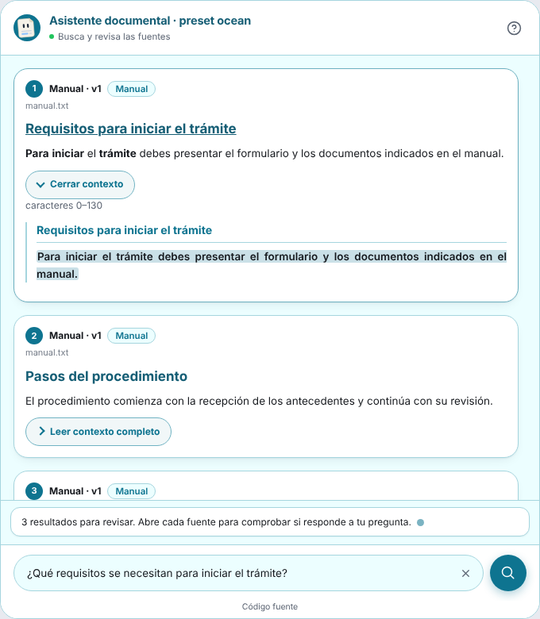
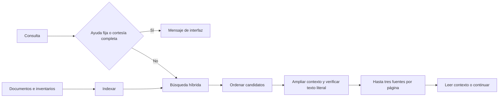
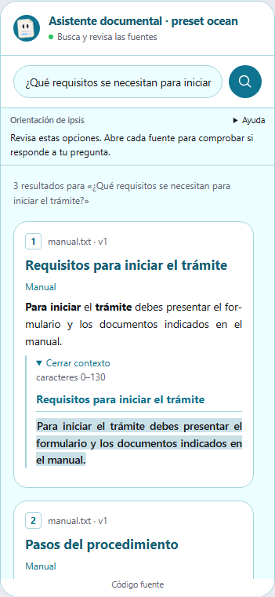
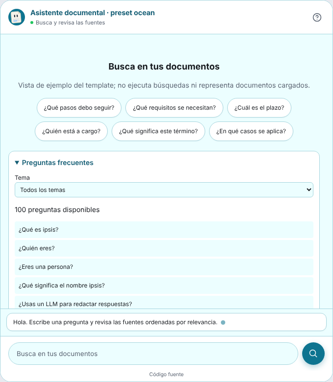

<div align="center">
<picture>
  <source media="(prefers-color-scheme: dark)" srcset="docs/assets/banner-dark.svg">
  
</picture>

[](LICENSE)
[](docs/es/guia/instalacion.md)
[](https://github.com/ClaudioH19/ipsis/releases/tag/v1.1.0)
[](docs/decisions/0001-non-generative-answers.md)
[](docs/decisions/0003-onnx-and-profiles.md)

**[Inicio rápido](#-inicio-rápido)** · **[Cómo funciona](#-cómo-funciona)** ·
**[Widget](#-widget-y-personalización)** · **[Evaluación](#-verificar-la-calidad)** ·
**[Documentación](#-documentación)** · **[English](README.md)**
</div>

**ipsis 1.1** es un asistente autoalojado que **encuentra y ordena fuentes de tus
propios documentos**. Muestra extractos literales, el archivo y su versión, la
ruta de secciones y un contexto que puedes abrir para verificar la información.
Funciona en CPU, sin un LLM generativo; después de descargar los modelos puede
trabajar sin internet en un despliegue local.

El motor predeterminado, `v2`, es un enrutador de fuentes. Ofrece hasta tres
resultados por página y permite seguir buscando. El ranking orienta la lectura;
**una fuente literal puede ser irrelevante, incompleta o contener un error del
propio documento**. Ipsis no certifica una respuesta ni calcula un porcentaje
de certeza a partir del ranking.

<div align="center">
<picture>
  <source media="(prefers-color-scheme: dark)" srcset="docs/assets/widget-sources-dark-es.png">
  
</picture>
<p><sub>Widget real con fuentes de ejemplo de la vista previa autónoma, tema ocean.</sub></p>
</div>

## ✨ Qué incluye

- **Búsqueda documental:** recuperación híbrida, variantes léxicas y ranking;
  `medium` añade un reranker semántico. Los scores no son probabilidades.
- **Lectura verificable:** texto y posiciones literales, contexto desplegable,
  párrafos y encabezados del documento, tablas con columnas y desplazamiento horizontal.
- **Documentos e inventarios:** PDF con texto, DOCX, Markdown, LaTeX, TXT, XLSX, XLS,
  CSV y TSV. Conserva registros y campos; no suma stock ni recalcula fórmulas.
- **Ayuda en español, inglés y portugués:** al menos 100 preguntas reconocidas
  por idioma en diez temas, además de 142 variantes de mensajes de interfaz.
  Una pregunta mixta sobre documentos sigue usando la búsqueda.
- **Nueve temas visuales:** classic, minimal, editorial, contrast, search,
  search_compact, ocean, forest y midnight. Colores, fuentes, títulos y secciones editables.
- **Integración web:** un archivo `widget.js`, Shadow DOM, teclado, móvil,
  modo oscuro, carga visible, transiciones y el avatar opcional Folio.
  La ayuda usa un menú compacto y los scrollbars se adaptan al tema.
- **Administración y despliegue:** CLI, panel para documentos y apariencia,
  API HTTP, Docker y HTTPS con Caddy.

El nombre alude a *ipsissima verba*: las palabras mismas del documento.
El paquete se usa por CLI y HTTP; no ofrece un SDK de Python público estable.

## 🚀 Inicio rápido

Instala [uv](https://docs.astral.sh/uv/getting-started/installation/) y Git.
En Windows puedes usar `winget install --id astral-sh.uv -e`.
`uv` instala Python si hace falta y mantiene un entorno aislado para la herramienta.

```bash
uv tool install --python 3.12 "ipsis @ git+https://github.com/ClaudioH19/ipsis.git"
uv tool update-shell
```

Abre una terminal nueva y crea tu proyecto:

```bash
mkdir mi-asistente
cd mi-asistente
ipsis init --profile medium --language es
ipsis models download
ipsis load /ruta/a/documentos
ipsis index
ipsis widget theme apply ocean
ipsis serve --demo --open
```

La página de prueba queda en `http://127.0.0.1:8000/widget/demo.html`.
Escribe una pregunta, revisa las fuentes y abre su contexto. **Mostrar más
resultados** añade otras opciones de la misma consulta. Una consulta nueva
reemplaza la lista; no hereda automáticamente el tema de la pregunta anterior.

Cuando cambien los archivos de `documents/` (nuevos, renombrados o borrados), ejecuta `ipsis sync`:
actualiza el catálogo y reconstruye el índice (ver [mantener el índice al día](docs/es/guia/uso.md#mantener-el-índice-al-día)).

`ipsis` sin argumentos abre la terminal interactiva. Para la interfaz de
consola en español usa `export IPSIS_LANG=es`; en PowerShell,
`$env:IPSIS_LANG = "es"`. El idioma documental se configura con `--language`.

| Perfil | Modelos usados por v2 | Uso |
|---|---|---|
| `light` | e5-small + búsqueda híbrida con BM25 | Prioriza la latencia |
| `medium` | e5-small + reranker (bge-reranker-v2-m3 en español y portugués, mMiniLM en otros idiomas) + búsqueda híbrida | Añade comparación semántica de candidatos |

V2 no carga el lector QA por defecto. `ipsis models list` muestra los modelos
que usa el motor activo. Consulta [instalación](docs/es/guia/instalacion.md)
para OCR, caché sin red y configuración de Qdrant.

### Actualizar un proyecto existente

Detén el servicio, actualiza el paquete y vuelve a iniciar el servicio desde
la misma carpeta del proyecto:

```bash
uv tool upgrade ipsis
ipsis serve --demo --open
```

Los documentos, la configuración y el índice se conservan. Los cambios de
presentación no requieren reindexar; `config/styles.yaml` existente no se
reemplaza automáticamente. Elige un preset para adoptar su diseño completo,
o ajusta valores individuales para conservar tu personalización.

Hay un cambio que sí requiere una acción. Un proyecto v2 creado con `config_version` 7 o anterior se migra
en su siguiente comando `ipsis` a `config_version` 8 y, si no había elegido preparación, a la preparación
estructural ([ADR 0009](docs/decisions/0009-structural-preparation-by-default.md)). Ejecuta `ipsis index`
para construir el índice nuevo: hasta entonces el servicio informa que no está listo. El índice anterior se
conserva y `retrieval.preparation.mode: legacy` vuelve a los fragmentos de tamaño fijo.

La instalación anterior sigue la rama predeterminada. Para fijar esta release,
instala con `ipsis @ git+https://github.com/ClaudioH19/ipsis.git@v1.1.0`;
una instalación fijada a un tag necesita cambiar ese tag para otra release.
Si tu sitio guarda una copia exportada del widget, vuelve a exportar `widget.js`.

## 🧭 Cómo funciona



Las respuestas fijas se reconocen como preguntas completas. Saludos, ayuda y
mensajes de interfaz se presentan separados de la evidencia documental.
Preguntas como «hola, ¿cuánto stock tiene CI-001?» siguen consultando el corpus.

Cada resultado conserva archivo, documento, versión, sección y offsets.
Los encabezados y las tablas solo se representan cuando su estructura está
verificada. Las celdas vacías no se convierten en cero. Las tablas grandes
se leen en el contexto; el texto original sigue disponible.

## 🎬 Demostración

Grabaciones del widget en un viewport de tamaño teléfono (390×844) sobre
reglamentos universitarios públicos. Toca una imagen para ver su video.

<div align="center">
<a href="docs/assets/demo/demo-mobile.mp4"></a>
<a href="docs/assets/demo/themes.mp4"></a>
<p><sub>Izquierda: una pregunta formal y dos informales. Derecha: los nueve temas, claro y oscuro.</sub></p>
</div>

Se grabaron con un navegador de escritorio que emula un viewport móvil, no en un
teléfono físico, como una secuencia de capturas: los tiempos no son representativos.

## 🌐 Widget y personalización

Pega esta etiqueta en tu sitio y autoriza su origen en CORS:

```html
<script src="https://asistente.tu-dominio.cl/widget.js"
        data-api="https://asistente.tu-dominio.cl" defer></script>
```

```bash
ipsis configure cors_origins=https://www.tu-sitio.cl
ipsis widget snippet --api https://asistente.tu-dominio.cl
```

También puedes incrustarlo en un contenedor con `<ipsis-chat mode="embedded"
api="..."></ipsis-chat>`. Hay ejemplos para
[HTML, Astro, Svelte, React, Angular, Python y WordPress](examples/README.md).

Puedes elegir tarjetas, separadores o márgenes editoriales, cambiar colores
claros y oscuros, tipografías de texto y títulos, radios, espacios y la bienvenida.
El panel ofrece estas opciones en **Widget → Estilo completo**.

```bash
ipsis widget theme list
ipsis widget theme apply forest
ipsis widget style set presentation.result_layout=cards colors.heading="#14532d"
ipsis widget style set typography.heading_family="Georgia, serif" typography.heading_size=20px
ipsis widget style set content.title="Centro de ayuda"
ipsis widget theme preview --output preview.html
```

La vista previa usa el widget real con datos locales de ejemplo; no necesita
un servicio ni un índice. Aplicar un preset reemplaza los ajustes visuales y
conserva los textos personalizados y el CSS extra.

<table>
<tr>
<td width="50%"></td>
<td width="50%"></td>
</tr>
<tr><td align="center">Lectura en móvil</td><td align="center">Preguntas frecuentes por tema</td></tr>
</table>

Las seis preguntas sugeridas rellenan el campo sin enviarlo. **Preguntas
frecuentes** permite explorar el catálogo por tema: uso, fuentes, inventarios,
alcance, privacidad, apariencia, documentos, servicio y mantenimiento.
El menú **Ayuda**, que se abre con el icono «?» del encabezado, reúne los mensajes de orientación. Puedes expandirlos cuando
necesites leerlos completos; una búsqueda nueva los vuelve a compactar.

| Ruta | Uso |
|---|---|
| `/widget/demo.html` | Página de prueba; se habilita con `--demo` |
| `/admin/panel` | Documentos, personalidad, temas y configuración; requiere token |
| `/config` | Idioma, presentación y catálogo de preguntas del widget |
| `POST /ask` | Consulta con `question` y `session_id`; fuentes o mensaje conversacional |
| `/health`, `/ready` | Vida y preparación del servicio |

`ipsis serve --mode development --open` habilita el flujo de prueba y muestra
un token temporal del panel si no configuraste uno. `--demo` y `--open` no
relajan el modo de producción ni sus controles de acceso.

## 📏 Verificar la calidad

**No necesitas un golden dataset para usar ipsis.**
Prueba consultas representativas sobre tus documentos: comprueba que recuperen
la fuente correcta, su orden, el contexto y la procedencia. Una actualización
del corpus requiere volver a indexarlo. `ipsis audit` verifica literalidad y
referencias; no prueba relevancia ni que el documento sea verdadero.

Los bancos de prueba siguen siendo útiles para detectar regresiones de
recuperación: ver el [golden set](docs/es/guia/golden.md). El motor v1 y su
calibración se retiraron; un proyecto que todavía dice `pipeline: v1` se carga
como v2.

## 📚 Documentación

| Guía | Contenido |
|---|---|
| [Instalación](docs/es/guia/instalacion.md) | Perfiles, modelos, caché, OCR y Qdrant |
| [Uso](docs/es/guia/uso.md) | CLI, terminal y referencia de comandos |
| [Fuentes v2](docs/methodology/fuentes-v2.md) | Ranking, contexto, paginación y límites |
| [Configuración](docs/es/guia/configuracion.md) | Archivos del proyecto y precedencia |
| [Widget](docs/es/guia/web.md) | Temas, API, accesibilidad y preguntas frecuentes |
| [Integraciones](docs/es/guia/integraciones.md) | Frameworks web, CORS y ejemplos |
| [Inventarios](docs/es/guia/inventarios.md) | Tablas y límites de formatos |
| [Audio y video](docs/es/guia/multimedia.md) | Fichas, umbral y tarjeta del widget |
| [Personalidad](docs/es/guia/personalidad.md) | Tonos, Folio y panel |
| [Despliegue](docs/es/guia/despliegue.md) | Docker, HTTPS y operación |
| [Golden set](docs/es/guia/golden.md) | Bancos de preguntas para evaluar la recuperación |

## 🛠️ Desarrollo

```bash
git clone https://github.com/ClaudioH19/ipsis.git
cd ipsis
uv sync --locked --extra test --extra browser
uv run --locked --extra test --extra browser playwright install chromium
uv run --locked --extra test --extra browser pytest -m "not slow and not modelos"
```

Las capturas se regeneran con `uv run --extra browser python
herramientas/capturas_widget.py`. La CI verifica contratos, el widget en
Chromium y un despliegue real del wheel en Docker. Ver
[CONTRIBUTING.md](CONTRIBUTING.md) y [CHANGELOG.md](CHANGELOG.md).

## ⚖️ Licencia

[AGPL-3.0-only](LICENSE). Los datasets léxicos y recursos incluidos mantienen
sus licencias y atribuciones. Si modificas y sirves ipsis por red, conserva el
acceso al código fuente de tu versión. El widget y el panel incluyen ese enlace.
