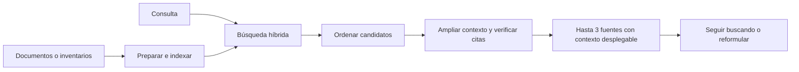
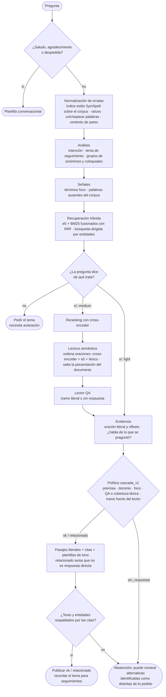

<div align="center">

<picture>
  <source media="(prefers-color-scheme: dark)" srcset="docs/assets/banner-dark.svg">
  
</picture>

[](LICENSE)
[](docs/es/guia/instalacion.md)
[](CHANGELOG.md)
[](docs/decisions/0001-non-generative-answers.md)
[](docs/decisions/0003-onnx-and-profiles.md)

**[Inicio rápido](#-inicio-rápido)** ·
**[Manual](#-manual)** ·
**[Cómo funciona](#-cómo-funciona)** ·
**[Interfaces web](#-interfaces-web)** ·
**[Calibración](#-medir-y-calibrar)** ·
**[Documentación](#-documentación)** ·
**[English](README.md)**

</div>

---

**V2 es el motor predeterminado:** la búsqueda entrega hasta tres fuentes
literales ordenadas por página, con extractos, contexto desplegable y más
resultados bajo demanda. Proyectos nuevos y configuraciones sin selector usan
v2. Una selección explícita `pipeline: v1` en `config/engine.yaml` conserva el
motor de respuestas anterior descrito abajo. Ver [fuentes ordenadas](docs/methodology/fuentes-v2.md).

**ipsis** es un asistente de búsqueda para tu sitio web que recupera y ordena
**pasajes literales de tus documentos**, con documento, sección y posición
exacta. El usuario revisa las fuentes y su contexto para comprobar la información.
No genera texto con un LLM. Una cita literal puede no responder la pregunta:
la trazabilidad permite verificarla, pero no garantiza su relevancia. Corre en
CPU, en tu propio servidor y, una vez descargados los modelos, sin acceso a la red.

El nombre viene del latín *ipsissima verba*, «las palabras mismas»: el
asistente responde con las propias palabras del documento.

<div align="center">
<picture>
  <source media="(prefers-color-scheme: dark)" srcset="docs/assets/widget-answer-dark.png">
  
</picture>
<p><sub>Vista del motor v1 opcional. El flujo predeterminado v2 muestra fuentes ordenadas para revisar.</sub></p>
</div>

## ✨ Características

<table>
<tr>
<td width="50%" valign="top">

**🔎 Extractivo y verificable**<br>
Los pasajes de la respuesta son tramos literales del documento, con plantillas
fijas y citas. `ipsis audit` comprueba texto y offsets literales; no prueba
que el pasaje responda bien la pregunta.

**🔎 Fuentes ordenadas para revisar**<br>
Hasta tres resultados por página, contexto desplegable y continuación de
búsqueda. El motor v1 opcional conserva los estados de respuesta y la calibración.

**⚡ Perfiles según el uso**<br>
`light` prioriza la latencia; `medium` es el recomendado. Todo en CPU con ONNX.

</td>
<td width="50%" valign="top">

**🗣️ Búsqueda multilingüe**<br>
Búsqueda híbrida y variantes léxicas para recuperar fuentes. Paquetes `es`,
`en` y `pt`; modelos multilingües en CPU. La calidad se comprueba con consultas
sobre los documentos de cada proyecto.

**💬 Widget embebible**<br>
Una línea de HTML, adaptable, aislado en Shadow DOM, con 7 tonos de respuesta
y **Folio**, un avatar que reacciona a cada evento.

**🏠 Realmente autoalojado**<br>
Una terminal con menú y modo interactivo, un panel `/admin` para personalidad,
umbrales y documentos, y `ipsis deploy prepare` con Docker y HTTPS (Caddy).

</td>
</tr>
</table>

### ¿Por qué extractivo?

| | RAG generativo | **ipsis** |
|---|---|---|
| Qué devuelve | Texto nuevo escrito por un LLM | **El texto del documento, literal** |
| Riesgo de error | Puede generar hechos sin sustento | **Copia hechos de la fuente; puede elegir un pasaje equivocado o incompleto** |
| Cómo lo verificas | Lees tú las fuentes | **La cita destaca el tramo exacto** |
| Hardware | GPU o una API externa | **CPU, en tu servidor** |
| Tus datos | Suelen enviarse a un proveedor | **Nunca salen de tu máquina** |
| Ideal para | Resúmenes y conversación abierta | **Manuales, reglamentos, políticas, soporte** |

### Qué es ipsis (y qué no)

- **Un paquete de Python con línea de comandos (`ipsis`) y un servicio HTTP**
  (`ipsis serve`, FastAPI). Se instala con `uv`, se usa en una carpeta de
  proyecto y tu sitio le habla con el widget o con `POST /ask`.
- **Docker es solo para desplegar.** `ipsis deploy prepare` genera un
  `Dockerfile`, un `compose.yaml` y, si quieres, Caddy para HTTPS. Para
  desarrollar o probarlo no necesitas Docker.
- **No es una librería de Python.** No hay una API de Python pública para
  llamarlo desde tu programa: se integra por HTTP (`POST /ask`) o con el widget.

## 🚀 Inicio rápido

Instala **uv** una sola vez. No necesitas crear ni activar entornos virtuales.
Python 3.12 se instala automáticamente si hace falta. No necesita GPU.

**Windows (PowerShell):**

```powershell
winget install --id astral-sh.uv -e
```

**Linux / macOS:**

```bash
curl -LsSf https://astral.sh/uv/install.sh | sh
```

Abre una terminal nueva. Con Git instalado (`git --version`), instala ipsis:

```bash
uv tool install --python 3.12 "ipsis @ git+https://github.com/ClaudioH19/ipsis.git"
uv tool update-shell
```

Abre otra terminal y comprueba `ipsis --version`. Ya puedes usar `ipsis` desde
cualquier carpeta. Para actualizar: `uv tool upgrade ipsis`. Si te falta Git o
el comando no aparece, consulta la [guía de instalación](docs/es/guia/instalacion.md).

Después, en cualquier carpeta:

```bash
mkdir mi-asistente && cd mi-asistente
export IPSIS_LANG=es                        # la terminal en español
ipsis init --profile medium --language es   # configuración del proyecto
ipsis models download                       # descarga los modelos que usa el motor activo
ipsis load /ruta/a/documentos               # PDF, DOCX, Markdown, TXT, XLSX, XLS, CSV, TSV
ipsis index                                 # parsear, fragmentar, vectorizar y guardar
ipsis doctor                                # ¿puede correr? si no, qué comando lo arregla
ipsis widget theme apply search             # presentación de resultados tipo buscador
ipsis serve --demo --open                   # API y página de prueba; abre el navegador
```

`ipsis` sin argumentos abre la terminal interactiva (abajo). `uv` gestiona
su aislamiento internamente; tú no activas nada. En modo local
el índice admite un proceso a la vez: detén `ipsis serve` antes de
`ipsis chat` o `ipsis ask --diagnostics`. En PowerShell, la variable se fija
con `$env:IPSIS_LANG = "es"`.

### Flujo de documentos a resultados en v2

1. **Cargar:** `ipsis load` acepta documentos o inventarios XLSX/XLS/CSV/TSV.
   Cada registro de inventario conserva sus columnas, valores y coordenadas.
2. **Indexar:** ejecuta `ipsis index` después de cargar o cambiar documentos.
   El índice queda en el proyecto y los modelos se reutilizan desde su caché.
3. **Presentar:** `ipsis widget theme apply search` configura una vista de
   buscador; `search_compact` ofrece la misma lectura con menos espacio.
4. **Probar:** `ipsis serve --open` inicia el servicio y abre la página de prueba
   con el widget real y los estilos del proyecto. También activa `--demo`.
5. **Verificar:** escribe una consulta, revisa hasta tres fuentes ordenadas y
   despliega su contexto. Las tablas conservan sus celdas; sus coordenadas se
   muestran al pasar el cursor. Pulsa **Seguir buscando** para otros resultados
   de esa consulta o escribe otra pregunta. El ranking orienta la lectura;
   no certifica que una fuente responda la pregunta.

| Necesitas | Comando | Resultado |
|---|---|---|
| Servir solo la API y el widget | `ipsis serve` | Mantiene el modo configurado; la demo depende de ese modo o de `IPSIS_DEMO` |
| Disponer del HTML de prueba | `ipsis serve --demo` | Habilita `http://127.0.0.1:8000/widget/demo.html` |
| Abrirlo automáticamente | `ipsis serve --open` | Activa la demo y abre el navegador cuando puede servirla |
| Probar y administrar | `ipsis serve --mode development --open` | La demo enlaza a `/admin/panel`; imprime un token temporal si no has configurado `IPSIS_ADMIN_TOKEN` |
| Usar otro puerto | `ipsis serve --demo --port 8123` | La demo queda en `http://127.0.0.1:8123/widget/demo.html` |
| Preparar una carpeta documental | `ipsis serve ./documentos --demo --open` | Crea/reutiliza `./documentos/.ipsis-project`, carga, indexa si hace falta y sirve |
| Consultar desde la terminal | `ipsis chat` | Consultas y `/comandos`; con índice local, detén primero el servicio |

El panel acepta las mismas extensiones para subir archivos; **Reindexar** hace
buscables los cambios. Si el widget exige una clave, la página de prueba permite
introducirla. `--demo` y `--open` conservan el modo y las claves de acceso; para
el panel se usa el token de administración. Ctrl+C detiene el servidor.
Los inventarios recuperan valores guardados; no recalculan fórmulas ni suman stock.
Ver [formatos y límites](docs/es/guia/inventarios.md).

Para descubrir opciones desde la consola:

```bash
ipsis help
ipsis help serve
ipsis serve --help
ipsis help widget theme apply
ipsis widget theme list
```

En el modo interactivo usa `/help serve` o `/help widget theme apply`.
Escribe `/serve ` y pulsa Tab para ver sus opciones con descripción. Enter
resuelve comandos incompletos únicos (`/ser --open` → `/serve --open`); las
rutas, argumentos y opciones se conservan y las coincidencias ambiguas se informan.

<details>
<summary><b>Elegir un perfil</b></summary>

| Perfil | Modelos usados por v2 predeterminado | Uso |
|---|---|---|
| `light` | e5-small, búsqueda híbrida con BM25 | Prioriza la latencia de recuperación |
| `medium` | e5-small + reranker mMiniLM, búsqueda híbrida con BM25 | Añade comparación semántica de los candidatos en CPU |

Se cambia con `ipsis profile set <perfil>` (te dice si hay que reindexar o
recalibrar). V2 no carga el lector QA en su configuración predeterminada:
presenta fuentes para revisar. `ipsis models list` muestra los modelos efectivos;
las mediciones del motor v1 se describen en su apartado más abajo.
El antiguo perfil `heavy` se eliminó: ningún modelo mayor
sumó una respuesta correcta sobre medium
([ADR 0003](docs/decisions/0003-onnx-and-profiles.md)). Se pueden elegir
modelos alternativos en la
[configuración del proyecto](docs/es/guia/configuracion.md).

</details>

<details>
<summary><b>Windows, instalación de desarrollo y Docker</b></summary>

Todo el detalle está en la [guía de instalación](docs/es/guia/instalacion.md).
Si desarrollas desde un clon, detén el servicio y ejecuta desde la raíz del
repositorio:

```bash
uv tool install --force --editable .
```

La CLI queda vinculada al código del clon. Usa los comandos desde la carpeta
de tu proyecto, que contiene `config/` y `documents/`. Reinicia `ipsis serve`
para cargar cambios de código; al añadir dependencias, repite la instalación.

Para un servidor con HTTPS:

```bash
ipsis deploy prepare --domain asistente.tu-dominio.cl
# copia dist/ al servidor y ejecuta:
docker compose --profile https up -d --build
```

Ver la [guía de despliegue](docs/es/guia/despliegue.md).

</details>

## 📖 Manual

### La terminal

`ipsis` solo abre la terminal interactiva, como `claude` o `codex`: Folio, el
avatar de ipsis, muestra el proyecto de esta carpeta, y al escribir `/` se
despliega un menú con todos los comandos y su descripción. Tras un comando,
`Tab` muestra sus subcomandos y opciones con su ayuda (`/calibrate --` →
`--alpha`, `--apply`), y tras `/load` completa rutas. La flecha arriba
recupera líneas anteriores; la barra inferior indica si el diagnóstico está
activo.

Enter también resuelve un comando incompleto único o un error de escritura
cercano: `/ser --demo --open` pasa a `/serve --demo --open`, y
`/widg the app search` a `/widget theme apply search`. Se muestra el comando
interpretado; si hay varias coincidencias, pide concretar. Los argumentos,
rutas y nombres de opciones se conservan.

Los comandos muestran la etapa real que están ejecutando y cuánto tiempo llevan.
Por ejemplo, `/index` pasa por lectura, fragmentado, validación, vectores y guardado;
las preguntas muestran búsqueda, lectura y verificación de citas. Las etapas
dependen del perfil y de lo que necesite cada pregunta. La respuesta aparece en
un bloque de Folio, con las fuentes debajo. `Ctrl+C` cancela la operación y
permite seguir en el chat. Los avisos van a stderr; los resultados, a stdout.
`/help` e `ipsis --help` recuerdan también cómo instalar con uv.

```text
  ╭──────────────╮       ipsis 0.9.0 · Folio
  │              │╲      Tus documentos, una conversación local.
  │              │ ╲
  │              ╰───┤   perfil medium · es · 3 documento(s)
  │                  │   /home/usuario/mi-asistente
  │    ▄▄    ▄▄      │
  │    ██    ██      │   / comandos con Tab · /help · /exit
  │    ▀▀    ▀▀      │   Ctrl+C cancela · Ctrl+D sale
  │                  │
  │  ━━━━━━━━━━━━    │   uv gestiona el entorno; no lo activas.
  │  ━━━━━━  ━━━━    │
  │                  │
  ╰──────────────────╯
› /cal
   /calibrate   Elige umbrales con tu banco de preguntas.
```

`ipsis help` imprime todos los comandos agrupados por tarea (también es lo
que imprime `ipsis` cuando su salida no es una terminal, en scripts);
`ipsis help <comando>` (o `ipsis <comando> --help`) explica un comando.
También admite rutas anidadas: `ipsis help widget theme apply`.

```text
$ ipsis
 ipsis 0.9.0 · Busca información en tus documentos: fuentes literales ordenadas, solo CPU.

 Empezar
   init             Crea la configuración de un dominio nuevo.
   profile          Muestra o cambia el perfil de instalación (light o medium).
   models           Modelos ONNX del perfil: listar, descargar, verificar o exportar.
   doctor           Diagnóstico de solo lectura: configuración, perfil, idioma, modelos, índice, ...
   help             Muestra los comandos agrupados por tarea, o la ayuda de un comando.
 Documentos
   load             Copia un archivo o carpeta al corpus y lo cataloga.
   index            Parsea, fragmenta, vectoriza y persiste el índice.
 Preguntar
   chat             Modo interactivo: escribe preguntas y /comandos (/help, /doctor, /index...).
 ...
```

En la terminal interactiva (`ipsis`, o `ipsis chat`) lo que escribes es una
pregunta, y lo que empieza con `/` es un comando. Los modelos se cargan una vez y las preguntas
de seguimiento («¿y con 90?») conservan el tema de la conversación.

```text
$ ipsis chat
ipsis chat -- escribe una pregunta, o /help para ver los comandos. /exit para salir.
> cada cuanto se cambia el filtro?
... Buscando una respuesta en tus documentos
  Buscando los pasajes más relevantes
  Verificando que las citas sean literales
Folio  [OK]
El filtro de carbón activado se cambia cada 12 meses ...
> /diagnostics on          # etapas, señales, regla y tramo exacto de cada respuesta
> /load ./manuales-nuevos  # cualquier comando de ipsis funciona como /comando
> /index
> /reload                  # recarga el motor tras cambiar la configuración
> /exit
```

### Todos los comandos

| Tarea | Comando | Qué hace |
|---|---|---|
| **Empezar** | `ipsis init [--profile light\|medium] [--language es] [--assistant-name NOMBRE] [--domain-description TEXTO] [--force]` | Crea `config/` y `documents/` en la carpeta actual |
| | `ipsis profile show` · `ipsis profile set medium` | Muestra el perfil activo, sus modelos, presupuesto y si índice y calibración le sirven; lo cambia |
| | `ipsis models list` · `download [--profile P]` · `verify` · `export` | Modelos ONNX: licencia y caché, descarga, inferencia de prueba; `export` convierte un modelo de Hugging Face (desarrollo) |
| | `ipsis doctor` | Diagnóstico de solo lectura con el comando que arregla cada problema |
| | `ipsis help [comando ...]` | El menú o las opciones de una ruta de comandos, incluidos subcomandos |
| **Documentos** | `ipsis load RUTA` | Copia un archivo o carpeta a `documents/` y lo cataloga |
| | `ipsis index [--corpus CARPETA]` | Parsea, fragmenta, vectoriza y guarda el índice |
| **Preguntar** | `ipsis chat [--diagnostics]` | Modo interactivo (preguntas y `/comandos`) |
| | `ipsis ask "PREGUNTA" [--url URL] [--diagnostics]` | Una pregunta al servicio en marcha, o con `--diagnostics` al motor en este proceso |
| | `ipsis serve [CARPETA] [--host H] [--port P] [--mode production\|development] [--reindex] [--demo] [--open]` | Levanta la API, el widget y `/admin`; con una carpeta, prepara el proyecto antes |
| **Personalizar** | `ipsis configure clave=valor ...` | `assistant_name`, `domain_description`, `language`, `profile`, `cors_origins`, `widget_keys`, `query_log.enabled`, `posture.mode`, `posture.max_alternatives` |
| | `ipsis personality show` · `validate` | Tono y avatar activos; valida `personality.yaml` |
| | `ipsis personality tone list` · `apply TONO` · `try [--tone T] [--situation S]` | Siete tonos de respuesta; imprime las variantes de uno |
| | `ipsis personality avatar list` · `import ARCHIVO [--name N]` · `apply NOMBRE` · `events` · `assign` · `colors` | Avatar del widget y cómo reacciona a cada evento |
| | `ipsis widget theme list` · `apply PRESET` · `preview` | Temas visuales: `classic`, `minimal`, `editorial`, `contrast`, `search`, `search_compact` |
| | `ipsis widget style show [--section S]` · `set seccion.clave=valor ...` | Cada valor de estilo de `config/styles.yaml` |
| | `ipsis widget snippet [--api URL] [--component] [--key K]` · `export CARPETA [--api URL]` | Código para pegar en tu sitio; una carpeta con `widget.js` |
| **Medir y calibrar** | `ipsis golden template [--n N]` · `import ARCHIVO` · `validate` · `export --format squad2\|csv` | Tus preguntas de prueba (golden set) |
| | `ipsis evaluate [--bank MANIFIESTO] [--output ARCHIVO]` | Cobertura, respuestas directas erradas y latencia con tu golden set |
| | `ipsis calibrate [--alpha 0.05] [--apply]` | Elige umbrales bajo una cota de riesgo (ver abajo) |
| | `ipsis compare REPORTE REPORTE ... [--output ARCHIVO]` | Compara reportes de evaluación |
| | `ipsis benchmark --bank MANIFIESTO [--profiles light,medium] [--latency-only] [--repetitions N]` | Compara perfiles, modos de recuperación o latencia |
| | `ipsis audit [--from FECHA] [--to FECHA]` | Revisa el registro de consultas: estados, reglas y si cada cita sigue siendo literal |
| **Desplegar y operar** | `ipsis deploy prepare [--domain D] [--target dist] [--wheel W] [--force]` | Una carpeta con Docker, compose y Caddy opcional, lista para copiar a un servidor |
| | `ipsis snapshot-config [--output ARCHIVO]` | La configuración efectiva con todos los valores por defecto resueltos |

La referencia completa, con cada opción y su valor por defecto, está en la
[guía de uso](docs/es/guia/uso.md).

### Archivos del proyecto

| Archivo | Qué contiene | Se cambia con |
|---|---|---|
| `config/assistant.yaml` | Nombre, idioma, perfil, CORS, claves del widget, registro, postura | `ipsis configure`, `ipsis profile set` |
| `config/engine.yaml` | Recuperación, lectura y umbrales (`profile_overrides`) | Editor, o la pestaña **Estado** de `/admin` |
| `config/calibration.yaml` | Umbrales elegidos por `ipsis calibrate --apply` | `ipsis calibrate` |
| `config/personality.yaml` | Tono y avatar | `ipsis personality`, `/admin` |
| `config/styles.yaml` | Cada valor visual del widget | `ipsis widget`, `/admin` |
| `config/domain.yaml` | Tus sinónimos y categorías (opcional) | Editor |
| `documents/` + `catalog.yaml` | Tus documentos y su catálogo | `ipsis load`, la pestaña **Documentos** de `/admin` |

Precedencia de los umbrales: **perfil → `config/engine.yaml` → calibración
vigente**. Detalle en la [guía de configuración](docs/es/guia/configuracion.md).

## 🧭 Cómo funciona

El recorrido predeterminado v2 recupera y ordena fuentes para que el usuario
revise su contenido. Los inventarios se preparan como registros completos;
el contexto se amplía después de puntuar, conservando la procedencia.



<details>
<summary><b>Motor v1 opcional: capas, reglas y mediciones anteriores</b></summary>

Se activa con `pipeline: v1`. Las reglas y cifras siguientes corresponden a
ese recorrido, no al enrutador v2 predeterminado.



Qué hace cada capa y con qué técnica. Ninguna capa escribe contenido: los
modelos ordenan, leen y deciden; la respuesta siempre es un tramo literal de
tus documentos.

| Capa | Qué hace | Técnica |
|---|---|---|
| Conversacional | Responde saludos, agradecimientos, despedidas y «¿qué sabes hacer?» | Patrones por idioma; plantillas fijas en 7 tonos |
| Normalización de erratas | Convierte «pasword», «covran», «abreel», «estacio namiento» en las palabras de los documentos | Índice de borrados simétrico (SymSpell) sobre las formas y raíces del corpus; distancia de edición 1–2 con transposiciones; comparación por raíz cuando la forma exacta no está en el corpus; separa palabras pegadas y une separadas; contexto de pares de palabras (presencia, nunca frecuencia) para erratas que forman otra palabra real. Nunca toca palabras reales ausentes del corpus («feriados»), nombres propios, siglas ni palabras de los grupos de sinónimos |
| Análisis | Entiende la pregunta antes de buscar | Intención por patrón («cuándo empieza», «quién», «cada cuánto») con respaldo por similitud e5; los seguimientos heredan el tema de la conversación («¿y con 90?»); grupos de sinónimos del paquete, incluidas equivalencias cotidianas («plata» → «dinero», «refri» → «refrigerador»), y los sinónimos de tu proyecto |
| Señales | Mide la pregunta contra el corpus | Términos foco (las palabras de tema más raras, sin palabras de pregunta, de relación ni genéricas); `s_oov` (parte de la pregunta ausente del corpus); abreviaturas informales y pronombres personales son palabras funcionales |
| Recuperación | Encuentra fragmentos candidatos | e5-small denso + BM25 disperso en Qdrant, fusionados con RRF; búsqueda extra por cada entidad literal de la pregunta (fechas, montos, códigos) |
| Aclaración | Pide el tema en vez de adivinar | No queda palabra de contenido («¿Cuánto es?»), un pronombre anafórico sin antecedente («¿Quién lo aprueba?»), o una pregunta corta cuya única palabra está en varios documentos |
| Reranking (medium) | Reordena los candidatos | Cross-encoder multilingüe (mMiniLM) sobre los 5 primeros candidatos fusionados |
| Lectura semántica (medium) | Elige qué lee el lector | Cada oración ordenada por RRF de cross-encoder, coseno e5 y coincidencia léxica; las tres mejores, cada una con su oración anterior; nunca títulos ni la presentación de un documento con secciones |
| Lectura (medium) | Extrae el tramo exacto | QA extractivo (mDeBERTa, SQuAD 2.0) que puede responder «sin respuesta» |
| Evidencia | Elige la oración literal y comprueba que hable de lo preguntado | Texto y offsets verificados contra el corpus; términos foco en la oración, los títulos de su sección o la oración anterior; forma de respuesta exigida («cada cuánto» pide un periodo, «cuánto cuesta» un monto); mismo núcleo con otro modificador («gastos de electricidad» frente a «gastos de conexión», también contra el título de la sección) es otra cosa |
| Política | Decide `ok`, `relacionado` o `sin_respuesta`, y un nivel de confianza | Reglas `cascada_v1` sobre señales explicables; un tramo fuerte del lector deja pasar la redacción informal cuando el lector está casi seguro, y entonces una pregunta coloquial (detectada por cómo está escrita, nunca por sus palabras) exige la mitad de los términos foco; umbrales calibrables con tu golden set |
| Redacción | Escribe la respuesta | Pasajes literales con citas y plantillas de tono; una respuesta `relacionado` pregunta si era eso lo que buscabas; con la postura proactiva, pasajes similares tras un `sin_respuesta` |
| Verificación | Comprueba antes de publicar | `texto == corpus[inicio:fin]` y entidades respaldadas por las citas; el primer pasaje citado alimenta la memoria de la conversación |

Cada decisión registra su regla y sus señales en el diagnóstico
(`ipsis chat --diagnostics`, `ipsis ask --diagnostics`). Detalle en la
[arquitectura](docs/architecture.md) y las
[notas de metodología](docs/methodology/README.md), que registran lo medido,
lo conservado y lo descartado ([preguntas informales](docs/methodology/informal-paraphrases.md),
[erratas](docs/methodology/lexical.md#typos)).

**Medido (medium, bancos retenidos escritos antes de los cambios que miden):**
97,3 % de las respuestas directas correctas (garantizado ≥ 94,0 % con 95 % de
confianza); con erratas, el 97 % de las preguntas que se responden bien siguen
respondiéndose bien; en preguntas coloquiales, 50 % se responden directo y
otro 53 % muestra el pasaje correcto como `relacionado`. Los bancos sintéticos
no certifican tus documentos: para eso está la [calibración](#-medir-y-calibrar).

</details>

## 🌐 Interfaces web

`ipsis serve` publica todo en un solo puerto:

| Dirección | Qué es | Acceso |
|---|---|---|
| `/admin/panel` | **Panel de administración**: tono, avatar, widget, **Estado** (perfil, índice, calibración, umbrales y diagnóstico; edición de umbrales) y **Documentos** (subir archivos y reindexar) | Exige `IPSIS_ADMIN_TOKEN` (≥ 32 caracteres); HTTPS en producción |
| `/widget/demo.html` | **Página de prueba** con el widget incrustado, los estilos del proyecto y búsqueda en documentos reales | `--demo`, `--open`, `--mode development`, o `IPSIS_DEMO=1` |
| `/widget.js` | El widget para tu sitio (`<script src="https://asistente.tu-dominio.cl/widget.js" data-api="https://asistente.tu-dominio.cl" defer>`) | Público |
| `POST /ask` | La API de preguntas (`{"question": "...", "session_id": "..."}`) | Pública; claves de widget y límite de peticiones opcionales |
| `/health`, `/ready` | Vida y disponibilidad (con resumen del diagnóstico) | Públicas |
| `/docs` | Documentación interactiva de la API | `--mode development`, o `IPSIS_DOCS=1` en producción |

```bash
ipsis serve --demo --open              # inicia el servicio y abre la página de prueba
ipsis serve --mode development --open  # también habilita el panel con un token temporal
```

Los inventarios admiten XLSX, XLS, CSV y TSV mediante `ipsis load` y las subidas
del panel. Cada fila de producto conserva sus etiquetas de columna; los
resultados muestran tablas y referencias a hojas/celdas. Es recuperación de
información: no suma existencias ni recalcula fórmulas. Ver
[carga de inventarios](docs/es/guia/inventarios.md).

```bash
export IPSIS_ADMIN_TOKEN="$(python -c 'import secrets; print(secrets.token_urlsafe(32))')"
ipsis serve --mode development         # /admin por HTTP, /docs, widget sin caché
# abre http://127.0.0.1:8000/admin/panel y pega el token
```

<table>
<tr>
<td width="50%"></td>
<td width="50%"></td>
</tr>
<tr>
<td align="center"><sub><b>Estado</b>: umbrales vigentes y su origen (perfil, proyecto o calibración)</sub></td>
<td align="center"><sub><b>Documentos</b>: subir documentos o inventarios XLSX/XLS/CSV/TSV y reindexar</sub></td>
</tr>
<tr>
<td width="50%"></td>
<td width="50%"></td>
</tr>
<tr>
<td align="center"><sub><b>Tono</b>, avatar y widget con vista previa en vivo</sub></td>
<td align="center"><sub>Pantalla completa en un teléfono</sub></td>
</tr>
</table>

Guardar umbrales o reindexar desde el panel recarga el motor; mientras tanto
`/ask` responde 503 («no listo») durante unos segundos, porque el índice local
admite un solo cliente. Cada cambio queda en `.ipsis/logs/admin.jsonl`.

## 🧪 Ejemplos

### Cargar documentos

```bash
ipsis load ./manuales/reglamento.pdf   # un archivo
ipsis load ./manuales                  # una carpeta entera (recursiva)
ipsis index                            # que se puedan responder
ipsis serve ./manuales                 # o: init + load + index + serve de una vez
```

Desde el panel: **Documentos** → elegir archivos → **Subir** → **Reindexar**.
Por HTTP, con el token de admin:

```bash
curl -X POST "https://asistente.tu-dominio.cl/admin/documents?name=politica.pdf" \
     -H "Authorization: Bearer $IPSIS_ADMIN_TOKEN" --data-binary @politica.pdf
curl -X POST https://asistente.tu-dominio.cl/admin/reindex -H "Authorization: Bearer $IPSIS_ADMIN_TOKEN"
```

Los PDF escaneados necesitan el extra de OCR y Tesseract; se añaden a la
misma instalación con uv siguiendo la [guía de OCR](docs/es/guia/instalacion.md#pdf-escaneados-ocr-opcional).

### Personalizar

```bash
ipsis configure assistant_name="Asistente de biblioteca" domain_description="el reglamento de la biblioteca"
ipsis configure cors_origins=https://www.tu-sitio.cl        # sitios que pueden embeber el widget
ipsis personality tone apply formal                          # cordial, formal, serious, upbeat, friendly, empathetic, direct
ipsis personality tone try --situation no_answer            # ver las variantes antes de elegir
ipsis widget theme apply editorial                          # classic, minimal, editorial, contrast
ipsis widget style set colors.accent=#0ea5e9 shape.panel_radius=10px
ipsis configure posture.mode=proactive posture.max_alternatives=3   # ofrecer pasajes similares tras sin_respuesta
ipsis widget snippet --api https://asistente.tu-dominio.cl          # código para pegar en tu sitio
```

Todo este bloque (salvo CORS, postura y el snippet) también se hace en el
panel `/admin`, con vista previa en vivo. Más en las guías de
[personalidad](docs/es/guia/personalidad.md) y [web](docs/es/guia/web.md).

### Cambiar umbrales

Los umbrales deciden cuándo una respuesta es directa (`ok`), relacionada o no
se muestra. Se cambian en `config/engine.yaml`:

```yaml
profile_overrides:
  default_thresholds:
    ok: 0.85            # puntaje del lector para responder directo (más alto = menos ok, más seguros)
    focus: 1.0          # la oración que responde debe tener todos los términos foco
    oov_ok: 0.60        # máxima parte de la pregunta ausente del corpus para un ok
    related: 0.33       # puntaje de dominio bajo el cual no se muestra nada relacionado
    ok_strong: 0.99     # tramo fuerte: un lector casi seguro...
    oov_ok_strong: 0.67 # ...tolera algo más de redacción informal
    focus_informal: 0.5 # ...y, en una pregunta coloquial, la mitad de los términos foco
```

o en la pestaña **Estado** de `/admin` (valor vacío = el del perfil), o por
HTTP:

```bash
curl -X PUT https://asistente.tu-dominio.cl/admin/thresholds \
     -H "Authorization: Bearer $IPSIS_ADMIN_TOKEN" -H "Content-Type: application/json" \
     -d '{"thresholds": {"ok": 0.85, "related": null}}'     # null = vuelve al valor del perfil
```

Cambiar umbrales a mano cambia cobertura por riesgo sin medirlo. Lo
recomendado es que `ipsis calibrate` los elija con tu golden set; una
calibración vigente tiene precedencia sobre `ok`, `oov_ok` y `focus`.

## 📏 Medir y calibrar

**Para qué sirve calibrar con tu corpus.** Los umbrales por defecto son
conservadores y se ajustaron con bancos sintéticos. Tus documentos y las
preguntas de tus usuarios son distintos: el mismo umbral puede callar
respuestas que tus documentos sí sustentan, o aceptar respuestas equivocadas
para tu contenido. La calibración lo mide con **tus** documentos y **tus**
preguntas de prueba, y elige los umbrales que dan más respuestas directas
manteniendo el riesgo de una respuesta directa equivocada bajo el objetivo que
fijes (5 % por defecto).

```bash
ipsis golden template              # propone preguntas a partir de tus documentos (golden/golden.csv)
#   completa la respuesta literal esperada de cada una, o márcala como sin respuesta
ipsis golden import golden/golden.csv
ipsis evaluate                     # cobertura, respuestas directas erradas y latencia hoy
ipsis calibrate                    # elige umbrales en dev, informa test; no cambia nada
ipsis calibrate --apply            # los guarda en config/calibration.yaml
```

Cómo funciona: el golden set se divide en `dev` y `test`. Solo `dev` elige:
para cada combinación de `ok`, `oov_ok` y `focus` cuenta las respuestas
aceptadas y las equivocadas, y se queda con la que da más respuestas directas
cuya cota superior de Clopper-Pearson del error es ≤ α. `test` se informa
aparte y nunca elige. Con α = 5 % y 95 % de confianza, un umbral fijo necesita
al menos 59 respuestas aceptadas sin errores para cumplir la cota: un golden
set chico termina como `muestra_insuficiente` y no cambia nada.

Lo que no es: la calibración **no entrena nada** (ningún modelo aprende de tus
datos), no garantiza un 5 % de error en producción y solo se aplica mientras
perfil, modelos, corpus y reglas léxicas sigan iguales (si no, `ipsis doctor`
la informa como obsoleta). Ver [calibración](docs/methodology/calibration.md)
y la [guía del golden set](docs/es/guia/golden.md).

## 📚 Documentación

| Guía | Contenido |
|---|---|
| [Instalación](docs/es/guia/instalacion.md) | Requisitos, perfiles, modelos, caché y Qdrant |
| [Uso](docs/es/guia/uso.md) | Flujo de trabajo, menú de la terminal, modo interactivo y cada comando |
| [Configuración](docs/es/guia/configuracion.md) | Cada archivo del proyecto, umbrales y precedencia |
| [Golden set](docs/es/guia/golden.md) | Preguntas de prueba, evaluación y calibración |
| [Web](docs/es/guia/web.md) | Widget, ubicación, API de JavaScript, CSP y avatar |
| [Personalidad](docs/es/guia/personalidad.md) | Tonos, Folio y el panel `/admin` |
| [Despliegue](docs/es/guia/despliegue.md) | Servidor con HTTPS, Docker, modos y lista previa al lanzamiento |
| [Arquitectura](docs/architecture.md) | Módulos, flujos y diagramas (en inglés) |

Por dentro: [notas de metodología](docs/methodology/README.md),
[decisiones de arquitectura](docs/decisions/) y el [changelog](CHANGELOG.md)
(en inglés).

## 🛠️ Desarrollo

```bash
git clone https://github.com/ClaudioH19/ipsis.git
cd ipsis
uv sync --locked --extra test
uv run --locked --extra test pytest -m "not slow and not browser"         # pruebas rápidas
python herramientas/evaluacion/general.py --download   # regresión de punta a punta con documentos reales
```

Las pruebas usan documentos sintéticos; el repositorio no distribuye corpus
ni métricas de ninguna institución. Los identificadores internos del código
están en español; todo lo que ve el usuario, en inglés (o español con
`IPSIS_LANG=es`). Lee [CONTRIBUTING.md](CONTRIBUTING.md) antes de abrir un
pull request.

<details>
<summary><b>Limitaciones conocidas</b></summary>

- Los PDF escaneados solo se leen con el extra de OCR (`ipsis[ocr]` y
  Tesseract); sin él, sus páginas sin texto se informan y se omiten.
- Las preguntas coloquiales se responden casi siempre como `relacionado` con
  el pasaje correcto, no directo: en el banco coloquial retenido, medium
  responde directo 36 de 72 (18 antes del foco coloquial) y muestra el pasaje correcto en casi todas las demás. Con sus
  señales, el sistema no distingue una paráfrasis de un dato ausente («los
  feriados», «moto eléctrica» cuando los documentos dicen «vehículos
  eléctricos») y se queda del lado seguro.
  [Mediciones](docs/methodology/informal-paraphrases.md).
- Una errata que forma otra palabra real («paring», «férias» → «feias») solo
  se corrige con contexto de pares a ambos lados; si no, se deja como está a
  propósito.
- `light` no tiene lector: rara vez puede decir `ok` a una pregunta coloquial.
- En una CPU de 2 hilos y un corpus de tamaño realista, medium responde en
  unos 2,5 s (p50) y 4,2 s (p95), sobre su objetivo de 1 s; más núcleos lo bajan.
- Las preguntas de seguimiento heredan el tema de la conversación, que vive en
  la memoria del servicio hasta 30 minutos sin preguntas; recargar la página
  empieza una conversación nueva.
- Un idioma por proyecto; no detecta el idioma de cada pregunta.
- El lector de medium todavía elige tramos literales incompletos o
  incorrectos en algunas preguntas independientes
  ([mediciones](docs/methodology/mediciones/v4-correcciones/README.md)).
- En modo local, Qdrant bloquea su carpeta mientras otro proceso la usa:
  detén `ipsis serve` antes de `ipsis chat`, y reindexar desde el panel pausa
  `/ask` unos segundos.
- La verificación de premisas busca entidades en todos los candidatos; no
  valida que cada dato pertenezca al sujeto, la acción o la condición
  preguntados.

</details>

## ⚖️ Licencia

Los recursos léxicos incluidos conservan sus propias licencias y
atribuciones; ver [fuentes de sinónimos](ipsis/recursos/sinonimos/FUENTES.md).

[GNU AGPL-3.0](LICENSE) (`AGPL-3.0-only`), la misma licencia del motor del
avatar ([@bible-strong/avatar-web](https://github.com/smontlouis/bible-strong-avatar-lab)).

- **Puedes** usarlo para cualquier fin, incluso comercial; estudiarlo,
  modificarlo y redistribuirlo.
- **Si lo instalas sin cambios** en tu servidor, no tienes obligaciones
  nuevas: el servicio ya enlaza a este repositorio.
- **Si lo modificas y lo ofreces por la red,** ofrece el código fuente de tu
  versión (§13): el widget y el panel muestran «Código fuente»
  (`GET /source`); apunta `IPSIS_SOURCE_URL` a tu repositorio.
- **Si lo redistribuyes** (por ejemplo, una imagen Docker), incluye la
  licencia y el código fuente.

Las licencias de los paquetes incluidos en el motor del avatar están en
`ipsis/servicio/estaticos/avatar.js.LICENSE.txt`.

<div align="center"><sub>Hecho para que un asistente pueda decir «no está en los documentos».</sub></div>
