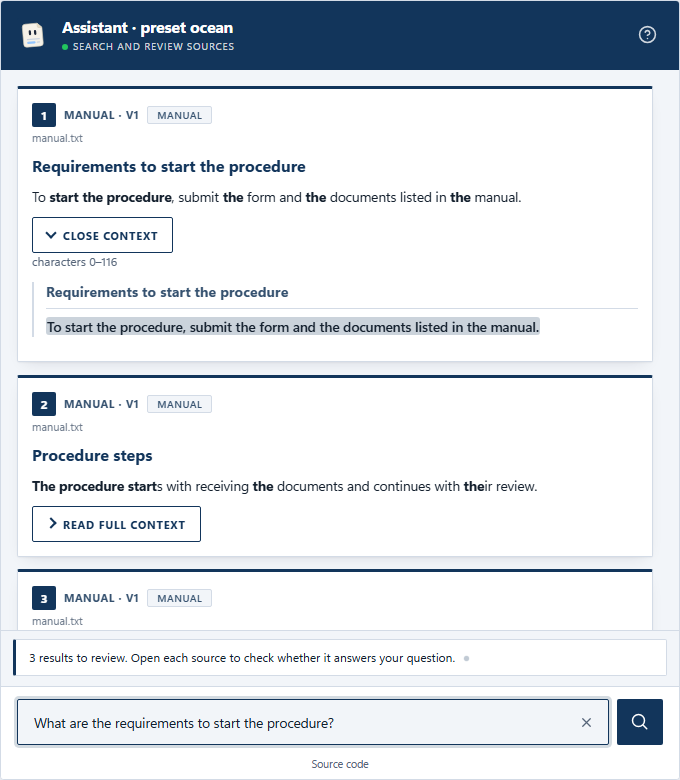
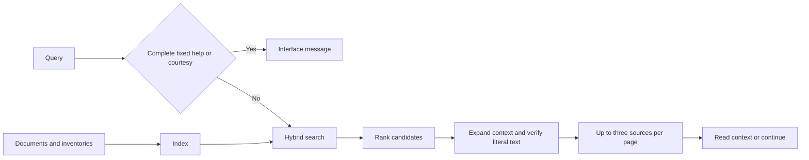
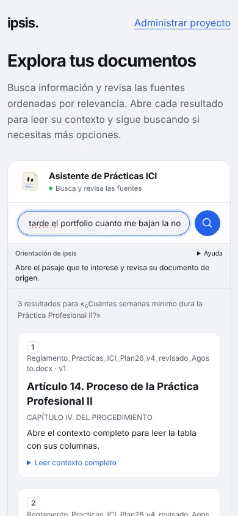
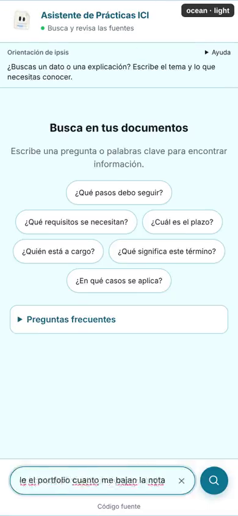
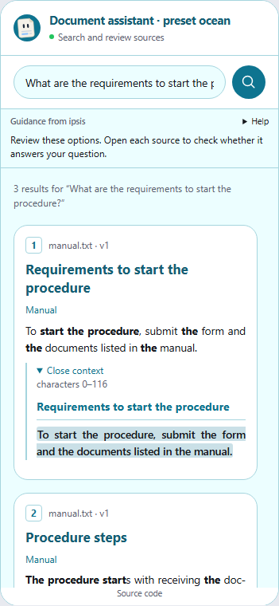
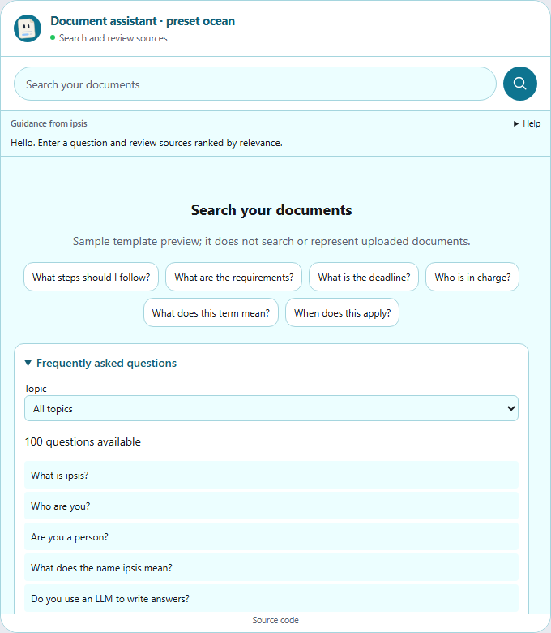

<div align="center">
<picture>
  <source media="(prefers-color-scheme: dark)" srcset="docs/assets/banner-dark.svg">
  
</picture>

[](LICENSE)
[](docs/guide/installation.md)
[](https://github.com/ClaudioH19/ipsis/releases/tag/v1.1.0)
[](docs/decisions/0001-non-generative-answers.md)
[](docs/decisions/0003-onnx-and-profiles.md)

**[Quick start](#-quick-start)** · **[How it works](#-how-it-works)** ·
**[Widget](#-widget-and-customization)** · **[Evaluation](#-checking-quality)** ·
**[Documentation](#-documentation)** · **[Español](README.es.md)**
</div>

**ipsis 1.1** is a self-hosted assistant that **finds and ranks sources from
your own documents**. It shows literal excerpts, filenames and versions,
section paths and expandable context for checking the information. It runs
on CPU without a generative LLM; after downloading models, a local deployment
can work without internet access.

The default engine, `v2`, is a source router. It offers up to three results per
page and lets users continue searching. Ranking guides reading;
**a literal source may be irrelevant, incomplete or contain an error in the
original document**. Ipsis does not certify an answer or turn ranking scores
into confidence percentages.

<div align="center">
<picture>
  <source media="(prefers-color-scheme: dark)" srcset="docs/assets/widget-sources-dark-en.png">
  
</picture>
<p><sub>Real widget with sample sources from the standalone preview, ocean theme.</sub></p>
</div>

## ✨ Features

- **Document search:** hybrid retrieval, lexical variants and ranking;
  `medium` adds a semantic reranker. Scores are not probabilities.
- **Verifiable reading:** literal text and offsets, expandable context,
  document paragraphs and headings, tables with columns and horizontal scrolling.
- **Documents and inventories:** text PDFs, DOCX, Markdown, LaTeX, TXT, XLSX, XLS,
  CSV and TSV. Records retain their fields; it does not sum stock or recalculate formulas.
- **Spanish, English and Portuguese help:** at least 100 recognized questions
  per language across ten topics, alongside 142 interface message variants.
  Mixed document queries still go through search.
- **Nine visual themes:** classic, minimal, editorial, contrast, search,
  search_compact, ocean, forest and midnight. Editable colors, fonts, headings and sections.
- **Web integration:** a single `widget.js`, Shadow DOM, keyboard access,
  mobile layout, dark mode, visible loading, transitions and the optional Folio avatar.
  Help uses a compact menu and scrollbars adapt to the theme.
- **Administration and deployment:** CLI, document and appearance panel,
  HTTP API, Docker and HTTPS with Caddy.

The name refers to *ipsissima verba*: the very words of the document.
The package is used through CLI and HTTP; it does not provide a stable public Python SDK.

## 🚀 Quick start

Install [uv](https://docs.astral.sh/uv/getting-started/installation/) and Git.
On Windows, use `winget install --id astral-sh.uv -e`.
`uv` installs Python when needed and keeps the tool in an isolated environment.

```bash
uv tool install --python 3.12 "ipsis @ git+https://github.com/ClaudioH19/ipsis.git"
uv tool update-shell
```

Open a new terminal and create your project:

```bash
mkdir my-assistant
cd my-assistant
ipsis init --profile medium --language en
ipsis models download
ipsis load /path/to/documents
ipsis index
ipsis widget theme apply ocean
ipsis serve --demo --open
```

The test page is at `http://127.0.0.1:8000/widget/demo.html`.
Enter a question, review the sources and open their context. **Show more
results** adds other options from the same query. A new query replaces the
list; it does not automatically inherit the previous question's topic.

When files in `documents/` are added, renamed or deleted, run `ipsis sync`: it updates the
catalog and rebuilds the index (see [keeping the index up to date](docs/guide/usage.md#keeping-the-index-up-to-date)).

Running `ipsis` without arguments opens the interactive terminal. Console
language uses `IPSIS_LANG`; document language is configured with `--language`.

| Profile | Models used by v2 | Purpose |
|---|---|---|
| `light` | e5-small + hybrid BM25 search | Prioritizes latency |
| `medium` | e5-small + reranker (bge-reranker-v2-m3 for Spanish and Portuguese, mMiniLM otherwise) + hybrid search | Adds semantic candidate comparison |

V2 does not load the QA reader by default. `ipsis models list` shows the
models used by the active engine. See [installation](docs/guide/installation.md)
for OCR, offline model caches and Qdrant configuration.

### Updating an existing project

Stop the service, update the package and start the service again from the
same project directory:

```bash
uv tool upgrade ipsis
ipsis serve --demo --open
```

Documents, configuration and indexes are preserved. Presentation changes do
not require reindexing; an existing `config/styles.yaml` is not automatically
replaced. Select a preset to adopt its complete design, or edit individual
values to keep your customization.

One change does need action. A v2 project created with `config_version` 7 or older is migrated on its
next `ipsis` command to `config_version` 8 and, if it had not chosen a preparation, to the structural
preparation ([ADR 0009](docs/decisions/0009-structural-preparation-by-default.md)). Run `ipsis index`
to build the new index: until then the service reports it is not ready. The old index is kept, and
`retrieval.preparation.mode: legacy` goes back to fixed-size chunks.

The installation above follows the default branch. To pin this release,
install `ipsis @ git+https://github.com/ClaudioH19/ipsis.git@v1.1.0`;
tag-pinned installations need a changed tag to move to another release.
If your website keeps an exported widget, export and replace `widget.js` again.

## 🧭 How it works



Fixed responses match complete questions. Greetings, help and interface
messages appear separately from document evidence. Queries such as
“hello, how much stock does CI-001 have?” still search the corpus.

Each result retains its filename, document, version, section and offsets.
Headings and tables are rendered only when their structure is verified.
Empty cells do not become zero. Large tables are read in expanded context;
their original text remains available.

## 🎬 Demo

Recordings of the widget running on a phone-sized viewport (390×844) over
public university regulations. Select an image to play its video.

<div align="center">
<a href="docs/assets/demo/demo-mobile.mp4"></a>
<a href="docs/assets/demo/themes.mp4"></a>
<p><sub>Left: one formal and two informal questions. Right: the nine themes, light and dark.</sub></p>
</div>

Both were recorded with a desktop browser emulating a mobile viewport, not on a
physical phone, as a sequence of captures: timings are not representative.

## 🌐 Widget and customization

Paste this tag into your website and authorize its origin in CORS:

```html
<script src="https://assistant.your-domain.com/widget.js"
        data-api="https://assistant.your-domain.com" defer></script>
```

```bash
ipsis configure cors_origins=https://www.your-site.com
ipsis widget snippet --api https://assistant.your-domain.com
```

You can also embed it in a container with `<ipsis-chat mode="embedded"
api="..."></ipsis-chat>`. There are examples for
[HTML, Astro, Svelte, React, Angular, Python and WordPress](examples/README.md).

Choose cards, dividers or editorial margins; adjust light and dark colors,
body and heading fonts, corners, spacing and welcome text. The panel exposes
these settings under **Widget → Full style**.

```bash
ipsis widget theme list
ipsis widget theme apply forest
ipsis widget style set presentation.result_layout=cards colors.heading="#14532d"
ipsis widget style set typography.heading_family="Georgia, serif" typography.heading_size=20px
ipsis widget style set content.title="Help center"
ipsis widget theme preview --output preview.html
```

The preview uses the real widget with local sample data; it needs no service
or index. Applying a preset replaces visual settings while preserving custom
content text and extra CSS.

<table>
<tr>
<td width="50%"></td>
<td width="50%"></td>
</tr>
<tr><td align="center">Reading on mobile</td><td align="center">Questions by topic</td></tr>
</table>

Six suggested questions fill the input without submitting it. **Frequently
asked questions** lets users explore topics covering search, sources,
inventories, scope, privacy, appearance, documents, service and maintenance.
The **Help** menu, opened with the "?" icon in the header, groups guidance messages. Expand them when you need the full
text; a new query returns them to their compact view.

| Route | Purpose |
|---|---|
| `/widget/demo.html` | Test page; enabled with `--demo` |
| `/admin/panel` | Documents, personality, themes and configuration; requires a token |
| `/config` | Language, presentation and the widget's question catalog |
| `POST /ask` | Query with `question` and `session_id`; sources or a conversational message |
| `/health`, `/ready` | Liveness and service readiness |

`ipsis serve --mode development --open` enables the test flow and prints a
temporary panel token if one is not configured. `--demo` and `--open` preserve
production mode and its access controls.

## 📏 Checking quality

**V2 needs no golden dataset or direct-answer calibration to run.**
Test representative queries against your documents: check the right source,
its ranking position, context and provenance. Corpus updates require
reindexing. `ipsis audit` verifies literal text and references; it does not
prove relevance or document truthfulness.

Test banks remain useful for catching retrieval regressions. Historical
direct-answer figures and calibration commands belong to the optional
`pipeline: v1` engine; they do not certify v2.

<details>
<summary>Compatibility: v1 engine and golden datasets</summary>

An explicit `pipeline: v1` selection in `config/engine.yaml` keeps the previous
engine. Its `golden`, `evaluate` and `calibrate` tools remain available for
evaluating and calibrating direct answers. V1 calibration does not control
router ranking. See [golden](docs/guide/golden.md) and the
[v1 methodology](docs/methodology/calibration.md).

</details>

## 📚 Documentation

| Guide | Contents |
|---|---|
| [Installation](docs/guide/installation.md) | Profiles, models, cache, OCR and Qdrant |
| [Usage](docs/guide/usage.md) | CLI, terminal and command reference |
| [V2 sources](docs/methodology/fuentes-v2.md) | Ranking, context, pagination and limits; Spanish |
| [Configuration](docs/guide/configuration.md) | Project files and precedence |
| [Widget](docs/guide/web.md) | Themes, API, accessibility and FAQ |
| [Integrations](docs/guide/integrations.md) | Web frameworks, CORS and examples |
| [Inventories](docs/guide/inventories.md) | Tables and format limits |
| [Personality](docs/guide/personality.md) | Tones, Folio and panel |
| [Deployment](docs/guide/deployment.md) | Docker, HTTPS and operations |
| [Optional v1 golden set](docs/guide/golden.md) | Previous engine evaluation and calibration |

## 🛠️ Development

```bash
git clone https://github.com/ClaudioH19/ipsis.git
cd ipsis
uv sync --locked --extra test --extra browser
uv run --locked --extra test --extra browser playwright install chromium
uv run --locked --extra test --extra browser pytest -m "not slow and not modelos"
```

Regenerate screenshots with `uv run --extra browser python
herramientas/capturas_widget.py`. CI checks contracts, the widget in Chromium
and a real wheel deployment in Docker. See [CONTRIBUTING.md](CONTRIBUTING.md)
and [CHANGELOG.md](CHANGELOG.md).

## ⚖️ License

[AGPL-3.0-only](LICENSE). Included lexical datasets and resources retain their
licenses and attribution. If you modify and serve ipsis over a network,
preserve access to your version's source code. The widget and panel include
that link.
