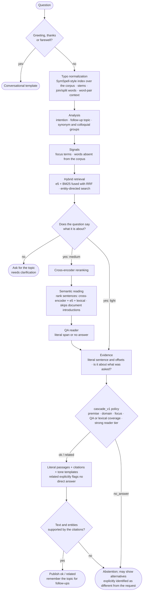
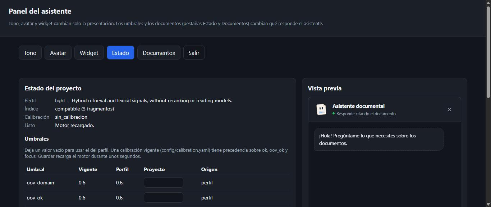
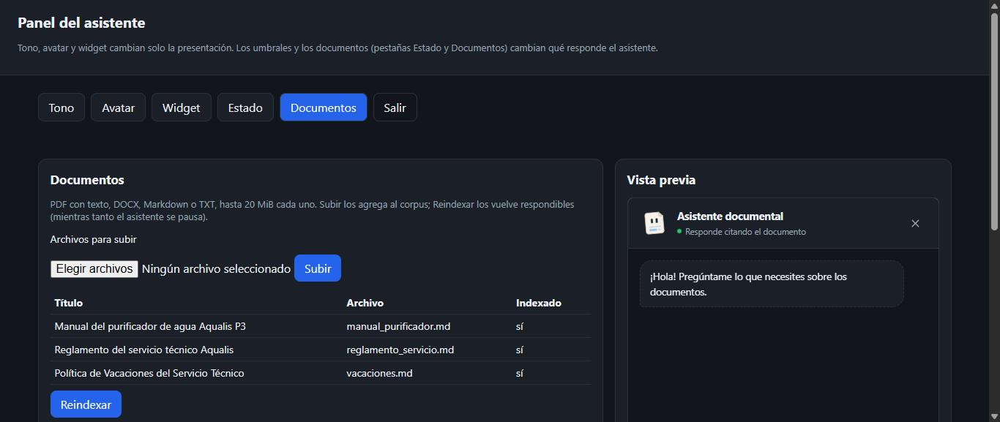

<div align="center">

<picture>
  <source media="(prefers-color-scheme: dark)" srcset="docs/assets/banner-dark.svg">
  
</picture>

[](LICENSE)
[](docs/guide/installation.md)
[](CHANGELOG.md)
[](docs/decisions/0001-non-generative-answers.md)
[](docs/decisions/0003-onnx-and-profiles.md)

**[Quick start](#-quick-start)** ·
**[Manual](#-manual)** ·
**[How it works](#-how-it-works)** ·
**[Web interfaces](#-web-interfaces)** ·
**[Calibration](#-measure-and-calibrate)** ·
**[Documentation](#-documentation)** ·
**[Español](README.es.md)**

</div>

---

**V2 is the default engine:** search returns up to three ranked literal sources
per page, with excerpts, expandable context and further results on demand.
New projects and configurations without a selector use v2. Explicit
`pipeline: v1` in `config/engine.yaml` keeps the legacy answer engine described
below. See [ranked sources](docs/methodology/fuentes-v2.md) for switching engines.

**ipsis** is an assistant for your website that answers questions about your
documents **by showing the literal text that supports the answer**, with its
document, section and exact position. It does not write with a generative
model: it uses checks to abstain or show related information when it finds
insufficient support. A literal citation can still be wrong for the question;
these checks reduce that risk but do not eliminate it. It runs on
CPU, on your own server and, once the models are downloaded, without
network access.

The name comes from the Latin *ipsissima verba*, "the very words": the
assistant answers with the document's own words.

<div align="center">
<picture>
  <source media="(prefers-color-scheme: dark)" srcset="docs/assets/widget-answer-dark.png">
  
</picture>
</div>

## ✨ Features

<table>
<tr>
<td width="50%" valign="top">

**🔎 Extractive and verifiable**<br>
Answer passages are literal spans of the document, accompanied by fixed
templates and citations. `ipsis audit` checks literal text and offsets;
it does not prove that a passage answers the question correctly.

**🛑 Knows when not to answer**<br>
`ok`, `related` and `no_answer` statuses, decided by explainable signals.
Thresholds can be calibrated using an observed risk bound (Clopper-Pearson).

**⚡ Profiles by use**<br>
`light` prioritizes latency; `medium` is the recommended default.
All on CPU with ONNX.

</td>
<td width="50%" valign="top">

**🗣️ Understands how people write**<br>
Typos ("pasword", "covran", "abreel"), abbreviations, colloquial words and
paraphrases; it asks for the topic when a question does not say it ("Who
approves it?"). `en`, `es` and `pt` packs; any other language works with
universal rules.

**💬 Embeddable widget**<br>
One line of HTML, responsive, isolated in Shadow DOM, with 7 answer tones and
**Folio**, an avatar that reacts to every event.

**🏠 Truly self-hosted**<br>
A terminal with a menu and an interactive mode, an `/admin` panel for
personality, thresholds and documents, and `ipsis deploy prepare` with Docker
and HTTPS (Caddy).

</td>
</tr>
</table>

### Why extractive?

| | Generative RAG | **ipsis** |
|---|---|---|
| What it returns | New text written by an LLM | **The document's text, verbatim** |
| Error risk | May generate unsupported facts | **Copies source facts; may select a wrong or incomplete passage** |
| How you verify it | Read the sources yourself | **The citation highlights the exact span** |
| Hardware | A GPU or an external API | **CPU, on your server** |
| Your data | Usually sent to a provider | **Never leaves your machine** |
| Best for | Summaries and open conversation | **Manuals, regulations, policies, support** |

### What ipsis is (and is not)

- **A Python package with a command line (`ipsis`) and an HTTP service**
  (`ipsis serve`, FastAPI). You install it with `uv`, run it in a project
  folder, and your site talks to it through the widget or `POST /ask`.
- **Docker is only for deployment.** `ipsis deploy prepare` writes a
  `Dockerfile`, a `compose.yaml` and, optionally, Caddy for HTTPS. You do not
  need Docker to develop or to try it.
- **Not a Python library.** There is no public Python API to call from your
  own program; integrate over HTTP (`POST /ask`) or with the widget.

## 🚀 Quick start

Install **uv** once. You do not need to create or activate virtual environments.
Python 3.12 is installed automatically if needed. No GPU required.

**Windows (PowerShell):**

```powershell
winget install --id astral-sh.uv -e
```

**Linux / macOS:**

```bash
curl -LsSf https://astral.sh/uv/install.sh | sh
```

Open a new terminal. With Git installed (`git --version`), install ipsis:

```bash
uv tool install --python 3.12 "ipsis @ git+https://github.com/ClaudioH19/ipsis.git"
uv tool update-shell
```

Open a new terminal and check `ipsis --version`. You can now use `ipsis` from
any folder. To update: `uv tool upgrade ipsis`. If Git is missing or you need
help with PATH, see the [installation guide](docs/guide/installation.md).

Then, in any folder:

```bash
mkdir my-assistant && cd my-assistant
ipsis init --profile medium --language en   # project configuration
ipsis models download                       # once per machine (~1.7 GB for medium)
ipsis load /path/to/documents               # PDF with text, DOCX, Markdown or TXT
ipsis index                                 # parse, chunk, embed and store
ipsis doctor                                # can it run? if not, which command fixes it
ipsis chat                                  # ask from the terminal (/help inside)
ipsis serve                                 # API, widget and /admin on http://127.0.0.1:8000
```

`ipsis` with no arguments opens the interactive terminal (below). The command
line speaks English; set `IPSIS_LANG=es` for Spanish. `uv` manages its isolation
internally; there is no activation step. In local mode the index
admits one process at a time: stop `ipsis serve` before `ipsis chat` or
`ipsis ask --diagnostics`.

<details>
<summary><b>Choosing a profile</b></summary>

| Profile | Models | Disk | Target p95 | Measured |
|---|---|---|---|---|
| `light` | e5-small | 0.5 GB | 150 ms | 85 ms p95 |
| `medium` | e5-small + mMiniLM reranker + mDeBERTa reader, semantic reading | 1.7 GB | 1 s | 2.5 s p50, 4.2 s p95 on a 2-thread CPU with a realistic corpus |

Change it later with `ipsis profile set <profile>` (it tells you whether to
reindex or recalibrate). `light` has no reader: it answers fewer questions
directly, especially colloquial ones. The former `heavy` profile was removed:
no larger model added a single correct answer over medium
([ADR 0003](docs/decisions/0003-onnx-and-profiles.md)). Alternative models
can still be selected through
[project configuration](docs/guide/configuration.md#alternative-models).

</details>

<details>
<summary><b>Windows, development install and Docker</b></summary>

All the details are in the [installation guide](docs/guide/installation.md).
For a server with HTTPS:

```bash
ipsis deploy prepare --domain assistant.your-domain.com
# copy dist/ to the server and run:
docker compose --profile https up -d --build
```

See the [deployment guide](docs/guide/deployment.md).

</details>

## 📖 Manual

### The terminal

`ipsis` alone opens the interactive terminal, like `claude` or `codex`: Folio,
the avatar of ipsis, shows the project in this folder, and typing `/` unfolds
a menu with every command and its description. After a command, `Tab` shows
its subcommands and options with their help (`/calibrate --` → `--alpha`,
`--apply`), and after `/load` it completes paths. Arrow up recalls previous
lines; the bottom bar shows whether diagnostics are on.

Commands show the real stage they are running and elapsed time. For example,
`/index` goes through reading, chunking, validation, vectors and storage;
questions show searching, reading and citation verification. Stages depend on
the profile and what each question needs. Answers appear under Folio, with
sources underneath. `Ctrl+C` cancels the operation and lets you keep chatting.
Progress goes to stderr; results go to stdout. `/help` and `ipsis --help` also
show the uv installation command.

```text
  ╭──────────────╮       ipsis 0.9.0 · Folio
  │              │╲      Your documents, a local conversation.
  │              │ ╲
  │              ╰───┤   profile medium · en · 3 document(s)
  │                  │   /home/user/my-assistant
  │    ▄▄    ▄▄      │
  │    ██    ██      │   / commands with Tab · /help · /exit
  │    ▀▀    ▀▀      │   Ctrl+C cancels · Ctrl+D leaves
  │                  │
  │  ━━━━━━━━━━━━    │   uv manages isolation; no activation.
  │  ━━━━━━  ━━━━    │
  │                  │
  ╰──────────────────╯
› /cal
   /calibrate   Choose thresholds with your question bank.
```

`ipsis help` prints every command grouped by task (also what `ipsis` prints
when its output is not a terminal, in scripts); `ipsis help <command>` (or
`ipsis <command> --help`) explains one command.

```text
$ ipsis
 ipsis 0.9.0 · Extractive answers from your documents: literal citations, calibrated abstention, CPU only.

 Start
   init             Create the configuration for a new project.
   profile          Show or change the installation profile (light or medium).
   models           ONNX models of the profile: list, download, verify or export.
   doctor           Read-only diagnosis: configuration, profile, language, models, index, ...
   help             Show the commands grouped by task, or the help of one command.
 Documents
   load             Copy a file or folder into the corpus and catalog it.
   index            Parse, chunk, embed and store the index.
 Ask
   chat             Interactive mode: type questions, and /commands (/help, /doctor, /index...).
 ...
```

In the interactive terminal (`ipsis`, or `ipsis chat`) what you type is a
question, and what starts with `/` is a command. The models load once, and follow-up questions
("and with 90?") keep the topic of the conversation.

```text
$ ipsis chat
ipsis chat -- type a question, or /help for commands. /exit to leave.
> how often is the filter replaced?
... Looking for an answer in your documents
  Finding the most relevant passages
  Verifying that citations are literal
Folio  [OK]
The activated carbon filter is replaced every 12 months ...
> /diagnostics on          # stages, signals, rule and exact span of each answer
> /load ./new-manuals      # any ipsis command works as /command
> /index
> /reload                  # reload the engine after changing configuration
> /exit
```

### Every command

| Task | Command | What it does |
|---|---|---|
| **Start** | `ipsis init [--profile light\|medium] [--language es] [--assistant-name NAME] [--domain-description TEXT] [--force]` | Creates `config/` and `documents/` in the current folder |
| | `ipsis profile show` · `ipsis profile set medium` | Shows the active profile, its models, budget and whether index and calibration fit; changes it |
| | `ipsis models list` · `download [--profile P]` · `verify` · `export` | ONNX models: license and cache, download, test inference; `export` converts a Hugging Face model (development) |
| | `ipsis doctor` | Read-only diagnosis with the command that fixes each problem |
| | `ipsis help [command]` | The menu, or the help of one command |
| **Documents** | `ipsis load PATH` | Copies a file or folder into `documents/` and catalogs it |
| | `ipsis index [--corpus FOLDER]` | Parses, chunks, embeds and stores the index |
| **Ask** | `ipsis chat [--diagnostics]` | Interactive mode (questions and `/commands`) |
| | `ipsis ask "QUESTION" [--url URL] [--diagnostics]` | One question to the running service, or with `--diagnostics` to the engine in this process |
| | `ipsis serve [FOLDER] [--host H] [--port P] [--mode production\|development] [--reindex]` | Starts the API, the widget and `/admin`; with a folder, prepares the project first |
| **Customize** | `ipsis configure key=value ...` | `assistant_name`, `domain_description`, `language`, `profile`, `cors_origins`, `widget_keys`, `query_log.enabled`, `posture.mode`, `posture.max_alternatives` |
| | `ipsis personality show` · `validate` | Active tone and avatar; checks `personality.yaml` |
| | `ipsis personality tone list` · `apply TONE` · `try [--tone T] [--situation S]` | Seven answer tones; prints the variants of one |
| | `ipsis personality avatar list` · `import FILE [--name N]` · `apply NAME` · `events` · `assign` · `colors` | Widget avatar and how it reacts to each event |
| | `ipsis widget theme list` · `apply PRESET` · `preview` | Visual presets: `classic`, `minimal`, `editorial`, `contrast` |
| | `ipsis widget style show [--section S]` · `set section.key=value ...` | Every style value of `config/styles.yaml` |
| | `ipsis widget snippet [--api URL] [--component] [--key K]` · `export FOLDER [--api URL]` | Code to paste in your site; a folder with `widget.js` |
| **Measure and calibrate** | `ipsis golden template [--n N]` · `import FILE` · `validate` · `export --format squad2\|csv` | Your test questions (golden set) |
| | `ipsis evaluate [--bank MANIFEST] [--output FILE]` | Coverage, wrong direct answers and latency on your golden set |
| | `ipsis calibrate [--alpha 0.05] [--apply]` | Chooses thresholds under a risk bound (see below) |
| | `ipsis compare REPORT REPORT ... [--output FILE]` | Compares evaluation reports |
| | `ipsis benchmark --bank MANIFEST [--profiles light,medium] [--latency-only] [--repetitions N]` | Compares profiles, retrieval modes or latency |
| | `ipsis audit [--from DATE] [--to DATE]` | Reviews the query log: statuses, rules and whether each citation is still literal |
| **Deploy and operate** | `ipsis deploy prepare [--domain D] [--target dist] [--wheel W] [--force]` | A folder with Docker, compose and optional Caddy, ready to copy to a server |
| | `ipsis snapshot-config [--output FILE]` | The effective configuration with every default resolved |

The full reference, with every option and its default, is in the
[usage guide](docs/guide/usage.md).

### Project files

| File | What it holds | Changed with |
|---|---|---|
| `config/assistant.yaml` | Name, language, profile, CORS, widget keys, query log, posture | `ipsis configure`, `ipsis profile set` |
| `config/engine.yaml` | Retrieval, reading and thresholds (`profile_overrides`) | Editor, or the **Status** tab of `/admin` |
| `config/calibration.yaml` | Thresholds chosen by `ipsis calibrate --apply` | `ipsis calibrate` |
| `config/personality.yaml` | Tone and avatar | `ipsis personality`, `/admin` |
| `config/styles.yaml` | Every visual value of the widget | `ipsis widget`, `/admin` |
| `config/domain.yaml` | Your own synonyms and categories (optional) | Editor |
| `documents/` + `catalog.yaml` | Your documents and their catalog | `ipsis load`, the **Documents** tab of `/admin` |

Precedence of thresholds: **profile → `config/engine.yaml` → applicable
calibration**. Details in the [configuration guide](docs/guide/configuration.md).

## 🧭 How it works



What each layer does, and with what technique. No layer writes content:
models rank, read and decide; the answer is always a literal span of your
documents.

| Layer | What it does | Technique |
|---|---|---|
| Conversational | Answers greetings, thanks, farewells and "what can you do?" | Per-language patterns; fixed templates in 7 tones |
| Typo normalization | Turns "pasword", "covran", "abreel", "estacio namiento" into the words of the documents | Symmetric-delete index (SymSpell) over the corpus forms and stems; edit distance 1–2 with transpositions; stem comparison when the exact form is not in the corpus; splitting joined and joining split words; word-pair context (presence, never frequency) for typos that form another real word. Never touches real words absent from the corpus ("feriados"), proper nouns, acronyms or words of the synonym groups |
| Analysis | Understands the question before searching | Intention by pattern ("when does it start", "who", "how often") with an e5-similarity fallback; follow-ups inherit the conversation topic ("and with 90?"); pack synonym groups, including everyday equivalences ("plata" → "dinero", "fridge" → "refrigerator"), and your project synonyms |
| Signals | Measures the question against the corpus | Focus terms (the rarest topic words, without question, relation or generic words); `s_oov` (share of the question absent from the corpus); informal abbreviations and personal pronouns are function words |
| Retrieval | Finds candidate fragments | Dense e5-small + sparse BM25 in Qdrant, fused with RRF; extra search by any literal entity of the question (dates, amounts, codes) |
| Clarification | Asks for the topic instead of guessing | No content word left ("How much is it?"), an anaphoric pronoun without antecedent ("Who approves it?"), or a short question whose only word is in several documents |
| Reranking (medium) | Reorders the candidates | Multilingual cross-encoder (mMiniLM) over the first 5 fused candidates |
| Semantic reading (medium) | Chooses what the reader reads | Every sentence ranked by RRF of cross-encoder, e5 cosine and lexical overlap; the top three, each with its previous sentence; never headings nor the introduction of a document with sections |
| Reading (medium) | Extracts the exact span | Extractive QA (mDeBERTa, SQuAD 2.0) that can answer "no answer" |
| Evidence | Picks the literal sentence and checks it is about what was asked | Text and offsets verified against the corpus; focus terms in the sentence, its section titles or the previous sentence; required answer form ("how often" needs a period, "how much does it cost" an amount); same head with another modifier ("electricity costs" vs "connection costs", also against the section title) is something else |
| Policy | Decides `ok`, `related` or `no_answer`, and a confidence level | `cascade_v1` rules over explainable signals; a strong reader tier lets informal wording through when the reader is nearly sure, and a colloquial question (detected by how it is written, never by its words) then needs half of the focus terms; thresholds calibrable with your golden set |
| Rendering | Writes the reply | Literal passages with citations and tone templates; a `related` reply asks whether that is what you wanted; with the proactive posture, similar passages after a `no_answer` |
| Verification | Checks before publishing | `text == corpus[start:end]` and entities supported by the citations; the first cited passage feeds the conversation memory |

Every decision records its rule and its signals in the diagnostics
(`ipsis chat --diagnostics`, `ipsis ask --diagnostics`). Details in the
[architecture](docs/architecture.md) and the
[methodology notes](docs/methodology/README.md), which record what was
measured, kept and rejected ([informal questions](docs/methodology/informal-paraphrases.md),
[typos](docs/methodology/lexical.md#typos)).

**Measured (medium, held-out banks written before the changes they measure):**
97.3 % of direct answers correct (guaranteed ≥ 94.0 % at 95 % confidence);
with typos, 97 % of the correctly answered questions are still answered
correctly; on colloquial questions, 50 % are answered directly and another
53 % show the right passage as `related`. Synthetic banks do not certify your
documents: that is what [calibration](#-measure-and-calibrate) is for.

## 🌐 Web interfaces

`ipsis serve` publishes everything on one port:

| Address | What it is | Access |
|---|---|---|
| `/admin/panel` | **Admin panel**: tone, avatar, widget, **Status** (profile, index, calibration, thresholds and diagnosis; edit thresholds) and **Documents** (upload files and reindex) | Requires `IPSIS_ADMIN_TOKEN` (≥ 32 characters); HTTPS in production |
| `/widget/demo.html` | **Demo page** with the widget on a fictitious site, to try the four statuses | `--mode development`, or `IPSIS_DEMO=1` in production |
| `/widget.js` | The widget for your site (`<script src="https://assistant.your-domain.com/widget.js" data-api="https://assistant.your-domain.com" defer>`) | Public |
| `POST /ask` | The question API (`{"question": "...", "session_id": "..."}`) | Public; optional widget keys and rate limit |
| `/health`, `/ready` | Liveness and readiness (with a diagnosis summary) | Public |
| `/docs` | Interactive API documentation | `--mode development`, or `IPSIS_DOCS=1` in production |

```bash
export IPSIS_ADMIN_TOKEN="$(python -c 'import secrets; print(secrets.token_urlsafe(32))')"
ipsis serve --mode development         # /admin over HTTP, /docs, no widget caching
# open http://127.0.0.1:8000/admin/panel and paste the token
```

<table>
<tr>
<td width="50%"></td>
<td width="50%"></td>
</tr>
<tr>
<td align="center"><sub><b>Status</b>: thresholds in force and their source (profile, project or calibration)</sub></td>
<td align="center"><sub><b>Documents</b>: upload PDF, DOCX, Markdown or TXT and reindex</sub></td>
</tr>
<tr>
<td width="50%"></td>
<td width="50%"></td>
</tr>
<tr>
<td align="center"><sub><b>Tone</b>, avatar and widget with a live preview</sub></td>
<td align="center"><sub>Full screen on a phone</sub></td>
</tr>
</table>

Saving thresholds or reindexing from the panel reloads the engine; meanwhile
`/ask` answers 503 ("not ready") for a few seconds, because the local index
admits one client. Every change is logged in `.ipsis/logs/admin.jsonl`.

## 🧪 Examples

### Load documents

```bash
ipsis load ./manuals/handbook.pdf      # one file
ipsis load ./manuals                   # a whole folder (recursive)
ipsis index                            # make them answerable
ipsis serve ./manuals                  # or: init + load + index + serve in one step
```

From the panel: **Documents** → choose files → **Upload** → **Reindex**.
Over HTTP, with the admin token:

```bash
curl -X POST "https://assistant.your-domain.com/admin/documents?name=policy.pdf" \
     -H "Authorization: Bearer $IPSIS_ADMIN_TOKEN" --data-binary @policy.pdf
curl -X POST https://assistant.your-domain.com/admin/reindex -H "Authorization: Bearer $IPSIS_ADMIN_TOKEN"
```

Scanned PDFs need the OCR extra and Tesseract; add them to the same uv
installation following the [OCR guide](docs/guide/installation.md#scanned-pdfs-ocr-optional).

### Customize

```bash
ipsis configure assistant_name="Library assistant" domain_description="the library rules"
ipsis configure cors_origins=https://www.your-site.com     # sites allowed to embed the widget
ipsis personality tone apply formal                         # cordial, formal, serious, upbeat, friendly, empathetic, direct
ipsis personality tone try --situation no_answer           # see the variants before choosing
ipsis widget theme apply editorial                         # classic, minimal, editorial, contrast
ipsis widget style set colors.accent=#0ea5e9 shape.panel_radius=10px
ipsis configure posture.mode=proactive posture.max_alternatives=3   # offer similar passages after no_answer
ipsis widget snippet --api https://assistant.your-domain.com        # code to paste in your site
```

Everything in this block (except CORS, posture and the snippet) can also be
done in the `/admin` panel with a live preview. More in the
[personality](docs/guide/personality.md) and [web](docs/guide/web.md) guides.

### Change thresholds

Thresholds decide when an answer is direct (`ok`), related or withheld. Change
them in `config/engine.yaml`:

```yaml
profile_overrides:
  default_thresholds:
    ok: 0.85            # reader score needed for a direct answer (higher = fewer, safer ok)
    focus: 1.0          # the answering sentence must contain every focus term
    oov_ok: 0.60        # max share of the question absent from the corpus for an ok
    related: 0.33       # domain score below which nothing related is shown
    ok_strong: 0.99     # strong reader tier: a nearly sure reader...
    oov_ok_strong: 0.67 # ...tolerates a little more informal wording
    focus_informal: 0.5 # ...and, for a colloquial question, half of the focus terms
```

or in the **Status** tab of `/admin` (empty value = the profile's), or over
HTTP:

```bash
curl -X PUT https://assistant.your-domain.com/admin/thresholds \
     -H "Authorization: Bearer $IPSIS_ADMIN_TOKEN" -H "Content-Type: application/json" \
     -d '{"thresholds": {"ok": 0.85, "related": null}}'     # null = back to the profile value
```

Changing thresholds by hand trades coverage for risk without measuring it.
The supported way is to let `ipsis calibrate` choose them with your golden set;
a calibration in force takes precedence over `ok`, `oov_ok` and `focus`.

## 📏 Measure and calibrate

**What calibrating with your corpus is for.** The default thresholds are
conservative and were tuned on synthetic banks. Your documents and your
users' questions are different: the same threshold may withhold answers your
documents support, or accept answers that are wrong for your content.
Calibration measures that on **your** documents with **your** test questions
and chooses the thresholds that give the most direct answers while keeping the
risk of a wrong direct answer below a target you set (5 % by default).

```bash
ipsis golden template              # proposes questions from your documents (golden/golden.csv)
#   fill in the expected literal answer of each one, or mark it unanswerable
ipsis golden import golden/golden.csv
ipsis evaluate                     # coverage, wrong direct answers and latency today
ipsis calibrate                    # choose thresholds on dev, report test; changes nothing
ipsis calibrate --apply            # save them to config/calibration.yaml
```

How it works: the golden set is split into `dev` and `test`. Only `dev`
chooses: for every combination of `ok`, `oov_ok` and `focus` it counts the
accepted answers and the wrong ones, and keeps the combination with the most
direct answers whose Clopper-Pearson upper bound on the error rate is ≤ α.
`test` is reported separately and never chooses. With α = 5 % and 95 %
confidence, a fixed threshold needs at least 59 accepted answers without
errors to meet the bound: a small golden set ends as `muestra_insuficiente`
(insufficient sample) and changes nothing.

What it is not: calibration **trains nothing** (no model learns from your
data), it does not guarantee a 5 % error rate in production, and it applies
only while profile, models, corpus and lexical rules stay the same (otherwise
`ipsis doctor` reports it as obsolete). See [calibration](docs/methodology/calibration.md)
and the [golden set guide](docs/guide/golden.md).

## 📚 Documentation

| Guide | Contents |
|---|---|
| [Installation](docs/guide/installation.md) | Requirements, profiles, models, cache and Qdrant |
| [Usage](docs/guide/usage.md) | Workflow, terminal menu, interactive mode and every command |
| [Configuration](docs/guide/configuration.md) | Every project file, thresholds and precedence |
| [Golden set](docs/guide/golden.md) | Test questions, evaluation and calibration |
| [Web](docs/guide/web.md) | Widget, placement, JavaScript API, CSP and avatar |
| [Personality](docs/guide/personality.md) | Tones, Folio and the `/admin` panel |
| [Deployment](docs/guide/deployment.md) | Server with HTTPS, Docker, modes and a pre-launch checklist |
| [Architecture](docs/architecture.md) | Modules, flows and diagrams |

Under the hood: [methodology notes](docs/methodology/README.md),
[architecture decisions](docs/decisions/) and the [changelog](CHANGELOG.md).
Guides in Spanish: [docs/es/](docs/es/README.md).

## 🛠️ Development

```bash
git clone https://github.com/ClaudioH19/ipsis.git
cd ipsis
uv sync --locked --extra test
uv run --locked --extra test pytest -m "not slow and not browser"     # fast tests
python herramientas/evaluacion/general.py --download   # end-to-end regression on real-format documents
```

The tests use synthetic documents; the repository distributes no corpus or
metrics from any institution. The code's internal identifiers are in
Spanish; everything user-facing is in English. Read
[CONTRIBUTING.md](CONTRIBUTING.md) before opening a pull request.

<details>
<summary><b>Known limitations</b></summary>

- Scanned PDFs are read only with the optional OCR extra (`ipsis[ocr]` and
  Tesseract); without it, their pages without text are reported and skipped.
- Colloquial questions are mostly answered as `related` with the right
  passage, not as direct answers: on the held-out colloquial bank, medium
  answers 36 of 72 directly (18 before the colloquial focus tier) and shows the right passage for most of the rest. The
  system cannot tell a paraphrase from a missing fact with its signals
  ("on bank holidays", "moto eléctrica" when the documents say "vehículos
  eléctricos") and keeps the safe side. [Measurements](docs/methodology/informal-paraphrases.md).
- A typo that forms another real word ("paring", "férias" → "feias") is
  corrected only with word-pair context on both sides; otherwise it is left
  as written on purpose.
- `light` has no reader: it can rarely say `ok` to a colloquial question.
- On a 2-thread CPU and a corpus of realistic size, medium answers in about
  2.5 s (p50) and 4.2 s (p95), above its 1 s target; more cores bring it down.
- Follow-up questions inherit the topic of the conversation, kept in the
  service's memory until 30 minutes without questions; a new page load starts
  a new conversation.
- One language per project; it does not detect the language of each question.
- The medium reader still selects incomplete or incorrect literal spans in
  some independent questions ([measurements](docs/methodology/mediciones/v4-correcciones/README.md)).
- In local mode, Qdrant locks its folder while another process uses it:
  stop `ipsis serve` before `ipsis chat`, and reindexing from the panel pauses
  `/ask` for a few seconds.
- Premise checking looks for entities across all candidates; it does not
  validate that each fact belongs to the subject, action or condition asked
  about.

</details>

## ⚖️ License

The bundled lexical datasets retain their own licenses and attribution;
see [synonym data sources](ipsis/recursos/sinonimos/FUENTES.md).

[GNU AGPL-3.0](LICENSE) (`AGPL-3.0-only`), the same license as the avatar
engine ([@bible-strong/avatar-web](https://github.com/smontlouis/bible-strong-avatar-lab)).

- **You may** use it for any purpose, including commercial; study, modify
  and redistribute it.
- **If you install it unchanged** on your server, you have no new
  obligations: the service already links to this repository.
- **If you modify it and offer it over a network,** offer the source code of
  your version (§13): the widget and the panel show "Source code"
  (`GET /source`); point `IPSIS_SOURCE_URL` to your repository.
- **If you redistribute it** (for example, a Docker image), include the
  license and the source code.

The licenses of the packages bundled in the avatar engine are in
`ipsis/servicio/estaticos/avatar.js.LICENSE.txt`.

<div align="center"><sub>Built so an assistant can say "it is not in the documents".</sub></div>
