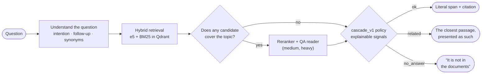
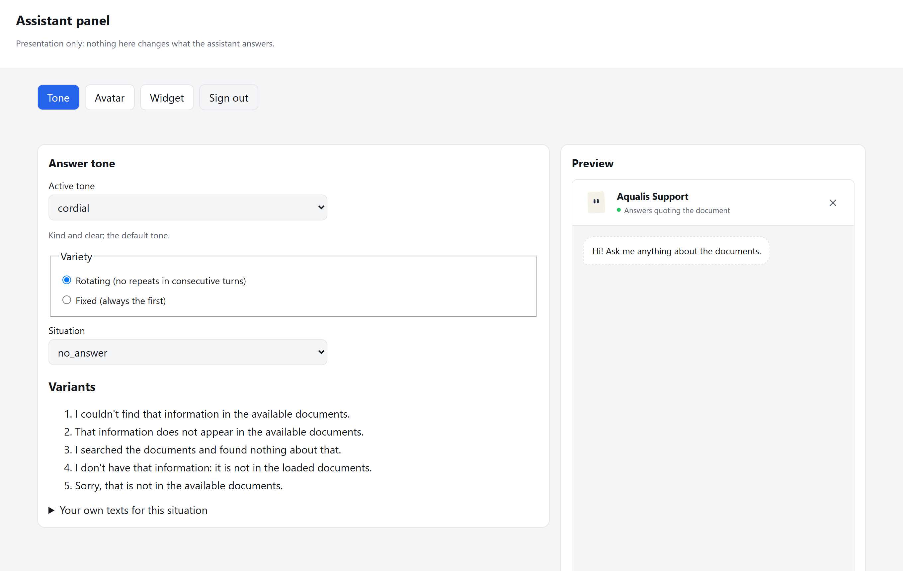
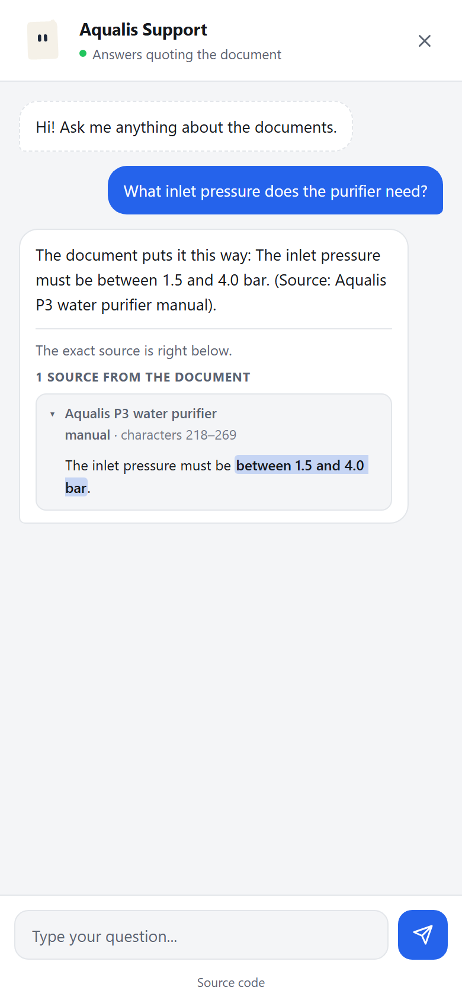

<div align="center">

<picture>
  <source media="(prefers-color-scheme: dark)" srcset="docs/assets/banner-dark.svg">
  
</picture>

[](LICENSE)
[](docs/guide/installation.md)
[](CHANGELOG.md)
[](docs/decisions/0001-non-generative-answers.md)
[](docs/decisions/0003-onnx-and-profiles.md)

**[Quick start](#-quick-start)** ·
**[How it works](#-how-it-works)** ·
**[Documentation](#-documentation)** ·
**[Architecture](docs/architecture.md)** ·
**[Deployment](docs/guide/deployment.md)** ·
**[Español](README.es.md)**

</div>

---

**ipsis** is an assistant for your website that answers questions about your
documents **by showing the literal text that supports the answer**, with its
document, section and exact position. It does not write with a generative
model: if the documents do not contain the answer, it says so. It runs on
CPU, on your own server and, once the models are downloaded, without
network access.

The name comes from the Latin *ipsissima verba*, "the very words": the
assistant answers with the document's own words.

<div align="center">
<picture>
  <source media="(prefers-color-scheme: dark)" srcset="docs/assets/widget-answer-dark.png">
  
</picture>
</div>

## ✨ Features

<table>
<tr>
<td width="50%" valign="top">

**🔎 Extractive and verifiable**<br>
Every answer is a literal span of the document, with the citation underneath
and the key fact highlighted. `ipsis audit` checks that it stays that way.

**🛑 Knows when not to answer**<br>
`ok`, `related` and `no_answer` statuses, decided by explainable signals.
Thresholds are calibrated under risk control (Clopper-Pearson).

**⚡ Three profiles**<br>
`light` (~85 ms), `medium` (+ reranker and QA reader, ~0.8 s) and `heavy`
(larger models and more checks). All on CPU with ONNX.

</td>
<td width="50%" valign="top">

**🌎 Multilingual**<br>
`en`, `es` and `pt` packs; any other language works with universal rules.

**💬 Embeddable widget**<br>
One line of HTML, responsive, isolated in Shadow DOM, with 7 answer tones and
**Folio**, an avatar that reacts to every event.

**🏠 Truly self-hosted**<br>
A Docker image per profile, `ipsis deploy prepare` with HTTPS (Caddy) and an
`/admin` panel to tune the personality without a terminal.

</td>
</tr>
</table>

### Why extractive?

| | Generative RAG | **ipsis** |
|---|---|---|
| What it returns | New text written by an LLM | **The document's text, verbatim** |
| Can it make things up? | Yes (hallucinations) | **No: if it is not there, it says so** |
| How you verify it | Read the sources yourself | **The citation highlights the exact span** |
| Hardware | A GPU or an external API | **CPU, on your server** |
| Your data | Usually sent to a provider | **Never leaves your machine** |
| Best for | Summaries and open conversation | **Manuals, regulations, policies, support** |

## 🧭 How it works



Every decision records its rule and its signals in the diagnostics
(`ipsis ask --diagnostics`). Details in the [architecture](docs/architecture.md)
and the [methodology notes](docs/methodology/README.md).

## 🚀 Quick start

Requires Python 3.11 or 3.12. No GPU needed.

```bash
pip install "ipsis @ git+https://github.com/ClaudioH19/ipsis.git"

mkdir my-assistant && cd my-assistant
ipsis init --profile medium --language en
ipsis models download            # once per machine
ipsis load /path/to/documents    # PDF with text, DOCX, Markdown or TXT
ipsis index
ipsis doctor                     # can it run? If not, which command to run
ipsis serve                      # http://127.0.0.1:8000
```

Ask from another terminal:

```bash
ipsis ask "How often should the filter be replaced?"
```

The command line speaks English; set `IPSIS_LANG=es` for Spanish.

<details>
<summary><b>Choosing a profile</b></summary>

| Profile | Models | Disk | Target p95 | Measured p95 |
|---|---|---|---|---|
| `light` | e5-small | 0.5 GB | 150 ms | 85 ms |
| `medium` | e5-small + mMiniLM reranker + mDeBERTa reader | 1.7 GB | 1 s | 815 ms |
| `heavy` | e5-base + bge-m3 reranker + mDeBERTa reader | 2.8 GB | 5 s | 2,130 ms |

Change it later with `ipsis profile set <profile>`. Measured on CPU with the
90-question universal bank; see [ADR 0003](docs/decisions/0003-onnx-and-profiles.md).

</details>

<details>
<summary><b>Windows, development environment and Docker</b></summary>

All the details are in the [installation guide](docs/guide/installation.md).
For a server with HTTPS:

```bash
ipsis deploy prepare --domain assistant.your-domain.com
# copy dist/ to the server and run:
docker compose --profile https up -d --build
```

See the [deployment guide](docs/guide/deployment.md).

</details>

## 🧩 On your site

```bash
ipsis configure cors_origins=https://www.your-site.com
ipsis widget snippet --api https://assistant.your-domain.com
```

```html
<script src="https://assistant.your-domain.com/widget.js"
        data-api="https://assistant.your-domain.com" defer></script>
```

There are examples for [HTML](examples/html/), [React](examples/react/) and
[WordPress](examples/wordpress/). Position, size, theme, citations and avatar
are configured without touching code ([web guide](docs/guide/web.md)).

<table>
<tr>
<td width="62%"></td>
<td width="38%"></td>
</tr>
<tr>
<td align="center"><sub><code>/admin</code> panel: tone, avatar and widget with a live preview</sub></td>
<td align="center"><sub>Full screen on a phone</sub></td>
</tr>
</table>

## 📏 Measure and calibrate

```bash
ipsis golden template              # proposes questions from your documents
ipsis golden import golden/golden.csv
ipsis evaluate                     # coverage, false "ok" answers and latency
ipsis calibrate --apply            # thresholds with false "ok" risk ≤ 5%, if the sample allows
```

Calibration trains nothing: it picks thresholds among observed values and
certifies the risk only when the sample is large enough (≥ 59 accepted
answers without errors). See [calibration](docs/methodology/calibration.md).

## 📚 Documentation

| Guide | Contents |
|---|---|
| [Installation](docs/guide/installation.md) | Requirements, profiles, models, cache and Qdrant |
| [Usage](docs/guide/usage.md) | Workflow and reference of every command |
| [Configuration](docs/guide/configuration.md) | Every project file |
| [Golden set](docs/guide/golden.md) | Test questions, evaluation and calibration |
| [Web](docs/guide/web.md) | Widget, placement, JavaScript API, CSP and avatar |
| [Personality](docs/guide/personality.md) | Tones, Folio and the `/admin` panel |
| [Deployment](docs/guide/deployment.md) | Server with HTTPS, Docker, modes and a pre-launch checklist |
| [Architecture](docs/architecture.md) | Modules, flows and diagrams |

Under the hood: [methodology notes](docs/methodology/README.md),
[architecture decisions](docs/decisions/) and the [changelog](CHANGELOG.md).
Guides in Spanish: [docs/es/](docs/es/README.md).

## 🛠️ Development

```bash
git clone https://github.com/ClaudioH19/ipsis.git
cd ipsis
python -m venv .venv && .venv/bin/python -m pip install -e ".[test]"
python -m pytest -m "not slow and not browser"     # fast tests
```

The tests use synthetic documents; the repository distributes no corpus or
metrics from any institution. The code's internal identifiers are in
Spanish; everything user-facing is in English. Read
[CONTRIBUTING.md](CONTRIBUTING.md) before opening a pull request.

<details>
<summary><b>Known limitations</b></summary>

- Scanned PDFs are read only with the optional OCR extra (`ipsis[ocr]` and
  Tesseract); without it, their pages without text are reported and skipped.
- A synonym outside the language pack's groups that does not appear in the
  document may lead to a related answer instead of a direct one: it is the
  safe side of the error.
- Follow-up questions ("and with 90?") only inherit the topic of the previous
  turn of the same session, kept in memory.
- One language per project; it does not detect the language of each
  question.
- In local mode, Qdrant locks its folder while another process uses it.

</details>

## ⚖️ License

[GNU AGPL-3.0](LICENSE) (`AGPL-3.0-only`), the same license as the avatar
engine ([@bible-strong/avatar-web](https://github.com/smontlouis/bible-strong-avatar-lab)).

- **You may** use it for any purpose, including commercial; study, modify
  and redistribute it.
- **If you install it unchanged** on your server, you have no new
  obligations: the service already links to this repository.
- **If you modify it and offer it over a network,** offer the source code of
  your version (§13): the widget and the panel show "Source code"
  (`GET /source`); point `IPSIS_SOURCE_URL` to your repository.
- **If you redistribute it** (for example, a Docker image), include the
  license and the source code.

The licenses of the packages bundled in the avatar engine are in
`ipsis/servicio/estaticos/avatar.js.LICENSE.txt`.

<div align="center"><sub>Built so an assistant can say "it is not in the documents".</sub></div>
