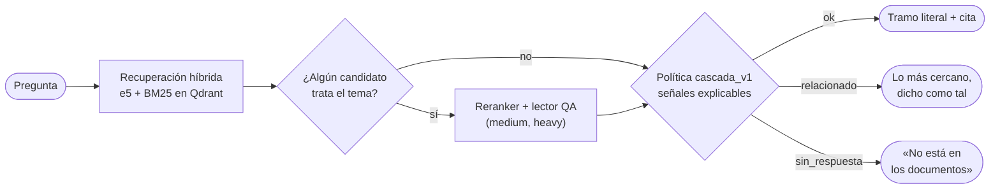
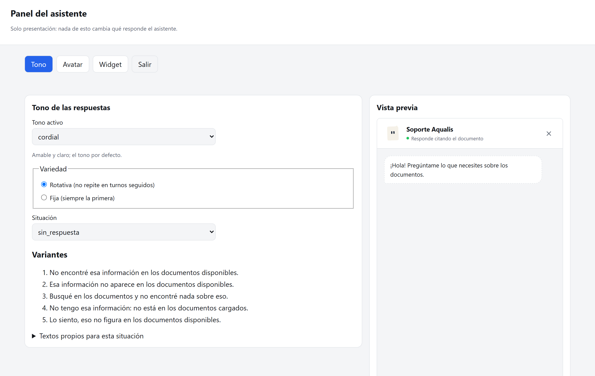
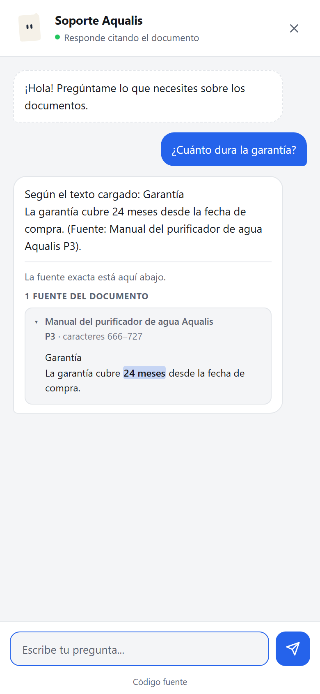

<div align="center">

<picture>
  <source media="(prefers-color-scheme: dark)" srcset="docs/assets/banner-oscuro.svg">
  
</picture>

[](LICENSE)
[](docs/guia/instalacion.md)
[](CHANGELOG.md)
[](docs/decisiones/0001-respuestas-no-generativas.md)
[](docs/decisiones/0003-onnx-y-perfiles.md)

**[Inicio rápido](#-inicio-rápido)** ·
**[Cómo funciona](#-cómo-funciona)** ·
**[Documentación](#-documentación)** ·
**[Arquitectura](docs/arquitectura.md)** ·
**[Despliegue](docs/guia/despliegue.md)**

</div>

---

**ipsis** es un asistente para tu sitio que responde preguntas sobre
tus documentos **mostrando el texto literal que lo respalda**, con documento,
sección y posición exacta. No redacta con un modelo generativo: si los
documentos no contienen la respuesta, lo dice. Corre en CPU, en tu propio
servidor y, una vez descargados los modelos, sin red.

<div align="center">
<picture>
  <source media="(prefers-color-scheme: dark)" srcset="docs/assets/widget-respuesta-oscuro.png">
  
</picture>
</div>

## ✨ Características

<table>
<tr>
<td width="50%" valign="top">

**🔎 Extractivo y verificable**<br>
Cada respuesta es un tramo literal del documento, con la cita debajo y el
dato marcado. `ipsis audit` comprueba que siga siéndolo.

**🛑 Sabe cuándo no responder**<br>
Estados `ok`, `relacionado` y `sin_respuesta`, decididos por señales
explicables. Los umbrales se calibran con riesgo controlado
(Clopper-Pearson).

**⚡ Tres perfiles**<br>
`light` (~85 ms), `medium` (+ reranker y lector QA, ~0,8 s) y `heavy`
(modelos grandes y más comprobaciones). Todo en CPU con ONNX.

</td>
<td width="50%" valign="top">

**🌎 Multilingüe**<br>
Paquetes `es`, `en` y `pt`; cualquier otro idioma funciona con reglas
universales.

**💬 Widget embebible**<br>
Una línea de HTML, responsive, aislado en Shadow DOM, con 7 tonos de
respuesta y **Folio**, un avatar que reacciona a cada evento.

**🏠 Self-hosted de verdad**<br>
Imagen Docker por perfil, `ipsis deploy prepare` con HTTPS (Caddy) y un
panel `/admin` para ajustar la personalidad sin terminal.

</td>
</tr>
</table>

### ¿Por qué extractivo?

| | RAG generativo | **ipsis** |
|---|---|---|
| Qué devuelve | Texto nuevo redactado por un LLM | **El texto del documento, literal** |
| ¿Puede inventar? | Sí (alucinaciones) | **No: si no está, lo dice** |
| Cómo se verifica | Hay que leer las fuentes | **La cita marca el tramo exacto** |
| Hardware | GPU o una API externa | **CPU, en tu servidor** |
| Tus datos | Suelen salir a un proveedor | **Nunca salen de tu máquina** |
| Ideal para | Resúmenes y conversación abierta | **Manuales, reglamentos, políticas, soporte** |

## 🧭 Cómo funciona



Cada decisión deja su regla y sus señales en el diagnóstico
(`ipsis ask --diagnostics`). Detalle en [arquitectura](docs/arquitectura.md)
y en las [fichas metodológicas](docs/metodologia/README.md).

## 🚀 Inicio rápido

Requiere Python 3.11 o 3.12. No necesita GPU.

```bash
pip install "ipsis @ git+https://github.com/ClaudioH19/Deterministic-Retrieval-Assistant-Chat.git"

mkdir mi-asistente && cd mi-asistente
ipsis init --profile medium --language es
ipsis models download            # una sola vez por máquina
ipsis load /ruta/a/documentos    # PDF con texto, DOCX, Markdown o TXT
ipsis index
ipsis doctor                       # ¿puede funcionar? Si no, qué comando ejecutar
ipsis serve                       # http://127.0.0.1:8000
```

Pregunta desde otra terminal:

```bash
ipsis ask "¿Cada cuánto se cambia el filtro?"
```

<details>
<summary><b>Elegir perfil</b></summary>

| Perfil | Modelos | Disco | p95 objetivo | p95 medido |
|---|---|---|---|---|
| `light` | e5-small | 0,5 GB | 150 ms | 85 ms |
| `medium` | e5-small + reranker mMiniLM + lector mDeBERTa | 1,7 GB | 1 s | 815 ms |
| `heavy` | e5-base + reranker bge-m3 + lector mDeBERTa | 2,8 GB | 5 s | 2.130 ms |

Se cambia después con `ipsis profile set <perfil>`. Medido en CPU con el
banco universal de 90 preguntas; ver [ADR 0003](docs/decisiones/0003-onnx-y-perfiles.md).

</details>

<details>
<summary><b>Instalación en Windows, entorno de desarrollo y Docker</b></summary>

Todo el detalle está en la [guía de instalación](docs/guia/instalacion.md).
Para un servidor con HTTPS:

```bash
ipsis deploy prepare --domain asistente.tu-dominio.com
# copia dist/ al VPS y ejecuta:
docker compose --profile https up -d --build
```

Ver la [guía de despliegue](docs/guia/despliegue.md).

</details>

## 🧩 En tu sitio

```bash
ipsis configure cors_origenes=https://www.tu-sitio.com
ipsis widget snippet --api https://asistente.tu-dominio.com
```

```html
<script src="https://asistente.tu-dominio.com/widget.js"
        data-api="https://asistente.tu-dominio.com" defer></script>
```

Hay ejemplos para [HTML](ejemplos/html/), [React](ejemplos/react/) y
[WordPress](ejemplos/wordpress/). Posición, tamaño, tema, citas y avatar se
configuran sin tocar código ([guía web](docs/guia/web.md)).

<table>
<tr>
<td width="62%"></td>
<td width="38%"></td>
</tr>
<tr>
<td align="center"><sub>Panel <code>/admin</code>: tono, avatar y widget con vista previa en vivo</sub></td>
<td align="center"><sub>En el teléfono, a pantalla completa</sub></td>
</tr>
</table>

## 📏 Medir y calibrar

```bash
ipsis golden template              # propone preguntas a partir de tus documentos
ipsis golden import golden/golden.csv
ipsis evaluate                       # cobertura, falsos «ok» y latencia
ipsis calibrate --apply            # umbrales con riesgo de falso «ok» ≤ 5 %, si la muestra alcanza
```

La calibración no entrena nada: elige umbrales entre valores observados y
certifica el riesgo solo cuando hay muestra suficiente (≥ 59 respuestas
aceptadas sin error). Ver [calibración](docs/metodologia/calibracion.md).

## 📚 Documentación

| Guía | Contenido |
|---|---|
| [Instalación](docs/guia/instalacion.md) | Requisitos, perfiles, modelos, caché y Qdrant |
| [Uso](docs/guia/uso.md) | Ciclo de trabajo y referencia de todos los comandos |
| [Configuración](docs/guia/configuracion.md) | Cada archivo del proyecto |
| [Golden set](docs/guia/golden.md) | Preguntas de prueba, evaluación y calibración |
| [Web](docs/guia/web.md) | Widget, ubicación, API JavaScript, CSP y avatar |
| [Personalidad](docs/guia/personalidad.md) | Tonos, Folio y panel `/admin` |
| [Despliegue](docs/guia/despliegue.md) | VPS con HTTPS, Docker, modos y lista antes de lanzar |
| [Arquitectura](docs/arquitectura.md) | Módulos, flujos y diagramas |

Por dentro: [fichas metodológicas](docs/metodologia/README.md),
[decisiones de arquitectura](docs/decisiones/) y [cambios](CHANGELOG.md).

## 🛠️ Desarrollo

```bash
git clone https://github.com/ClaudioH19/Deterministic-Retrieval-Assistant-Chat.git ipsis
cd ipsis
python -m venv .venv && .venv/bin/python -m pip install -e ".[test]"
python -m pytest -m "not slow and not browser"     # rápidas
```

Las pruebas usan documentos sintéticos; el repositorio no distribuye corpus
ni métricas de una institución. Lee [CONTRIBUTING.md](CONTRIBUTING.md) antes
de abrir un pull request.

<details>
<summary><b>Límites conocidos</b></summary>

- Los PDF escaneados necesitan OCR externo; se rechazan para no indexar
  contenido vacío.
- Un sinónimo que no aparece en el documento puede llevar a abstenerse: es el
  lado seguro del error.
- No usa el historial de la conversación para preguntas de seguimiento.
- Un idioma por proyecto; no detecta el idioma de cada pregunta.
- En modo local, Qdrant bloquea su carpeta mientras otro proceso la usa.

</details>

## ⚖️ Licencia

[GNU AGPL-3.0](LICENSE) (`AGPL-3.0-only`), la misma licencia que el motor del
avatar ([@bible-strong/avatar-web](https://github.com/smontlouis/bible-strong-avatar-lab)).

- **Puedes** usarlo con cualquier fin, también comercial; estudiarlo,
  modificarlo y redistribuirlo.
- **Si lo instalas sin cambios** en tu servidor, no tienes obligaciones
  nuevas: el servicio ya enlaza a este repositorio.
- **Si lo modificas y lo ofreces por red,** ofrece el código fuente de tu
  versión (§13): el widget y el panel muestran «Código fuente» (`GET /fuente`);
  apunta `IPSIS_SOURCE_URL` a tu repositorio.
- **Si lo redistribuyes** (por ejemplo, una imagen Docker), incluye la licencia
  y el código fuente.

Las licencias de los paquetes incluidos en el motor del avatar están en
`ipsis/servicio/estaticos/avatar.js.LICENSE.txt`.

<div align="center"><sub>Hecho para que un asistente pueda decir «no está en los documentos».</sub></div>
