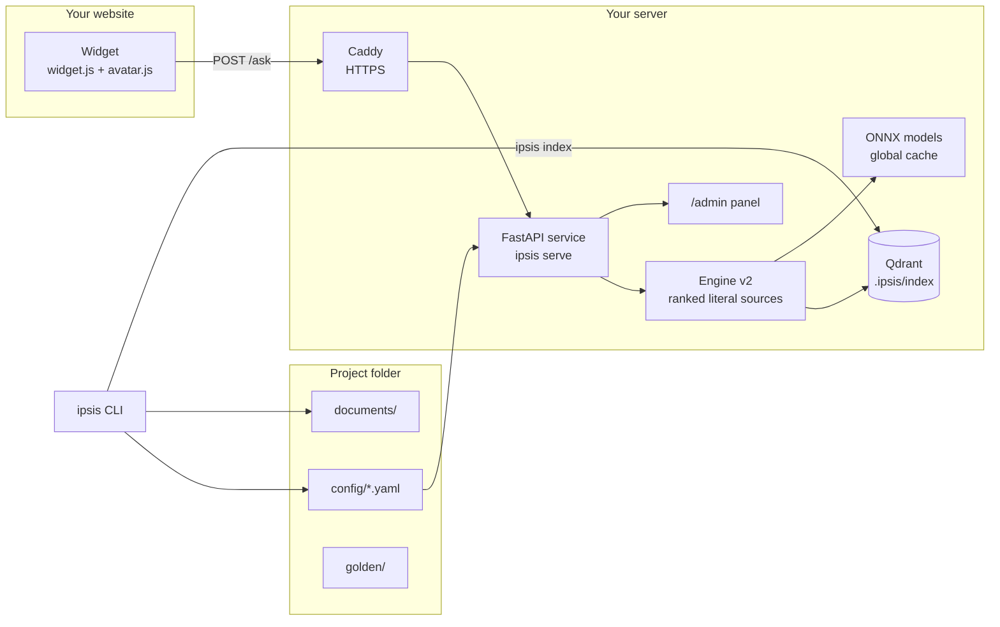
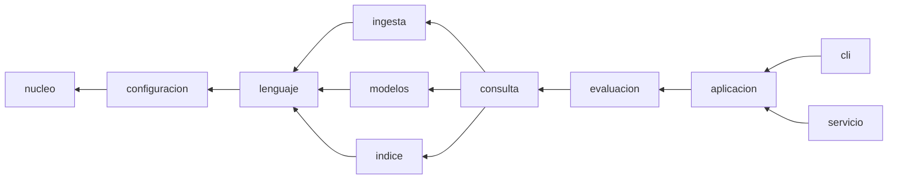
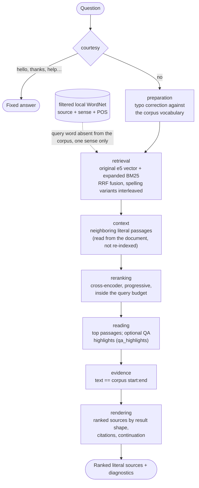
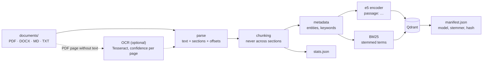
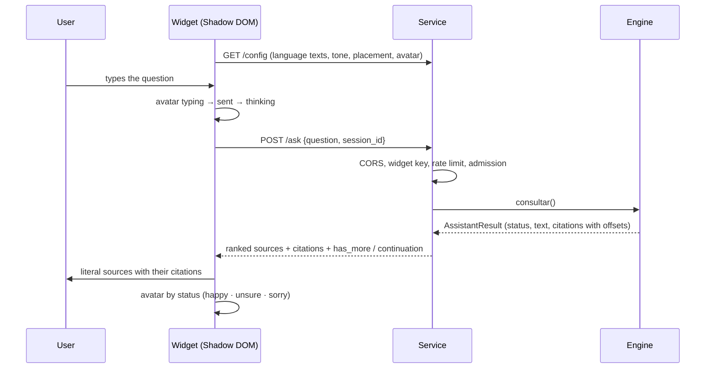
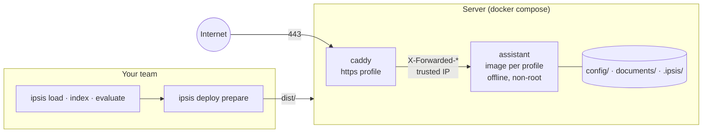

# Architecture

How ipsis is organized, what each module does and how a question travels
from the widget to a cited answer. The techniques in detail are in the
[methodology notes](methodology/README.md); the decisions in the
[ADRs](decisions/).

Three criteria guide the structure:

- **Minimal:** each folder groups one responsibility; there are no loose
  files in `ipsis/`.
- **Understandable:** a folder's name says what is inside and dependencies
  go in one direction only.
- **Auditable:** every decision can be rebuilt from readable files, and a
  test (`tests/test_arquitectura.py`) enforces the dependency rules.

The source code (modules, functions and internal data) is written in
Spanish, the language the project started in. Everything a user sees is in
English, with Spanish as the second language: commands and messages
(`IPSIS_LANG=es`), project files, the HTTP API, the widget and the admin
panel. The translation between the two happens at the edges
(`ipsis/configuracion/glosario.py`, `ipsis/recursos/mensajes/` and the API
models).

## 1. Overview

- **No network at run time:** models are downloaded once to the global
  cache (`IPSIS_MODELS_DIR`) and the service runs with `HF_HUB_OFFLINE=1`.
- **No generative model:** the text that answers is always a literal span of
  `documents/`; what is added around it comes from fixed templates (tones).

## 2. Layers of `ipsis/`

Rules, checked by `tests/test_arquitectura.py`:

- a module only imports from its own layer or the ones below;
- `nucleo`, `configuracion` and `lenguaje` do not load `onnxruntime`,
  `qdrant_client` or `fastapi` when imported;
- `cli` and `servicio` only import `aplicacion`, `nucleo` and `recursos`:
  the logic lives in the use cases, shared by the terminal and the API.

## 3. Modules

### `nucleo/` — contracts

| Module | What it does |
|---|---|
| `contratos.py` | Protocols of the swappable components: parser, chunker, dense and sparse encoders, retriever, fusion, reranker, verifier and the query engine |
| `esquemas.py` | Strict Pydantic schemas crossing boundaries: `ChunkRecord`, `RetrievalCandidate`, `LecturaQA`, `EvidenceSpan`, `AssistantResult`, diagnostics |
| `registro.py` | Registry of factories by type and name |

### `configuracion/` — project files

| Module | What it does |
|---|---|
| `esquemas.py` | Schemas of `assistant.yaml` and `engine.yaml`, with `config_version` migrations up to 8 |
| `glosario.py` | English names on disk ↔ internal names, for every project file |
| `archivos.py` | Reads and writes project YAML through the glossary (atomic writes) |
| `carga.py` | Loads and validates the configuration; copies the templates on `ipsis init` |
| `migraciones.py` | Migrates older projects (folders, files and Spanish keys) |
| `perfiles.py` | Profiles `light`, `medium` and `bm25` (models, budget, retrieval mode, per-language rerankers); merge profile ← `engine.yaml` |
| `personalidad.py` | `personality.yaml`: tone, avatar and the event catalog |
| `rutas.py` | Relative paths of a project |

### `lenguaje/` — everything that depends on the language

| Module | What it does |
|---|---|
| `paquete.py` | Language packs (`es`, `en`, `pt`) and the universal fallback |
| `texto.py` | `terminos()` (the only path from text to terms) and `dividir_oraciones()` |
| `lexico.py` | BM25, TF-IDF, MMR and the signals `s_oov`, focus, `s_foco`, `s_cov`, `s_lex` |
| `consultas.py` | Query understanding: intention and relation words, cues, synonyms, generic words, derived nouns |
| `intenciones.py` | Similarity fallback: cached examples, cosine and margin between intentions |
| `respuestas.py` | Literal QA boundary completion: quantities with units and limits, actors with their current action |
| `sinonimos.py` | Packaged WordNet stem index, OOV expansion for BM25, project phrase equivalences and lexical provenance hash |
| `entidades.py` | Universal and pack entities (dates, amounts, deadlines, references) |
| `dominio.py` | Your own domain rules (`domain.yaml`) |
| `tonos.py` | Answer tones, their linter and neutrality |

### `ingesta/` — from files to fragments

| Module | What it does |
|---|---|
| `catalogo.py` | `documents/catalog.yaml`: what is loaded and active |
| `parsear.py` | PDF, DOCX, Markdown and TXT to text with structure and offsets |
| `ocr.py` | Optional OCR of PDF pages without text (Tesseract), with cache and confidence per page |
| `chunking.py` | Fixed-size strategies (`CH-F256`, and `CH-F256S`, which never crosses sections); new projects use the structural preparation instead (`preparacion.py`, `unidades.py`, [ADR 0009](decisions/0009-structural-preparation-by-default.md)) |
| `metadata.py` | Entities, TF-IDF keywords and a deterministic category |
| `ingesta.py` | The full `ipsis index` sequence |

### `modelos/` — ONNX on CPU

| Module | What it does |
|---|---|
| `onnx.py` | `ModeloOnnx`: shared session and tokenizer (Template Method) |
| `denso.py` | e5 encoder with prefixes and pooling |
| `reranker.py` | Cross-encoder: one logit per (question, passage) pair |
| `lector.py` | QA reader: a literal span or "no answer" |
| `catalogo.py`, `descarga.py`, `verificacion.py`, `exportacion.py` | Which models exist, offline cache, minimal check and export (development) |

### `indice/` — Qdrant and what describes it

| Module | What it does |
|---|---|
| `qdrant.py` | Dense + sparse BM25 collection, indexing and hybrid search with RRF |
| `estadisticas.py` | `stats.json`: df, N and mean length for the signals |
| `manifiesto.py` | What the index was built with (model, stemmer, corpus hash) |
| `payload.py` | Qdrant payload ↔ `ChunkRecord` |

### `consulta/` — the engine

| Module | What it does |
|---|---|
| `v2/` | The engine: `motor.py` runs the stages and times them; `forma.py`, `resultados.py`, `paginacion.py` and `reranking.py` shape, publish and page the ranked sources |
| `recuperador.py` | The Qdrant retriever (dense + BM25 with RRF) |
| `plantillas.py` | Loads the fixed texts: tone, connectors and conversational answers |
| `salida.py` | Builds the result and the HTTP contract of an answer |
| `media.py` | The media lane (video and audio records) |
| `seguimiento.py` | Conversation memory: topics per session, follow-ups, expiry ([ADR 0006](decisions/0006-conversation-memory.md)). Not wired to v2 yet: base of the conversation plan |
| `admision.py` | Limit of concurrent queries (503 when saturated) |
| `variantes.py` | Picks the tone variant by session and turn |

### `evaluacion/` — measuring (pure functions)

| Module | What it does |
|---|---|
| `banco.py` | The versioned bank format |
| `golden.py` | CSV, JSONL and SQuAD 2.0 ↔ bank; question template |
| `metricas.py` | Coverage, false `ok`, Clopper-Pearson risk, latencies |
| `benchmark.py`, `comparacion.py` | Per-profile reports and comparison |

### `aplicacion/` — use cases

One per area, shared by the CLI and the API: `proyecto`, `corpus`,
`consulta`, `modelos`, `golden`, `evaluacion`, `benchmark`, `diagnostico`
(`ipsis doctor` and `/ready`), `registro` (queries and `ipsis audit`),
`personalidad`, `avatar`, `widget`, `estilos`, `modo` (development or
production), `despliegue` and `publico` (public ↔ internal names).
`registro_base.py` registers the default implementations.

### `cli/` and `servicio/` — presentation

| Module | What it does |
|---|---|
| `cli/base.py`, `cli/comandos/*` | One command per class (Command pattern), grouped as in `ipsis --help`; texts from the message catalog |
| `cli/menu.py`, `cli/comandos/chat.py` | `ipsis` alone (or `ipsis help`): the commands grouped by task with examples; `ipsis chat`: the interactive mode, questions to one engine loaded once and `/commands` dispatched to the same CLI |
| `servicio/api.py` | FastAPI: `/ask`, `/config`, `/ready`, static files, CORS, cache and errors; translates the engine contract to the public one |
| `servicio/admin.py` | `/admin` (API with a token) and `/admin/panel`: personality and styles, and also status, document upload and reindexing (`aplicacion/panel.py`); a reload replaces the engine in the background (`servicio/api.py::recargar_motor`) |
| `servicio/seguridad.py` | Rate limit and widget keys |
| `servicio/estaticos/` | `widget.js`, `avatar.js` (the bundled avatar engine) and the panel |

### `recursos/` — data shipped in the package

`plantillas/` (what `ipsis init` copies), `mensajes/` (the en/es message
catalog), `idiomas/`, `tonos/<language>/`, `perfiles/`, `avatares/` (Folio)
and `despliegue/` (templates of `ipsis deploy prepare`).

## 4. Life of a question

| Stage | light | medium |
|---|:-:|:-:|
| courtesy, preparation (typo correction), retrieval, context | ✓ | ✓ |
| reranking | — | ✓ (cross-encoder; the language's own reranker for `es`/`pt`) |
| reading | ✓ (publishes passages) | ✓ (publishes passages; QA highlights if enabled) |
| evidence, rendering | ✓ | ✓ |

v2 does not decide whether a question "has an answer": it publishes the
ranked literal sources for a person to review, with their citations, and says
`no_answer` only when nothing is recovered. It keeps no state between
questions apart from the continuation cursors of "keep searching". The
conversation memory (follow-ups such as "and abroad?") is not part of v2
yet: the code that implemented it (`consulta/seguimiento.py`) is kept as the
base of the plan in [docs/plan](plan/README.md). The stages in detail:
[engine map](methodology/motor-v2.md) and
[ranked sources](methodology/fuentes-v2.md).

The former `heavy` profile was removed on 2026-10-08 (ADR 0003), and the v1
engine (answer cascade, calibration and abstention alternatives) in October 2026. See
[general regression](../herramientas/evaluacion/README.md) for reproducible
measurements and alternative-model comparisons.

### Understanding the question

Two small, model-free pieces prepare the question, with the language pack's
rules (`ipsis/recursos/idiomas/<language>.yaml`) and the corpus statistics.
Nothing is generated and the question the user wrote is the one that is
searched:

| | What it looks for | Example | What changes afterwards |
|---|---|---|---|
| **Typos** | A word that is not in the corpus vocabulary and is one edit away from one that is | "pasword" → "password" | The corrected question is searched as another variant; the original is kept |
| **Synonyms** | A question word missing from the corpus whose synonym is in it | "necesita" → "requieren" | The synonym is added to the BM25 query; the dense vector is the original's |

The rationale is in [ADR 0005](decisions/0005-deterministic-query-understanding.md);
the lexical resources in [lexical](methodology/lexical.md).

## 5. Ingestion

`ipsis index` rebuilds everything. `ipsis doctor` compares the manifest with
the profile and the language, and a fingerprint of the documents with the
indexed one, to tell when reindexing is needed.

## 6. Service and widget

| Route | What for |
|---|---|
| `POST /ask` | The question |
| `GET /config` | What the widget needs: language texts, tone microcopy, styles, placement and avatar |
| `GET /widget.js`, `/avatar.js`, `/styles.css`, `/avatars/*.avatar.json` | Static files (long cache in production) |
| `GET /health` · `GET /ready` | Alive · ready, with the project diagnosis (503 when something blocks) |
| `/admin/*`, `/admin/panel` | Personality, styles, status, documents and reindexing over HTTP, with a token and HTTPS |
| `GET /source` | Source code (AGPL §13) |

## 7. Deployment

Step by step in the [deployment guide](guide/deployment.md).

## 8. Auditing

| The auditor's question | Where it is answered |
|---|---|
| What was the index built with? | `.ipsis/index/*.manifest.json`: model, stemmer, corpus hash, payload version |
| Why does this term weigh so much? | `.ipsis/index/*.stats.json`: df, N, mean length |
| Why did this question show these sources? | `ipsis ask --diagnostics` or the query log: stages, candidates and rule |
| Is the answer literal? | `ipsis audit`: checks every logged piece of evidence against the corpus |
| Who changed the personality? | `.ipsis/logs/admin.jsonl`: date, IP, action and keys (never the token) |

## 9. Design patterns

| Pattern | Where | What for |
|---|---|---|
| Strategy + Protocol | `nucleo/contratos.py` | Swappable components |
| Registry / Factory | `nucleo/registro.py`, `aplicacion/registro_base.py` | Build components by name; heavy imports live inside the factory |
| Pipeline | `consulta/v2/motor.py` | The engine runs the stages in order and times each one |
| Template Method | `modelos/onnx.py` | What the three ONNX models share |
| Adapter | `indice/qdrant.py`, `modelos/*` | Isolate Qdrant and onnxruntime |
| Command | `cli/comandos/*` | One command, one class |
| Facade (use cases) | `aplicacion/*` | CLI and API share the logic |
| Layered configuration | `configuracion/perfiles.py` | profile ← `engine.yaml` |
| Value objects | `nucleo/esquemas.py` | Every piece of data crossing a boundary is strict Pydantic |
| Glossary at the edges | `configuracion/glosario.py`, `recursos/mensajes/` | English for users, internal names for the code |
