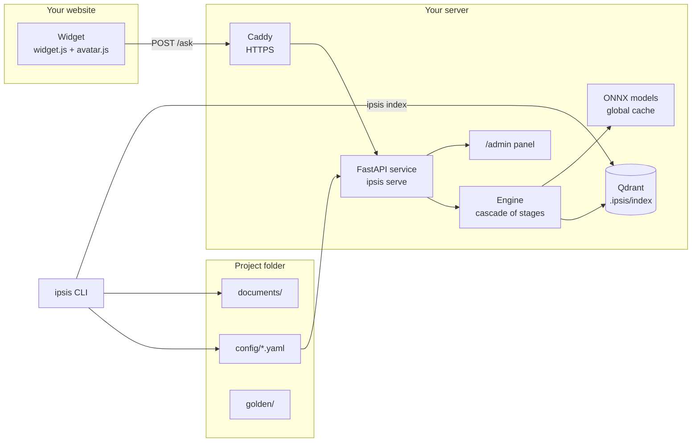
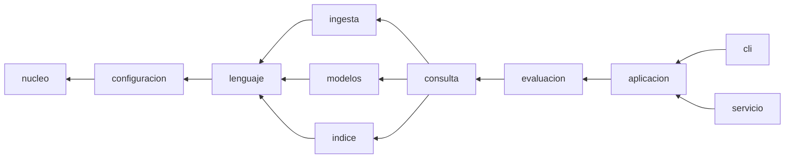
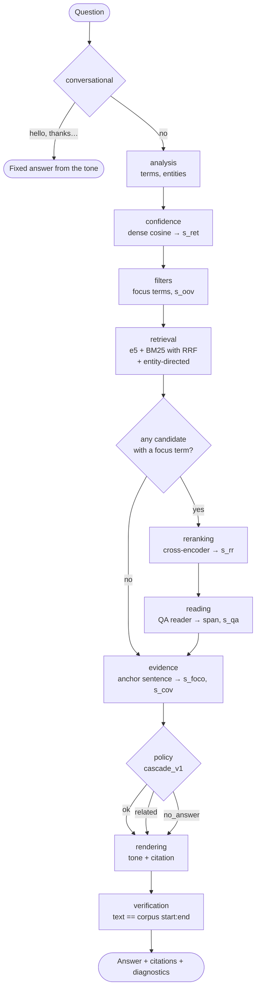
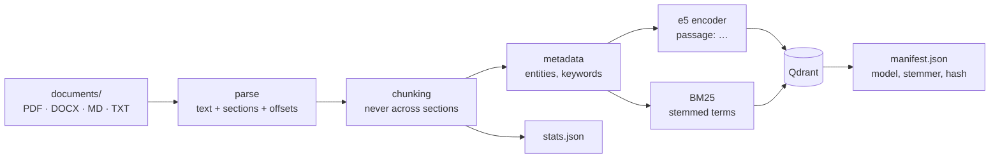
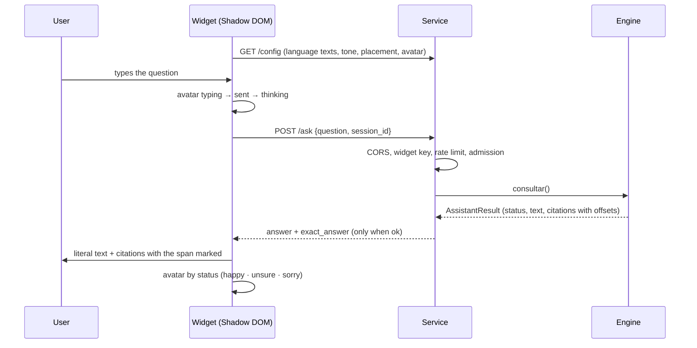

# Architecture

How ipsis is organized, what each module does and how a question travels
from the widget to a cited answer. The techniques in detail are in the
[methodology notes](methodology/README.md); the decisions in the
[ADRs](decisions/).

Three criteria guide the structure:

- **Minimal:** each folder groups one responsibility; there are no loose
  files in `ipsis/`.
- **Understandable:** a folder's name says what is inside and dependencies
  go in one direction only.
- **Auditable:** every decision can be rebuilt from readable files, and a
  test (`tests/test_arquitectura.py`) enforces the dependency rules.

The source code (modules, functions and internal data) is written in
Spanish, the language the project started in. Everything a user sees is in
English, with Spanish as the second language: commands and messages
(`IPSIS_LANG=es`), project files, the HTTP API, the widget and the admin
panel. The translation between the two happens at the edges
(`ipsis/configuracion/glosario.py`, `ipsis/recursos/mensajes/` and the API
models).

## 1. Overview

- **No network at run time:** models are downloaded once to the global
  cache (`IPSIS_MODELS_DIR`) and the service runs with `HF_HUB_OFFLINE=1`.
- **No generative model:** the text that answers is always a literal span of
  `documents/`; what is added around it comes from fixed templates (tones).

## 2. Layers of `ipsis/`

Rules, checked by `tests/test_arquitectura.py`:

- a module only imports from its own layer or the ones below;
- `nucleo`, `configuracion` and `lenguaje` do not load `onnxruntime`,
  `qdrant_client` or `fastapi` when imported;
- `cli` and `servicio` only import `aplicacion`, `nucleo` and `recursos`:
  the logic lives in the use cases, shared by the terminal and the API.

## 3. Modules

### `nucleo/` — contracts

| Module | What it does |
|---|---|
| `contratos.py` | Protocols of the swappable components: parser, chunker, dense and sparse encoders, retriever, fusion, reranker, abstention policy, verifier, renderer and `Etapa` (stage) |
| `esquemas.py` | Strict Pydantic schemas crossing boundaries: `ChunkRecord`, `RetrievalCandidate`, `LecturaQA`, `EvidenceSpan`, `AssistantResult`, diagnostics |
| `registro.py` | Registry of factories by type and name |

### `configuracion/` — project files

| Module | What it does |
|---|---|
| `esquemas.py` | Schemas of `assistant.yaml` and `engine.yaml`, with `config_version` migrations up to 5 |
| `glosario.py` | English names on disk ↔ internal names, for every project file |
| `archivos.py` | Reads and writes project YAML through the glossary (atomic writes) |
| `carga.py` | Loads and validates the configuration; copies the templates on `ipsis init` |
| `migraciones.py` | Migrates older projects (folders, files and Spanish keys) |
| `perfiles.py` | Profiles `light`, `medium`, `heavy` and `bm25`; merge profile ← `engine.yaml` ← calibration |
| `calibracion.py` | `calibration.yaml` and when it applies (provenance) |
| `personalidad.py` | `personality.yaml`: tone, avatar and the event catalog |
| `rutas.py` | Relative paths of a project |

### `lenguaje/` — everything that depends on the language

| Module | What it does |
|---|---|
| `paquete.py` | Language packs (`es`, `en`, `pt`) and the universal fallback |
| `texto.py` | `terminos()` (the only path from text to terms) and `dividir_oraciones()` |
| `lexico.py` | BM25, TF-IDF, MMR and the signals `s_oov`, focus, `s_foco`, `s_cov`, `s_lex` |
| `entidades.py` | Universal and pack entities (dates, amounts, deadlines, references) |
| `dominio.py` | Your own domain rules (`domain.yaml`) |
| `tonos.py` | Answer tones, their linter and neutrality |

### `ingesta/` — from files to fragments

| Module | What it does |
|---|---|
| `catalogo.py` | `documents/catalog.yaml`: what is loaded and active |
| `parsear.py` | PDF with text, DOCX, Markdown and TXT to text with structure and offsets |
| `chunking.py` | Fragments that never cross sections (`CH-F256` by default) |
| `metadata.py` | Entities, TF-IDF keywords and a deterministic category |
| `ingesta.py` | The full `ipsis index` sequence |

### `modelos/` — ONNX on CPU

| Module | What it does |
|---|---|
| `onnx.py` | `ModeloOnnx`: shared session and tokenizer (Template Method) |
| `denso.py` | e5 encoder with prefixes and pooling |
| `reranker.py` | Cross-encoder: one logit per (question, passage) pair |
| `lector.py` | QA reader: a literal span or "no answer" |
| `catalogo.py`, `descarga.py`, `verificacion.py`, `exportacion.py` | Which models exist, offline cache, minimal check and export (development) |

### `indice/` — Qdrant and what describes it

| Module | What it does |
|---|---|
| `qdrant.py` | Dense + sparse BM25 collection, indexing and hybrid search with RRF |
| `estadisticas.py` | `stats.json`: df, N and mean length for the signals |
| `manifiesto.py` | What the index was built with (model, stemmer, corpus hash) |
| `payload.py` | Qdrant payload ↔ `ChunkRecord` |

### `consulta/` — the engine

| Module | What it does |
|---|---|
| `motor.py` | Runs the profile's stages, times each one and builds the result |
| `contexto.py` | `ContextoConsulta`: what each stage reads and fills in |
| `admision.py` | Limit of concurrent queries (503 when saturated) |
| `variantes.py` | Picks the tone variant by session and turn |
| `etapas/` | One file per stage (see §4) |

### `evaluacion/` — measuring and calibrating (pure functions)

| Module | What it does |
|---|---|
| `banco.py` | The versioned bank format |
| `golden.py` | CSV, JSONL and SQuAD 2.0 ↔ bank; question template |
| `metricas.py` | Coverage, false `ok`, Clopper-Pearson risk, latencies |
| `calibracion.py` | Chooses thresholds on `dev` with risk ≤ α |
| `benchmark.py`, `comparacion.py` | Per-profile reports and comparison |

### `aplicacion/` — use cases

One per area, shared by the CLI and the API: `proyecto`, `corpus`,
`consulta`, `modelos`, `golden`, `evaluacion`, `benchmark`, `diagnostico`
(`ipsis doctor` and `/ready`), `registro` (queries and `ipsis audit`),
`personalidad`, `avatar`, `widget`, `estilos`, `modo` (development or
production), `despliegue` and `publico` (public ↔ internal names).
`registro_base.py` registers the default implementations.

### `cli/` and `servicio/` — presentation

| Module | What it does |
|---|---|
| `cli/base.py`, `cli/comandos/*` | One command per class (Command pattern), grouped as in `ipsis --help`; texts from the message catalog |
| `servicio/api.py` | FastAPI: `/ask`, `/config`, `/ready`, static files, CORS, cache and errors; translates the engine contract to the public one |
| `servicio/admin.py` | `/admin` (API with a token) and `/admin/panel` |
| `servicio/seguridad.py` | Rate limit and widget keys |
| `servicio/estaticos/` | `widget.js`, `avatar.js` (the bundled avatar engine) and the panel |

### `recursos/` — data shipped in the package

`plantillas/` (what `ipsis init` copies), `mensajes/` (the en/es message
catalog), `idiomas/`, `tonos/<language>/`, `perfiles/`, `avatares/` (Folio)
and `despliegue/` (templates of `ipsis deploy prepare`).

## 4. Life of a question

| Stage | light | medium | heavy |
|---|:-:|:-:|:-:|
| conversational, analysis, confidence, filters, retrieval | ✓ | ✓ | ✓ |
| reranking | — | ✓ (mmarco, k=4) | ✓ (bge-m3, k=8) |
| reading | — | ✓ (2 passages) | ✓ (4 passages + agreement) |
| evidence, policy, rendering, verification | ✓ | ✓ | ✓ |
| measured p95 (universal bank) | 85 ms | 815 ms | 2,130 ms |

Each stage receives the `ContextoConsulta`, fills it in and may close the
query. If no candidate contains a focus term, the reranker and the reader
are skipped (early exit). The rules in detail: [policy](methodology/policy.md).

## 5. Ingestion

`ipsis index` rebuilds everything. `ipsis doctor` compares the manifest with
the profile and the language, and a fingerprint of the documents with the
indexed one, to tell when reindexing is needed.

## 6. Service and widget

| Route | What for |
|---|---|
| `POST /ask` | The question |
| `GET /config` | What the widget needs: language texts, tone microcopy, styles, placement and avatar |
| `GET /widget.js`, `/avatar.js`, `/styles.css`, `/avatars/*.avatar.json` | Static files (long cache in production) |
| `GET /health` · `GET /ready` | Alive · ready, with the project diagnosis (503 when something blocks) |
| `/admin/*`, `/admin/panel` | Personality and styles over HTTP, with a token and HTTPS |
| `GET /source` | Source code (AGPL §13) |

## 7. Deployment

Step by step in the [deployment guide](guide/deployment.md).

## 8. Auditing

| The auditor's question | Where it is answered |
|---|---|
| What was the index built with? | `.ipsis/index/*.manifest.json`: model, stemmer, corpus hash, payload version |
| Why does this term weigh so much? | `.ipsis/index/*.stats.json`: df, N, mean length |
| Where do the thresholds come from? | `config/calibration.yaml`: bank, hashes, α and the `test` result |
| Why was this question `related`? | `ipsis ask --diagnostics` or the query log: stages, signals and rule |
| Is the answer literal? | `ipsis audit`: checks every logged piece of evidence against the corpus |
| Who changed the personality? | `.ipsis/logs/admin.jsonl`: date, IP, action and keys (never the token) |

## 9. Design patterns

| Pattern | Where | What for |
|---|---|---|
| Strategy + Protocol | `nucleo/contratos.py` | Swappable components |
| Registry / Factory | `nucleo/registro.py`, `aplicacion/registro_base.py` | Build components by name; heavy imports live inside the factory |
| Pipeline | `consulta/motor.py` + `etapas/` | The profile lists the stages; the engine runs and times them |
| Template Method | `modelos/onnx.py` | What the three ONNX models share |
| Adapter | `indice/qdrant.py`, `modelos/*` | Isolate Qdrant and onnxruntime |
| Command | `cli/comandos/*` | One command, one class |
| Facade (use cases) | `aplicacion/*` | CLI and API share the logic |
| Layered configuration | `configuracion/perfiles.py` | profile ← `engine.yaml` ← calibration |
| Value objects | `nucleo/esquemas.py` | Every piece of data crossing a boundary is strict Pydantic |
| Glossary at the edges | `configuracion/glosario.py`, `recursos/mensajes/` | English for users, internal names for the code |
