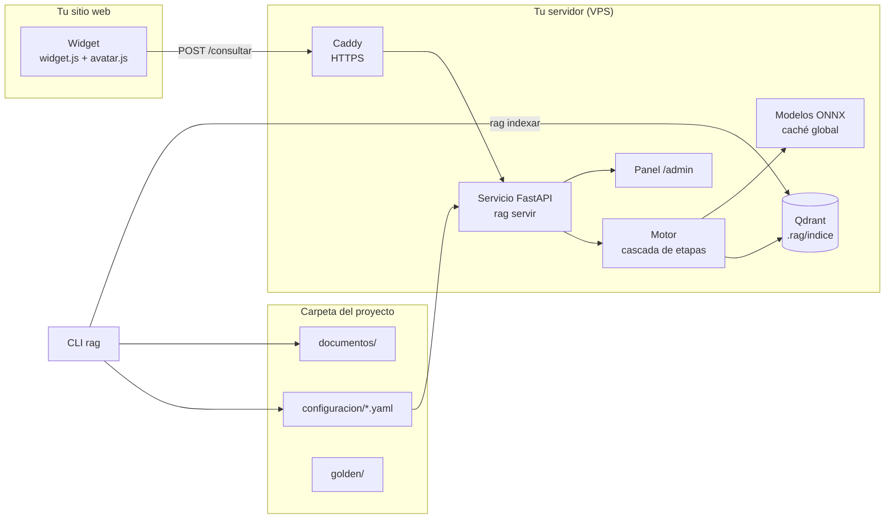
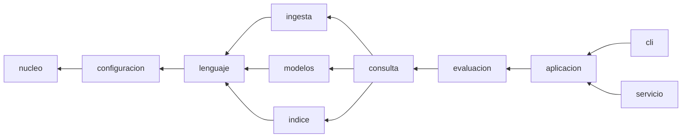
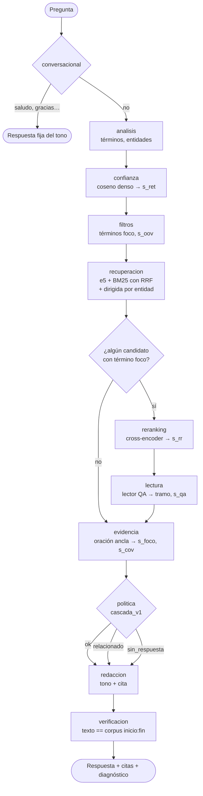
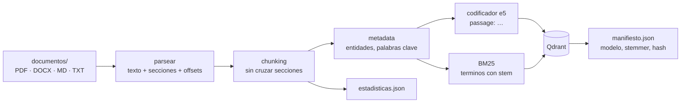
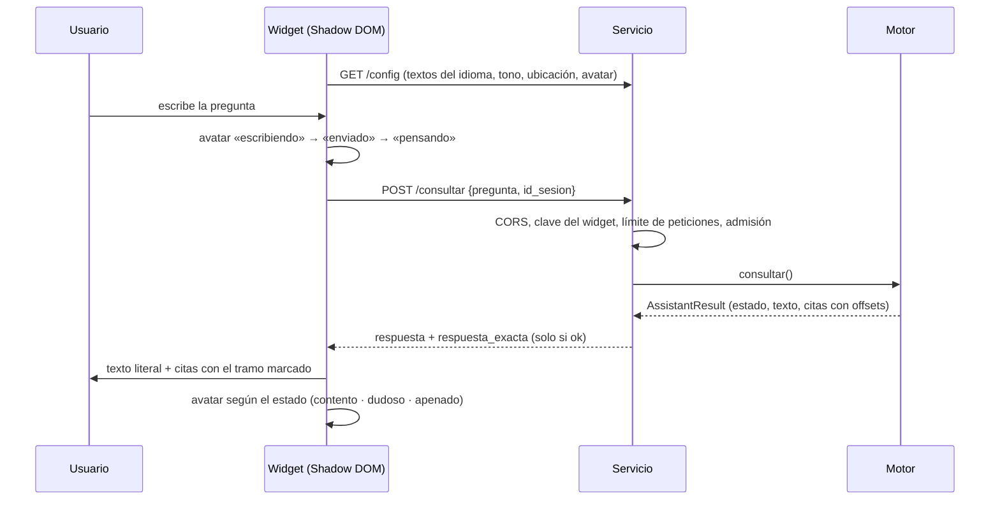
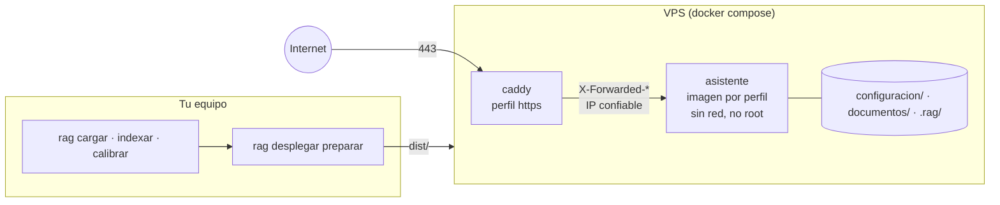

# Arquitectura

Cómo está organizado rag-extractivo, qué hace cada módulo y cómo viaja una
pregunta desde el widget hasta una respuesta citada. Las técnicas en detalle
están en las [fichas metodológicas](metodologia/README.md); las decisiones, en
los [ADR](decisiones/).

Tres criterios guían la estructura:

- **Mínima:** cada carpeta agrupa una responsabilidad; no hay archivos sueltos
  en `rag/`.
- **Entendible:** el nombre de la carpeta dice qué hay dentro y las
  dependencias van en una sola dirección.
- **Auditable:** toda decisión se puede reconstruir desde archivos legibles, y
  una prueba (`tests/test_arquitectura.py`) hace cumplir las reglas de
  dependencia.

## 1. Vista general

- **Sin red en ejecución:** los modelos se descargan una vez a la caché global
  (`RAG_MODELOS_DIR`) y el servicio corre con `HF_HUB_OFFLINE=1`.
- **Sin modelo generativo:** el texto que responde es siempre un tramo literal
  de `documentos/`; lo que se agrega alrededor son plantillas fijas (tonos).

## 2. Capas de `rag/`

Reglas, verificadas en cada CI:

- un módulo solo importa de su capa o de las anteriores;
- `nucleo`, `configuracion` y `lenguaje` no cargan `onnxruntime`,
  `qdrant_client` ni `fastapi` al importarse;
- `cli` y `servicio` solo importan `aplicacion`, `nucleo` y `recursos`: la
  lógica vive en los casos de uso, que comparten la terminal y la API.

## 3. Módulos

### `nucleo/` — contratos

| Módulo | Qué hace |
|---|---|
| `contratos.py` | Protocolos de los componentes intercambiables: parser, chunker, codificadores denso y disperso, retriever, fusión, reranker, política de abstención, verificador, redacción y `Etapa` |
| `esquemas.py` | Esquemas Pydantic estrictos que cruzan fronteras: `ChunkRecord`, `RetrievalCandidate`, `LecturaQA`, `EvidenceSpan`, `AssistantResult`, diagnóstico |
| `registro.py` | Registry de factories por tipo y nombre |

### `configuracion/` — archivos del proyecto

| Módulo | Qué hace |
|---|---|
| `esquemas.py` | Esquemas de `asistente.yaml` y `motor.yaml`, con migraciones de `config_version` hasta la 4 |
| `carga.py` | Carga y valida la configuración; copia las plantillas en `rag init` |
| `migraciones.py` | Migra la estructura de archivos de un proyecto anterior |
| `perfiles.py` | Perfiles `light`, `medium`, `heavy` y `bm25`; fusión perfil ← `motor.yaml` ← calibración |
| `calibracion.py` | `calibracion.yaml` y cuándo aplica (procedencia) |
| `personalidad.py` | `personalidad.yaml`: tono, avatar y catálogo de eventos |
| `rutas.py` | Rutas relativas del proyecto del cliente |

### `lenguaje/` — todo lo que depende del idioma

| Módulo | Qué hace |
|---|---|
| `paquete.py` | Paquetes de idioma (`es`, `en`, `pt`) y el respaldo universal |
| `texto.py` | `terminos()` (el único camino de texto a términos) y `dividir_oraciones()` |
| `lexico.py` | BM25, TF-IDF, MMR y las señales `s_oov`, foco, `s_foco`, `s_cov`, `s_lex` |
| `entidades.py` | Entidades universales y del paquete (fechas, montos, plazos, referencias) |
| `dominio.py` | Reglas propias del cliente (`dominio.yaml`) |
| `tonos.py` | Tonos de respuesta, su linter y la neutralidad |

### `ingesta/` — de archivos a fragmentos

| Módulo | Qué hace |
|---|---|
| `catalogo.py` | `documentos/catalogo.yaml`: qué está cargado y vigente |
| `parsear.py` | PDF con texto, DOCX, Markdown y TXT a texto con estructura y offsets |
| `chunking.py` | Fragmentos que no cruzan secciones (`CH-F256` por defecto) |
| `metadata.py` | Entidades, palabras clave TF-IDF y categoría determinista |
| `ingesta.py` | La secuencia completa de `rag indexar` |

### `modelos/` — ONNX en CPU

| Módulo | Qué hace |
|---|---|
| `onnx.py` | `ModeloOnnx`: sesión y tokenizador comunes (Template Method) |
| `denso.py` | Codificador e5 con prefijos y pooling |
| `reranker.py` | Cross-encoder: un logit por par (pregunta, pasaje) |
| `lector.py` | Lector QA: tramo literal o «sin respuesta» |
| `catalogo.py`, `descarga.py`, `verificacion.py`, `exportacion.py` | Qué modelos existen, caché sin red, prueba mínima y exportación (desarrollo) |

### `indice/` — Qdrant y lo que lo describe

| Módulo | Qué hace |
|---|---|
| `qdrant.py` | Colección densa + dispersa BM25, indexación y búsqueda híbrida con RRF |
| `estadisticas.py` | `estadisticas.json`: df, N y largo medio para las señales |
| `manifiesto.py` | Con qué se construyó el índice (modelo, stemmer, hash del corpus) |
| `payload.py` | Payload de Qdrant ↔ `ChunkRecord` |

### `consulta/` — el motor

| Módulo | Qué hace |
|---|---|
| `motor.py` | Recorre las etapas del perfil, mide cada una y arma el resultado |
| `contexto.py` | `ContextoConsulta`: lo que cada etapa lee y completa |
| `admision.py` | Límite de consultas concurrentes (503 si se satura) |
| `variantes.py` | Elige la variante del tono por sesión y turno |
| `etapas/` | Un archivo por etapa (ver §4) |

### `evaluacion/` — medir y calibrar (funciones puras)

| Módulo | Qué hace |
|---|---|
| `banco.py` | Formato versionado de bancos |
| `golden.py` | CSV, JSONL y SQuAD 2.0 ↔ banco; plantilla de preguntas |
| `metricas.py` | Cobertura, falsos `ok`, riesgo con Clopper-Pearson, latencias |
| `calibracion.py` | Elige umbrales en `dev` con riesgo ≤ α |
| `benchmark.py`, `comparacion.py` | Reportes por perfil y comparación de artefactos |

### `aplicacion/` — casos de uso

Uno por área, compartidos por la CLI y la API: `proyecto`, `corpus`,
`consulta`, `modelos`, `golden`, `evaluacion`, `benchmark`, `diagnostico`
(`rag doctor` y `/ready`), `registro` (consultas y `rag auditar`),
`personalidad`, `avatar`, `widget`, `estilos`, `modo` (desarrollo o
producción) y `despliegue`. `registro_base.py` registra las
implementaciones por defecto.

### `cli/` y `servicio/` — presentación

| Módulo | Qué hace |
|---|---|
| `cli/base.py`, `cli/comandos/*` | Un comando por clase (patrón Command), agrupados como en `rag --help` |
| `servicio/api.py` | FastAPI: `/consultar`, `/config`, `/ready`, estáticos, CORS, caché y errores |
| `servicio/admin.py` | `/admin` (API con token) y `/admin/panel` |
| `servicio/seguridad.py` | Límite de peticiones y claves del widget |
| `servicio/estaticos/` | `widget.js`, `avatar.js` (motor del avatar empaquetado) y el panel |

### `recursos/` — datos que viajan en el paquete

`plantillas/` (lo que copia `rag init`), `idiomas/`, `tonos/<idioma>/`,
`perfiles/`, `avatares/` (Folio) y `despliegue/` (plantillas de
`rag desplegar preparar`).

## 4. Flujo de una consulta

| Etapa | light | medium | heavy |
|---|:-:|:-:|:-:|
| conversacional, analisis, confianza, filtros, recuperacion | ✓ | ✓ | ✓ |
| reranking | — | ✓ (mmarco, k=4) | ✓ (bge-m3, k=8) |
| lectura | — | ✓ (2 pasajes) | ✓ (4 pasajes + concordancia) |
| evidencia, politica, redaccion, verificacion | ✓ | ✓ | ✓ |
| p95 medido (banco universal) | 85 ms | 815 ms | 2.130 ms |

Cada etapa recibe el `ContextoConsulta`, lo completa y puede cerrar la
consulta. Si ningún candidato contiene un término foco, se saltan reranker y
lector (salida temprana). Detalle de las reglas: [política](metodologia/politica.md).

## 5. Ingesta

`rag indexar` reconstruye todo. `rag doctor` compara el manifiesto con el
perfil y el idioma, y una huella de los documentos con la indexada, para
decir cuándo hay que reindexar.

## 6. Servicio y widget

| Ruta | Para qué |
|---|---|
| `POST /consultar` | La consulta |
| `GET /config` | Lo que el widget necesita: textos del idioma, microcopia del tono, estilos, ubicación y avatar |
| `GET /widget.js`, `/avatar.js`, `/estilos.css`, `/avatares/*.avatar.json` | Estáticos (caché larga en producción) |
| `GET /health` · `GET /ready` | Vivo · listo, con el diagnóstico del proyecto (503 si algo bloquea) |
| `/admin/*`, `/admin/panel` | Personalidad y estilos por HTTP, con token y HTTPS |
| `GET /fuente` | Código fuente (AGPL §13) |

## 7. Despliegue

Paso a paso en la [guía de despliegue](guia/despliegue.md).

## 8. Auditoría

| Pregunta del auditor | Dónde se responde |
|---|---|
| ¿Con qué se construyó el índice? | `.rag/indice/*.manifiesto.json`: modelo, stemmer, hash del corpus, versión del payload |
| ¿Por qué pesa tanto este término? | `.rag/indice/estadisticas.json`: df, N, largo medio |
| ¿De dónde salen los umbrales? | `configuracion/calibracion.yaml`: banco, hashes, α y resultado en `test` |
| ¿Por qué esta consulta dio `relacionado`? | `rag preguntar --diagnostico` o el registro: etapas, señales y regla |
| ¿La respuesta es literal? | `rag auditar`: comprueba cada evidencia del registro contra el corpus |
| ¿Quién cambió la personalidad? | `.rag/registros/admin.jsonl`: fecha, IP, acción y claves (nunca el token) |

## 9. Patrones de diseño

| Patrón | Dónde | Para qué |
|---|---|---|
| Strategy + Protocol | `nucleo/contratos.py` | Componentes intercambiables |
| Registry / Factory | `nucleo/registro.py`, `aplicacion/registro_base.py` | Construir componentes por nombre; los imports pesados viven dentro de la factory |
| Pipeline | `consulta/motor.py` + `etapas/` | El perfil lista las etapas; el motor las recorre y las mide |
| Template Method | `modelos/onnx.py` | Lo común de los tres modelos ONNX |
| Adapter | `indice/qdrant.py`, `modelos/*` | Aíslan Qdrant y onnxruntime |
| Command | `cli/comandos/*` | Un comando, una clase |
| Facade (casos de uso) | `aplicacion/*` | CLI y API comparten la lógica |
| Configuración por capas | `configuracion/perfiles.py` | perfil ← `motor.yaml` ← calibración |
| Value objects | `nucleo/esquemas.py` | Todo dato que cruza una frontera es Pydantic estricto |
