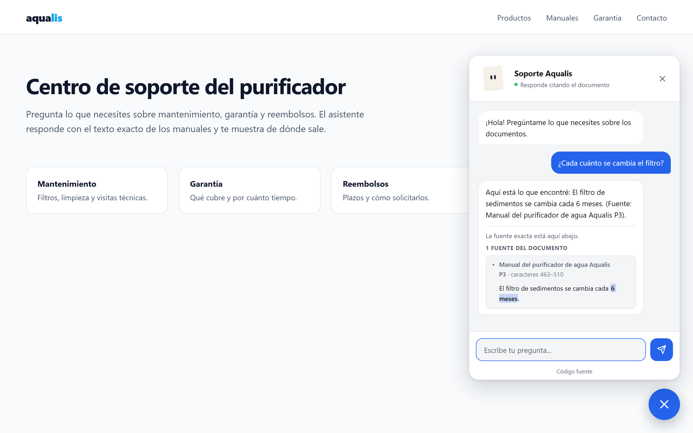

# Widget en tu sitio web

La integración tiene dos partes:
- el **servicio**, que corre en tu servidor o VPS (ver
  [despliegue.md](despliegue.md));
- el **widget**, un solo archivo `widget.js` sin dependencias que el
  servicio publica en `/widget.js`.



## Insertarlo

La forma más simple: pide el código ya armado y pégalo antes de `</body>`.

```bash
ipsis widget snippet --api https://asistente.tu-dominio.cl
ipsis widget snippet --api https://asistente.tu-dominio.cl --componente   # como Web Component
```

Con la etiqueta `<script>`:

```html
<script src="https://asistente.tu-dominio.cl/widget.js"
        data-api="https://asistente.tu-dominio.cl"
        data-posicion="abajo-derecha" data-tamano="normal" data-lanzador="burbuja"
        defer></script>
```

O como Web Component:

```html
<ipsis-chat api="https://asistente.tu-dominio.cl" posicion="abajo-izquierda"></ipsis-chat>
<script src="https://asistente.tu-dominio.cl/widget.js" defer></script>
```

Agrega el origen exacto de tu sitio a CORS
(`ipsis configurar cors_origenes=https://www.tu-sitio.cl`). Si usas claves de
widget (`data-widget-key`), recuerda que son públicas: identifican y limitan
el tráfico, no son un secreto.

## Ubicación, tamaño y lanzador

Se configuran en `configuracion/estilos.yaml` (sección `ubicacion`) o con
atributos en la etiqueta. **Si el sitio declara un atributo, ese manda.**

| Opción | Atributo (`data-` en el `<script>`) | Valores |
|---|---|---|
| Posición | `posicion` | `abajo-derecha` (por defecto), `abajo-izquierda`, `arriba-derecha`, `arriba-izquierda`, `incrustado` |
| Distancia al borde | `desplazamiento-x`, `desplazamiento-y` | píxeles (24 por defecto) |
| Capa | `z-index` | entero (2147483000 por defecto) |
| Tamaño del panel | `tamano` | `compacto` (340×520), `normal` (390×600), `amplio` (440×680) |
| Lanzador | `lanzador` | `burbuja` (botón redondo), `pestana` (botón con el nombre), `oculto` |

**Incrustado.** El chat vive dentro de un contenedor de tu página, siempre
abierto, sin botón ni ventana flotante. El contenedor decide el alto:

```html
<div style="height:560px">
  <ipsis-chat api="https://asistente.tu-dominio.cl" modo="incrustado"></ipsis-chat>
</div>
<script src="https://asistente.tu-dominio.cl/widget.js" defer></script>
```

**Lanzador oculto.** Tu sitio abre el chat con su propio botón:

```html
<button onclick="window.RagChat.abrir()">¿Dudas? Pregunta al manual</button>
```

## API JavaScript del sitio

Se supone un widget por página.

| Llamada | Qué hace |
|---|---|
| `window.RagChat.abrir()` | Abre el panel |
| `window.RagChat.cerrar()` | Lo cierra |
| `window.RagChat.estado()` | `{abierto, posicion, tamano, lanzador, sesion}` |
| `window.RagChat.avatar.disparar(evento)` | Hace reaccionar al avatar con un evento de la tabla de [personalidad.md](personalidad.md#cómo-reacciona-el-avatar). Devuelve `false` si aún no hay avatar |
| `window.RagChat.avatar.estado()` | `{listo, persistente, transitorio, mirada}` |

Eventos que emite el elemento: `rag:abierto`, `rag:cerrado`, `rag:pregunta`,
`rag:respuesta`, `rag:error` y `rag:avatar`. Este último trae
`{estado: "listo", nombre}` cuando el avatar se montó, o
`{estado: "error", mensaje}` cuando no se pudo y quedó el ícono, y
`{estado: "evento", evento, clave}` en cada reacción.

## Avatar

Si `personalidad.yaml` tiene un avatar activo y válido, el widget lo muestra
en lugar del ícono:
- **Carga bajo demanda:** el motor (`/avatar.js`, 52 KB comprimido) se pide
  al abrir el panel por primera vez. Con `avatar.en_lanzador: true` se pide
  antes, cuando el navegador está ocioso, para mostrarlo en el botón.
- **Nunca rompe el chat:** si falla la red, la definición o la CSP, queda el
  ícono y se emite `rag:avatar` con el error.
- **Decorativo:** lleva `aria-hidden`; los estados ya tienen texto.

## Pantallas

- **Teléfono** (≤ 480 px de ancho, o apaisado bajo): hoja a pantalla
  completa.
  - Respeta los bordes seguros (`safe-area-inset`, con
    `viewport-fit=cover` en tu página).
  - Sigue el alto visible, así el teclado virtual no tapa el campo de
    texto.
- **Tablet** (481–1024 px): panel ajustado al espacio disponible.
- **Escritorio:** panel flotante en la esquina elegida.
- **Preferencias del sistema:** modo oscuro, `prefers-reduced-motion` (sin
  animaciones) y contraste alto (`forced-colors`).

## Citas

Toda respuesta con evidencia muestra, **debajo**, un bloque de citas para
comprobarla:
- una invitación a revisar la fuente (del tono activo);
- por cada cita: documento, sección y posición en caracteres, con el texto
  literal;
- el tramo exacto que respondió, resaltado.

`estilos.yaml::presentacion.citas` elige cómo se ven, nunca si se ven:
- `acordeon`: desplegables; la que tiene el tramo exacto viene abierta;
- `lista`: todas a la vista.

Los valores anteriores siguen funcionando: `abiertas` equivale a `lista`, y
`ocultas` ya no oculta nada (equivale a `acordeon`).

## Textos

- **Del tono activo** (ver [personalidad.md](personalidad.md)): la
  bienvenida, «buscando…», la invitación a las citas y los mensajes de error
  vienen de `/config` en 5 variantes, y el widget rota entre ellas.
- **Accesibilidad:** «buscando…» y los errores se anuncian a los lectores
  de pantalla con una región `aria-live`.
- **Seguridad:** ningún texto de la API se inserta como HTML; todo usa
  `textContent`.

## Estilo

Todo el aspecto vive en `configuracion/estilos.yaml` y se aplica sin
reiniciar el servicio:

- **Presets:** `ipsis widget tema listar` y `ipsis widget tema aplicar editorial`
  (`clasico`, `minimal`, `editorial`, `contraste`).
- **Cada valor:** `ipsis widget estilo mostrar` y, por ejemplo,
  `ipsis widget estilo cambiar colores.acento=#0ea5e9 forma.radio_panel=10px
  tipografia.familia="Inter, sans-serif"`. Secciones: `colores`,
  `colores_oscuro`, `tipografia`, `forma`, `sombras`, `animaciones`,
  `ubicacion` y `presentacion`.
- **Sin terminal:** el panel `/admin/panel`, pestaña Widget, «Estilo
  completo» (ver [personalidad.md](personalidad.md#panel-gráfico-adminpanel)).
- **Vista previa sin servicio:** `ipsis widget tema vista-previa`.

## CSP de tu sitio

Si tu sitio usa Content Security Policy, permite el dominio del asistente:

```text
script-src  'self' https://asistente.tu-dominio.cl;
connect-src 'self' https://asistente.tu-dominio.cl;
style-src   'self' https://asistente.tu-dominio.cl 'unsafe-inline';
```

- `style-src` permite la hoja `/estilos.css` y el estilo propio del widget,
  que vive aislado en su Shadow DOM.
- El avatar animado necesita además `'unsafe-eval'` en `script-src`,
  porque su librería valida la definición con ajv, que compila el esquema en
  el navegador. Sin eso, el widget muestra el ícono y el chat funciona igual.
- Si el widget se sirve desde otro dominio, el servicio debe permitir tu
  sitio en `cors_origenes`: el motor del avatar es un módulo ES y el
  navegador lo pide con CORS.

## Exportar archivos estáticos

```bash
ipsis widget exportar ./public/ipsis --api https://asistente.tu-dominio.cl --posicion abajo-izquierda
```

Genera, para servirlos desde otro servidor:
- `widget.js` y `snippet.html`;
- `avatar.js` y `avatar.js.LICENSE.txt` (el motor y sus licencias);
- `avatares/<nombre>.avatar.json`: el avatar activo, con los colores del
  proyecto. Si hay avatar, el snippet lleva `avatar-base="."`: el widget
  carga el motor y la definición desde esa carpeta, no desde el servicio.

## Ejemplos ejecutables

- `ejemplos/html`: página estática configurable desde `config.js`;
- `ejemplos/react`: proyecto Vite y adaptador de eventos para React;
- `ejemplos/wordpress`: plugin instalable con el shortcode
  `[ipsis]`.

Las pruebas de navegador (`pytest -m browser`) usan Chromium real y
verifican:
- teclado, foco y diálogo;
- cada posición en teléfono, tablet y escritorio, sin desbordes y con el
  campo visible con el teclado abierto;
- las citas con el tramo exacto marcado;
- la API `RagChat`.
