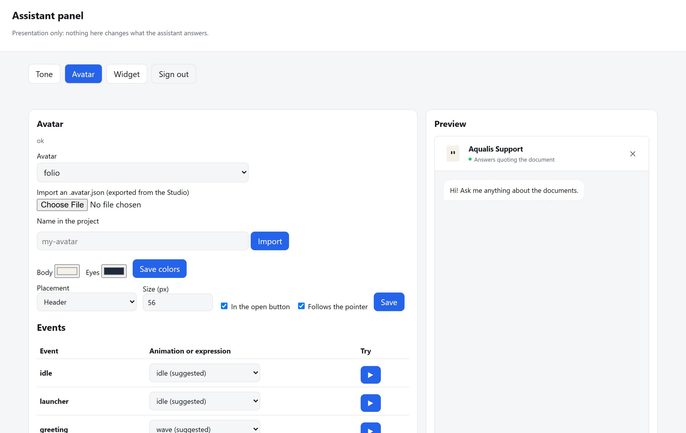

# Personality: answer tone and avatar

The **tone** decides how the assistant sounds around the text of your
documents. It never decides what it answers. The document text goes
literally and the citations go underneath, to check it. Changing the tone
does not change the status of any answer, and needs no reindexing.

## Configuration: `config/personality.yaml`

`ipsis init` creates it with comments. Edit it by hand or with
`ipsis personality …` (reference in [usage.md](usage.md)). Every change
from the terminal is fully validated before it is written; if it does not
pass, the file stays the same.

```bash
ipsis personality tone list                     # the 7 tones, with an example
ipsis personality tone apply formal
ipsis personality tone try --situation no_answer
ipsis personality validate                      # exits with 1 if something prevents the engine from starting
```

`tone.variety: fixed` always uses the first variant of each situation
(`rotating` is the default).

```yaml
config_version: 1
tone:
  active: cordial          # cordial | formal | serious | upbeat | friendly | empathetic | direct
  variety: rotating        # rotating | fixed
  templates: {}            # your own texts per situation
avatar:
  enabled: true
  definition: folio
  placement: message       # message (beside the assistant message) | header | top-corner | bottom-corner
  size: 56
  in_launcher: true
  gaze: {enabled: true, eye_range: 6, head_range: 8, dead_zone: 24}
  idle_minutes: 2
  colors: {}               # {body: "#rrggbb", eyes: "#rrggbb"}
  events: {}               # event → animation or expression
```

## Avatar

The widget shows an avatar made with
[@bible-strong/avatar-web](https://github.com/smontlouis/bible-strong-avatar-lab).
It is designed in the Studio ([avatars.bible-strong.app](https://avatars.bible-strong.app))
and exported as `.avatar.json`.

```bash
ipsis personality avatar import ./my-avatar.avatar.json --name my-avatar
ipsis personality avatar apply my-avatar
ipsis personality avatar events                  # event → animation (and fallbacks)
ipsis personality avatar assign thinking looking-up
ipsis personality avatar colors --body "#f5f1e8" --eyes "#1e293b"
```

- **On import** it checks: up to 256 KiB, JSON without duplicate keys,
  required fields, the `neutral` expression, keys in `lowercase-and-hyphens`
  format and `#rrggbb` colors. The library validates the rest when the
  avatar loads in the browser.
- **Every event** of the widget has a suggested key and a fallback. When
  the avatar lacks the key, the fallback chain is used, down to `neutral`.
  So any avatar works, even if it does not define every animation.
- **If the avatar is missing or invalid,** the widget shows the icon and
  `ipsis doctor` flags a warning: it never blocks the service.

### Folio, the default avatar

The sheet of the logo, alive: tilted, with the folded corner, two ink eyes
and two lines of text. It has no mouth: it expresses itself with the shape
and angle of its eyes, where they look and the turn of its head. It does
what the project does: it reads, looks at the citation before asserting and
never exaggerates.

- `happy` is sober: it first looks at the citations and only then lights up
  (eyes in an arc).
- `unsure` and `sorry` never show a gesture of success.
- At rest it glances to the sides and now and then rereads the page; it
  greets and says goodbye with a wink.
- Colors: paper `#f5f1e8` and ink `#1e293b`; change them with
  `ipsis personality avatar colors`. The engine draws the logo silhouette,
  beige outline, fold, and gray and blue lines. Themes can change these
  details with `--rw-folio-borde`, `--rw-folio-pliegue`,
  `--rw-folio-renglon` and `--rw-folio-resalte`.

Folio includes **23 animations**: `idle`, `wave`, `attentive`, `listening`,
`nod`, `thinking`, `thinking-long`, `happy`, `unsure`, `sorry`, `kind`,
`goodbye`, `worried`, `sleepy`, `wake-up`, `spin`, `flip`, `bounce`, `sway`,
`dance`, `float`, `paper-plane-out` and `paper-plane-in`.

Assign these whole-page movements to any event through the panel or CLI:

| Animation | Movement | Playback |
|---|---|---|
| `spin` | One complete 360° turn | Once |
| `flip` | Turns around the vertical axis, showing the back | Once |
| `bounce` | Two jumps with gentle squash and stretch | Once |
| `sway` | Rocks from side to side | Loop |
| `dance` | Sideways steps, small jumps and rocking | Loop |
| `float` | Floats gently up and down | Loop |
| `paper-plane-out` | Folds corners, body and wings, then flies away as a paper plane | Once |
| `paper-plane-in` | Flies in, lands and unfolds into the page | Once |

Their duration comes from the animation steps in the `.avatar.json`.
Pausing and resuming preserves motion progress. With the system's reduced
motion preference, the page does not rotate or move.
Flights last 3.2 seconds, with gentle folds and acceleration; the eyes follow
the transformation and remain on the wing during flight.
Wing outlines and folds are rounded. Each flight can depart or arrive from
either side, with a gentle curve and scale change. The trail animates small
gusts that drift and fade; pausing preserves the direction and gust progress.
They also respect this preference: Folio stays a page. Interrupting a
flight immediately restores the page.

It also includes **18 expressions**: `neutral`, `attentive`, `reading`,
`happy`, `kind`, `unsure`, `sorry`, `thinking`, `thinking-side`, `sleepy`,
`eyes-closed`, `surprised`, `worried`, `nod-down`, `look-left`, `look-right`,
`curious` and `wink`. An expression is a pose; an animation combines poses,
transitions and, when enabled, blinking.

This catalog belongs to Folio: you can import an `.avatar.json` with other
animations and expressions. The CLI checks that an assigned key exists
in the active avatar; the panel lists that avatar's keys in its selectors.

Permanent configuration lives in **`/admin/panel` → Avatar**: choose the
avatar, colors, size, placement, pointer tracking and the animation or
expression for each event, with a preview. Changes are saved in
`config/personality.yaml`. From the terminal:

```bash
ipsis personality avatar list
ipsis personality avatar events
ipsis personality avatar assign greeting wave
ipsis personality avatar assign thinking thinking-long
ipsis personality avatar assign answer_ok happy
ipsis personality avatar assign greeting spin
ipsis personality avatar assign answer_ok bounce
ipsis personality avatar assign sent paper-plane-out
ipsis personality avatar assign answer_ok paper-plane-in
ipsis personality avatar colors --body "#f5f1e8" --eyes "#1e293b"
ipsis personality validate
```

To try gestures and situations in the visualizer, from the repository root:
`python herramientas/avatar/visualizador.py` and open <http://127.0.0.1:8765/>.
The `herramientas/avatar/muestra.html` grid remains available with a static server.

### How the avatar reacts

With `events: {}`, Folio uses this default sequence. The panel and
`ipsis personality avatar events` show the same assignments; custom
assignments in `personality.yaml` take priority. Imported avatars keep
the standard map and its fallbacks.

| Situation | Folio animation |
|---|---|
| Closed widget and launcher | `float`: gentle floating |
| Every opening | `wake-up`: wakes up, then becomes attentive |
| Open, waiting | `attentive`: attentive eyes with continuous floating |
| Typing | `listening` |
| Sending a question | `paper-plane-out`: folds and departs with the question, then searches |
| Searching / more than 3 seconds | `thinking` / `thinking-long` |
| Answer found | `paper-plane-in`: returns with the citation and unfolds |
| Related answer | `unsure` |
| No answer in the documents | `sorry` |
| Conversation | `kind` |
| Network or service error | `worried` |
| Closing | `goodbye`, followed by floating |
| Inactivity | `sleepy`; the next activity plays `wake-up` |

In the chat sequence, the paper plane represents sending the question and returning with evidence.
Searching keeps `thinking`; opening and closing retain their greetings.
If an answer arrives during takeoff, it takes priority and starts landing
without delaying the response or waiting for the flight to finish.

While idle or attentive, Folio also reacts spontaneously: it looks around,
gets curious, reads or winks with a gentle sway. Gentle floating continues
between reactions and while tracking the pointer, preserving attentive eyes
and the motion's phase. It also uses the catalog's
greeting, nodding, listening, swaying, bouncing and floating sequences.
Occasionally it dances, spins, flips or departs and returns as a paper plane.
Loops play for one cycle; showier gestures are at least 45 seconds apart.
There are 16 reactions. Pauses between gestures vary
from 1.8 to 3.6 seconds, without repeating the same gesture consecutively.
Typing, searching, responses and pointer tracking take priority. Reactions
are suspended in hidden tabs and omitted with reduced motion; they do not
change the chat state or generate messages.

| Event | When | Kind |
|---|---|---|
| `idle` | panel closed | persistent |
| `attentive` | panel open, not typing | persistent |
| `typing` | while typing; back to `attentive` 1.2 s later | persistent |
| `thinking` · `thinking_long` | waiting for the answer; "long" after 3 s | persistent |
| `sleepy` | no activity for `avatar.idle_minutes` minutes | persistent |
| `greeting` · `farewell` | every opening · on closing | transient |
| `sent` | when the question is sent | transient |
| `answer_ok` · `answer_related` · `no_answer` · `conversational` | depending on the answer status | transient |
| `error` | network or service failure | transient |
| `wake_up` | first activity after `sleepy` | transient |

- A transient event plays once and returns to the current persistent one. A
  higher-priority one interrupts another: errors win over everything, and
  answers win over `sent`.
- **Gaze:** with `avatar.gaze.enabled`, the eyes and head follow the pointer
  at rest (`idle` or `attentive`). There is a dead zone in the center
  (`dead_zone`, in px) and it returns to the center after 1.5 s without
  movement. With the system's "reduce motion" it does not follow the
  pointer.
- A hidden tab pauses the animation.
- **Hover and typing (Folio):** hovering over it prompts a friendly gesture.
  It listens while you type and looks back at the draft after a 1.2-second
  pause. It locally recognizes question and exclamation marks, greetings,
  affection, joy, sadness, worry, sleepiness, doubt, agreement and reading.
  Vocabulary lives in `herramientas/avatar/reacciones-texto.json`, grouped
  by expression with word, phrase and emoticon lists. Add entries to the
  dictionary and rebuild the engine to extend it. Matching ignores case and
  accents, uses the latest signal and skips simple negations such as
  “no estoy triste”. Searches, responses and errors take
  priority. The visualizer includes a text field for trying this without
  sending queries; reduced motion omits these gestures.
- **Body, typing and deleting (Folio):** besides the eyes, the whole body follows the pointer: it leans and tilts a few
  pixels toward it and grows slightly when it comes close, then settles after 1.5 s of stillness. Each letter you type is
  a short nod, and while you write it leans toward the field. Deleting shakes its head; deleting five or more
  characters in a hurry startles it (`surprised`), and emptying a field that held at least four characters makes it
  wink and bounce, like "forget it". Motion comes from damped springs (`herramientas/avatar/vida-folio.js`) applied
  with the CSS `translate`, `rotate` and `scale` properties, so it composes with the internal float and flights. It
  only acts at rest, attentive or typing, and never with reduced motion.
- On a phone the avatar is 40 px and hides while the keyboard is open.

## Included tones

In English, Spanish and Portuguese:

| Tone | Character | Example for `no_answer` (en) |
|---|---|---|
| `cordial` (default) | kind and clear | "I couldn't find that information in the available documents." |
| `formal` | polite, careful, no exclamations | "Unfortunately, that information is not included in the available documents." |
| `serious` | sober, short sentences | "That information is not in the documents." |
| `upbeat` | enthusiastic, without exaggerating facts | "I searched thoroughly, but that is not in the documents! Try another question." |
| `friendly` | casual and close, still respectful | "Hmm, I can't find that in your documents." |
| `empathetic` | acknowledges what the person needs | "I'm sorry, that information is not in the available documents." |
| `direct` | blunt and imperative, never aggressive | "Not in the documents. Ask something else." |

Each tone brings 19 situations: 12 variants in the four the user sees in
almost every answer (`opening`, `addition`, `no_answer`, `related_intro`), 7
in the widget ones and 8 in the rest. That is 162 per tone and language,
3,402 in total, and every language has the same count per situation.

## Situations

| Situation | When it is used | Variables |
|---|---|---|
| `greeting`, `thanks`, `farewell`, `capability` | conversational answers | `{assistant_name}`, `{domain_description}` (thanks: only the second; farewell: none) |
| `opening` | before the document text | — |
| `addition`, `condition`, `exception` | between document fragments | — |
| `related_intro` | a related, not direct, answer | — |
| `related_check` | closes a related answer: asks whether the passage is what the user wanted and invites rephrasing | — |
| `missing_focus` | related, the main term is missing | `{term}` (required) |
| `no_answer` | it is not in the documents | — |
| `premise_not_found` | the question asked about something that does not exist | `{entity}` (required) |
| `needs_clarification` | the question does not say what it is about ("¿Cuánto es?", "Who approves it?" with no conversation) | — |
| `alternatives_intro` | not used since the v1 engine was retired (it introduced the similar passages of the removed proactive posture); the tone files still define it | — |
| `welcome`, `waiting`, `citations_hint`, `network_error`, `rate_limit_error`, `service_error` | widget texts | `welcome`: `{assistant_name}` |

## Variety and traceability

- Within a conversation, the variant is chosen by session, turn and
  situation, and it does not repeat in consecutive turns.
- The same session and turn always give the same text.
- Every variant used is recorded as a template id (for example
  `formal.opening.3`) in `ipsis ask --diagnostics` and in the query log.
  `ipsis audit` counts queries per tone.

## Your project's own texts

In `config/personality.yaml` you can replace any situations you like:

```yaml
tone:
  templates:
    no_answer:
    - That is not in the team handbook.
    - The handbook does not cover that question.
```

## Rules for every template

A linter checks them; the same rules apply to your overrides:

- Shape:
  - one line, up to 200 characters;
  - if it opens «¡» or «¿», it closes them.
- Forbidden content:
  - digits, because they would assert a fact that does not come from the
    document;
  - URLs, HTML, Markdown and emojis;
  - whole words in capitals.
- Variables: only those of its situation, without formatting.
- Connectors: those that introduce document text end with ":".
- Variety: the variants are different and none repeats in another
  situation of the same tone. In the bundled tones, two variants of a
  situation also cannot be near copies (nearly the same words, or one word
  swapped in a sentence of five or more); short ones like "If:" and
  "Unless:" are fine.
- Quantity: the bundled tones meet the count above; a project override
  needs at least one variant.
- None of the language's forbidden expressions
  (`ipsis/recursos/tonos/<language>/_reglas.yaml`): insults, blaming the
  user, condescension.

## Configure over HTTP (`/admin`)

With `IPSIS_ADMIN_TOKEN` set, the service exposes an API to change the
personality and the widget without a terminal (see modes and security in
[deployment.md](deployment.md)). Every call carries
`Authorization: Bearer <token>`. Bodies use the same names as the YAML
files.

| Method and path | What it does |
|---|---|
| `GET /admin/personality` | Configuration, tones (with an example), situations, events, avatars and avatar status |
| `PUT /admin/personality` | A partial change, e.g. `{"tone": {"active": "formal"}}`. Fully validated; on failure it answers 422 with the `errors` and writes nothing |
| `POST /admin/personality/preview` | `{"tone": "formal", "situation": "no_answer"}` → the variants with the project variables |
| `GET /admin/avatars` · `POST /admin/avatars` | Lists, or imports `{"name": "my-avatar", "definition": {…}}` |
| `GET /admin/styles` · `PUT /admin/styles` | Widget theme and placement (`styles.yaml`), with the same validation as the terminal |
| `GET /admin/styles/flat` · `POST /admin/styles/set` | Every `section.key` value, or `{"assignments": ["colors.accent=#0ea5e9"]}` |
| `GET /admin/styles/presets` · `POST /admin/styles/preset` | Lists the visual presets, or applies one: `{"name": "editorial"}` (`classic`, `minimal`, `editorial`, `contrast`) |
| `GET /admin/status` | Profile, index, the documents and the `ipsis doctor` checks |
| `GET /admin/documents` · `POST /admin/documents?name=FILE` | Lists the catalog, or uploads one document as the raw body (PDF, DOCX, MD or TXT, up to 20 MiB; only the base name is kept). Like `ipsis load`: it does not reindex |
| `POST /admin/reindex` · `GET /admin/task` | Reindexes in the background (409 if a reload is already running); `task` reports `running`, `done` or `error`. Meanwhile `/ask` answers 503 |

Changes, over HTTP or from the terminal, show without restarting:

- the service checks the date of `personality.yaml`, `language.yaml` and
  `assistant.yaml` on every query, and the engine takes the new templates;
- `/config` gives the widget the current microcopy and avatar.

## Admin panel (`/admin/panel`)



It is the same API, with forms. Open `https://your-domain/admin/panel` (or
`http://127.0.0.1:8000/admin/panel` on your machine) and paste the token.
The panel speaks English by default and Spanish with `IPSIS_LANG=es` on the
service.

| Tab | What it does |
|---|---|
| **Tone** | Chooses the tone and the variety. Per situation, it shows the variants with the project variables and lets you write your own texts. If a text fails the linter, it shows the errors and saves nothing |
| **Avatar** | Imports an `.avatar.json` (validated before saving), chooses the avatar, its colors, placement and size, and assigns each event to an animation. The ▶ button triggers the event in the preview |
| **Widget** | Applies a preset and changes the accent color, position, size, launcher and how citations show. "Full style" edits every value of `styles.yaml`: light and dark colors, typography, shapes, shadows and animations |
| **Status** | Profile, index and readiness; and the `ipsis doctor` checks |
| **Documents** | The catalog; uploads PDF, DOCX, Markdown or TXT files (up to 20 MiB each) and reindexes in the background, showing the progress |

Tone, avatar and widget change only the presentation. **Status** and
**Documents** change what the assistant answers: new documents become answerable after reindexing.

- **Preview:** the real widget, served by your service. It reloads by
  itself after each saved change.
- **Token:** stored only in the browser tab (`sessionStorage`). It is
  cleared when the tab closes or with "Sign out".
- **Security:**
  - the panel loads nothing from other domains;
  - its content policy (CSP) forbids inline scripts;
  - it follows the same transport rules as the API: in production, HTTPS
    except from the machine itself;
  - without `IPSIS_ADMIN_TOKEN`, the panel does not exist (404).
- Its files carry no data: everything it shows arrives through the API with
  the token.

## Neutrality of the included tones

The tones shipped in the package are neutral:

- **No regionalisms:** nothing like "no worries", «pega», «chao», «e aí».
- **No gendered forms for the person:** «Te doy la bienvenida» instead of
  «Bienvenido»; nothing like «o senhor».
- **No greetings that depend on the time of day:** nothing like "Good
  morning".
- **In Portuguese,** forms valid in both Brazil and Portugal: nouns instead
  of gerunds («Busca em andamento»).

Each language's list is in `_reglas.yaml` (`regionalisms`) and a test
enforces it.

Your own texts (`tone.templates`) are checked against the same list, but as
a **warning**, not an error: they are saved anyway, because a local site may
want to speak like its audience. The warning shows in
`ipsis personality validate`, in `ipsis doctor` and in the panel's Tone tab.
If the project language has no pack of its own (for example `fr`), it is not
checked.

## Human review of a new tone

The linter does not judge meaning. Before publishing a tone, a person
checks:

1. **Recognizable tone:** the 162 variants sound like the same character.
2. **Honesty:** `related_intro` and `missing_focus` say it is not a direct
   answer; `no_answer` and `premise_not_found` never suggest the
   information exists elsewhere.
3. **No content:** no template reads as something the document says.
4. **The connector fits:** `opening`, `addition`, `condition` and
   `exception` read well followed by a citation that starts with a capital
   letter.
5. **Natural in the language:** no calques or confusing regionalisms.
6. **`direct` without aggression:** blunt, never hurtful.
