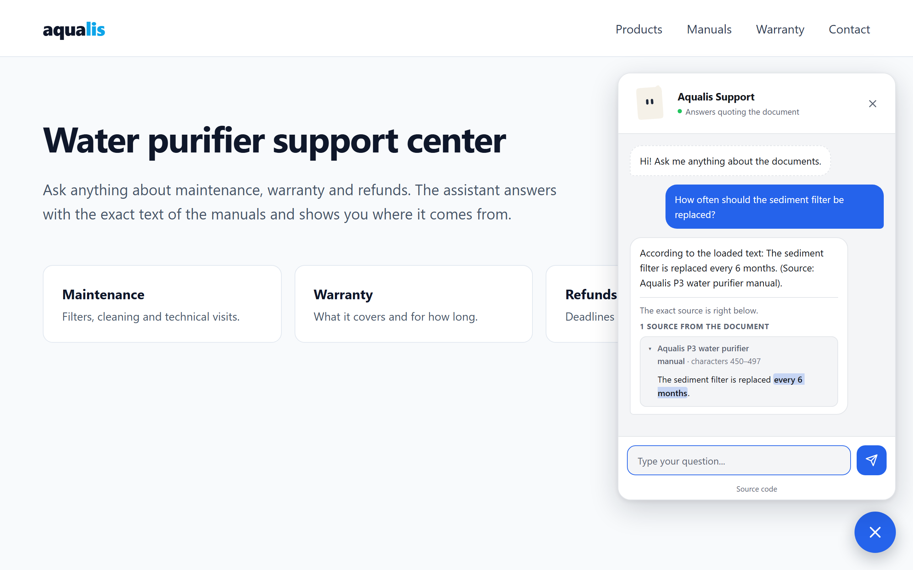

# The widget on your website

The integration has two parts:

- the **service**, running on your server (see [deployment.md](deployment.md));
- the **widget**, a single dependency-free `widget.js` file the service
  publishes at `/widget.js`.



## Add it

The simplest way: ask for the ready-made code and paste it before `</body>`.

```bash
ipsis widget snippet --api https://assistant.your-domain.com
ipsis widget snippet --api https://assistant.your-domain.com --component   # as a Web Component
```

With the `<script>` tag:

```html
<script src="https://assistant.your-domain.com/widget.js"
        data-api="https://assistant.your-domain.com"
        data-position="bottom-right" data-size="normal" data-launcher="bubble"
        defer></script>
```

Or as a Web Component:

```html
<ipsis-chat api="https://assistant.your-domain.com" position="bottom-left"></ipsis-chat>
<script src="https://assistant.your-domain.com/widget.js" defer></script>
```

Add the exact origin of your site to CORS
(`ipsis configure cors_origins=https://www.your-site.com`). If you use widget
keys (`data-widget-key`), remember they are public: they identify and limit
traffic, they are not a secret.

## Placement, size and launcher

They are set in `config/styles.yaml` (the `placement` section) or with
attributes on the tag. **When the site declares an attribute, it wins.**

| Option | Attribute (`data-` on the `<script>`) | Values |
|---|---|---|
| Position | `position` | `bottom-right` (default), `bottom-left`, `top-right`, `top-left`, `embedded` |
| Distance from the edge | `offset-x`, `offset-y` | pixels (24 by default) |
| Layer | `z-index` | integer (2147483000 by default) |
| Panel size | `size` | `compact` (340×520), `normal` (390×600), `wide` (440×680) |
| Launcher | `launcher` | `bubble` (round button), `tab` (button with the name), `hidden` |

Other attributes: `title` and `greeting` (used only if `/config` does not
answer), `color` (accent) and `widget-key`.

**Embedded.** The chat lives inside a container of your page, always open,
with no button or floating window. The container decides the height:

```html
<div style="height:560px">
  <ipsis-chat api="https://assistant.your-domain.com" mode="embedded"></ipsis-chat>
</div>
<script src="https://assistant.your-domain.com/widget.js" defer></script>
```

**Hidden launcher.** Your site opens the chat with its own button:

```html
<button onclick="window.Ipsis.open()">Questions? Ask the manual</button>
```

## JavaScript API for the site

One widget per page is assumed.

| Call | What it does |
|---|---|
| `window.Ipsis.open()` | Opens the panel |
| `window.Ipsis.close()` | Closes it |
| `window.Ipsis.state()` | `{open, position, size, launcher, session}` |
| `window.Ipsis.avatar.trigger(event)` | Makes the avatar react to an event from the table in [personality.md](personality.md#how-the-avatar-reacts). Returns `false` when there is no avatar yet |
| `window.Ipsis.avatar.state()` | `{ready, persistent, transient, gaze}` |

Events emitted by the element: `ipsis:open`, `ipsis:close`,
`ipsis:question` (`{question}`), `ipsis:answer` (`{status, answer}`, where
`answer` is the full `POST /ask` response), `ipsis:error` (`{message}`) and
`ipsis:avatar`. The last one carries `{state: "ready", name}` when the avatar
is mounted, `{state: "error", message}` when it could not be and the icon
stayed, and `{state: "event", event, key}` on each reaction.

## HTTP API

The widget uses three public endpoints; you can call them too:

| Endpoint | What it returns |
|---|---|
| `POST /ask` with `{"question": "...", "session_id": "..."}` | `status` (`ok`, `related`, `no_answer`, `conversational`, `degraded`, `saturated`), `answer`, `answer_blocks` (`answer` by paragraph: `type` is `lead`, `passage` or `message`, with `text`, `connector`, `citation` and `chunk_id`; `passage` text is literal from the document), `fragments` (`doc_title`, `section`, `offset_start`, `offset_end`, `text`, `score`…), `confidence`, `latency_ms`, `exact_answer` when the reader marked a span, and `conversational_category` |
| `GET /config` | What the widget needs: `assistant_name`, `greeting`, `preset`, `density`, `citations`, `interface` texts, `microcopy` of the tone, `placement` and `avatar` |
| `GET /health`, `GET /ready` | Liveness and readiness (with the same diagnosis as `ipsis doctor` under `project`) |

With widget keys configured, `POST /ask` needs the `X-Ipsis-Widget-Key`
header.

## Avatar

When `personality.yaml` has an active and valid avatar, the widget shows it
instead of the icon:

- **Loaded on demand:** the engine (`/avatar.js`, 52 KB compressed) is
  requested the first time the panel opens. With `avatar.in_launcher: true`
  it is requested earlier, when the browser is idle, to show it on the
  button.
- **It never breaks the chat:** if the network, the definition or the CSP
  fails, the icon stays and `ipsis:avatar` is emitted with the error.
- **Decorative:** it carries `aria-hidden`; the states already have text.

## Screens

- **Phone** (≤ 480 px wide, or low landscape): a full-screen sheet.
  - It respects the safe areas (`safe-area-inset`, with
    `viewport-fit=cover` on your page).
  - It follows the visible height, so the virtual keyboard never hides the
    text field.
- **Tablet** (481–1024 px): a panel fitted to the available space.
- **Desktop:** a floating panel in the chosen corner.
- **System preferences:** dark mode, `prefers-reduced-motion` (no
  animations) and high contrast (`forced-colors`).

## Citations

Every answer with evidence shows, **underneath**, a block of citations to
check it:

- an invitation to check the source (from the active tone);
- for each citation: document, section and character position, with the
  literal text;
- the exact span that answered, highlighted.

`styles.yaml::presentation.citations` chooses how they look, never whether
they show:

- `accordion`: collapsible; the one with the exact span comes open;
- `list`: all of them visible.

## Texts

- **From the active tone** (see [personality.md](personality.md)): the
  welcome, "searching…", the invitation to the citations and the error
  messages come from `/config` in 7 variants, and the widget rotates them.
- **Interface texts** (button labels, placeholder…) come from the language
  pack of the project.
- **Accessibility:** "searching…" and the errors are announced to screen
  readers with an `aria-live` region.
- **Security:** no text from the API is inserted as HTML; everything uses
  `textContent`.

## Style

The whole look lives in `config/styles.yaml` and applies without restarting
the service:

- **Presets:** `ipsis widget theme list` and `ipsis widget theme apply editorial`
  (`classic`, `minimal`, `editorial`, `contrast`).
- **Each value:** `ipsis widget style show` and, for example,
  `ipsis widget style set colors.accent=#0ea5e9 shape.panel_radius=10px
  typography.family="Inter, sans-serif"`. Sections: `colors`,
  `dark_colors`, `typography`, `shape`, `shadows`, `animations`,
  `placement` and `presentation`.
- **No terminal needed:** the `/admin/panel`, Widget tab, "Full style" (see
  [personality.md](personality.md#admin-panel-adminpanel)).
- **Preview without the service:** `ipsis widget theme preview`.

## Your site's CSP

If your site uses a Content Security Policy, allow the assistant's domain:

```text
script-src  'self' https://assistant.your-domain.com;
connect-src 'self' https://assistant.your-domain.com;
style-src   'self' https://assistant.your-domain.com 'unsafe-inline';
```

- `style-src` allows the `/styles.css` sheet and the widget's own style,
  which lives isolated in its Shadow DOM.
- The animated avatar also needs `'unsafe-eval'` in `script-src`, because
  its library validates the definition with ajv, which compiles the schema
  in the browser. Without it, the widget shows the icon and the chat works
  anyway.
- If the widget is served from another domain, the service must allow your
  site in `cors_origins`: the avatar engine is an ES module and the browser
  requests it with CORS.

## Export static files

```bash
ipsis widget export ./public/ipsis --api https://assistant.your-domain.com --position bottom-left
```

It generates, to serve them from another server:

- `widget.js` and `snippet.html`;
- `avatar.js` and `avatar.js.LICENSE.txt` (the engine and its licenses);
- `avatars/<name>.avatar.json`: the active avatar, with the project's
  colors. When there is an avatar, the snippet carries `avatar-base="."`:
  the widget loads the engine and the definition from that folder, not from
  the service.

## Runnable examples

- `examples/html`: a static page configurable from `config.js`;
- `examples/react`: a Vite project and an event adapter for React;
- `examples/wordpress`: an installable plugin with the `[ipsis]` shortcode.

The browser tests (`pytest -m browser`) use a real Chromium and check:

- keyboard, focus and dialog;
- every position on phone, tablet and desktop, with no overflow and the
  field visible with the keyboard open;
- the citations with the exact span marked;
- the `window.Ipsis` API.
