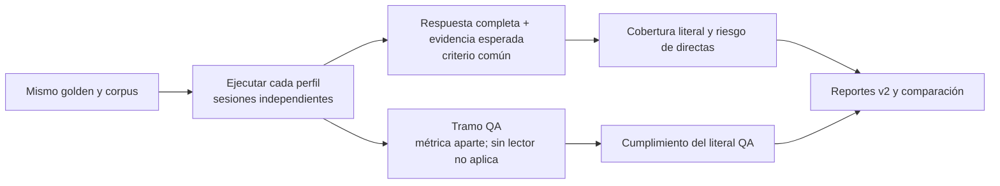

# Evaluaciones comparables por respuesta completa

Fecha: 2026-10-08. Se corrige la mezcla de criterios detectada en la
[evaluación inicial](../auditoria-2026-10-08/README.md).

## Qué cambió

El criterio principal es `respuesta_completa_v2` para todos los perfiles:
el literal esperado debe aparecer en la **respuesta publicada** y en una
evidencia del documento y rango esperado por el golden. Un dato presente
solo en una cita adicional que no aparece en la respuesta no basta.

El tramo QA se mide por separado. En `light`, sin lector, esa métrica no
aplica; no se le asigna un acierto artificial. En `medium` y `heavy` se
cuenta cuántos tramos incluyen el literal completo exigido por el banco.
Una unidad omitida como «hábiles» es un defecto relevante; un actor correcto
puede no cumplir una cláusula más larga exigida por el golden. Esta comparación
literal del tramo no es una evaluación semántica de todos los hechos.

Flujo de evaluación:



`directas_sin_literal` y el riesgo de aceptadas ahora se refieren a la
respuesta completa con respaldo en la evidencia esperada.
`tramo_qa_sin_literal`, `tramos_qa_evaluados` y `exactitud_tramo_qa`
preservan el diagnóstico del lector. La cobertura literal tiene por denominador
las preguntas respondibles; el riesgo tiene por denominador las directas.
`related` no se cuenta como acierto directo.

`evaluate` devuelve 1 si hay falsos `ok` o directas sin el dato esperado,
aunque no haya contestado preguntas no respondibles. Una insuficiencia del
tramo QA por sí sola queda fuera de esa guardia. Los reportes de benchmark,
la salida CLI y los reproductores de consultas y conversaciones también
separan los dos resultados.

## Compatibilidad y calibración

Los artefactos nuevos declaran esquema 2 y criterio v2. Los reportes antiguos
se siguen leyendo con su criterio `tramo_o_respuesta_v1` y sus cifras originales.
`compare` y el comparador del banco de consultas rechazan mezclar criterios:
es necesario volver a medir ambas configuraciones.

La calibración usa el mismo criterio principal que la evaluación. Sus archivos
pasan a versión 2. Una calibración versión 1, incluso sin una versión explícita,
se conserva pero no se aplica; el motor vuelve a los umbrales del perfil y
`doctor` informa que debe recalibrarse. No se modifica una calibración antigua
para aparentar que cumple la definición nueva.

Siguen pendientes los límites de la revisión inicial: `test` no bloquea
automáticamente una aplicación fallida y la procedencia no cubre todos los
cambios de lectura/cascada. Las guías indican cómo apartar una calibración
antes de modificar esos ajustes y cómo revisar `dev` y `test` antes de aplicar.

## Medición de los tres perfiles

Banco `consultas_es@1.0.0`: 60 preguntas sintéticas de regresión, 34 respondibles
y 26 no respondibles. Misma configuración predeterminada de cada perfil,
modelos locales sin descargas, dos hilos ONNX, motor calentado y una ronda
por perfil. La suite de pruebas se ejecutó después de terminar el benchmark.

| Perfil | Directas | Respuestas completas con literal esperado | Cobertura sobre 34 respondibles | Errores entre directas | QA con literal completo / evaluados | p95 |
|---|---:|---:|---:|---:|---:|---:|
| light | 17 | 14 | 41,2 % | 3 | No aplica | 69 ms |
| medium | 25 | 25 | 73,5 % | 0 | 8/25 | 3.099,6 ms |
| heavy | 23 | 21 | 61,8 % | 2 | 6/21 | 17.081,8 ms |

En este banco, **medium mejora la respuesta completa de light y heavy**.
Heavy no aporta una mejora: produce dos falsos `ok` en preguntas ambiguas sin
contexto previo («¿Quién lo aprueba?» y «¿Cuánto es?») y es más lento.
El tamaño de los modelos y la cantidad de candidatos no garantizan precisión.

Light conserva los tres errores de contenido documentados: confunde el inicio
de una compra con una nueva compra después de un rechazo, la recepción conforme
con el rechazo de productos y la firma de un acta con la firma de una Resolución.

Medium tiene 17 tramos que no contienen el literal completo del golden, pero
sus 25 respuestas completas sí contienen el dato esperado con evidencia del
documento/rango correcto. No se presentan esos 17 como respuestas falsas.

El comando termina con código 1 por los presupuestos de latencia excedidos:
medium tiene objetivo p95 de 1 s y heavy de 4 s. La evaluación concluyó y guardó
los resultados; ese código no representa un error de ejecución ni un fallo de
las pruebas. Los tiempos corresponden a esta máquina y esta ronda, no a una
garantía de rendimiento en otro servidor.

## Evidencia y reproducción

- [Reporte por perfiles](benchmark-profiles.md).
- [Casos, señales y resultados JSON](benchmark-profiles.json).
- [Comparación recalculada desde los artefactos](comparacion.json).
- [Artefactos completos por perfil](artefactos.zip), con observaciones,
  evidencia y configuración para volver a calcular las métricas.
- [Validación y huellas de los componentes de evaluación](validacion.json).

Los caminos `artefactos` del JSON registran el directorio original `.cache/`.
El ZIP conserva los tres archivos por nombre; puede extraerse en otra carpeta
para compararlos. Los documentos del banco son sintéticos y sus hashes se
conservan en los artefactos. No se alteran las mediciones históricas.

En una instalación con los modelos ya descargados, desde la raíz:

```bash
ipsis benchmark --bank tests/datos/banco_consultas/es/manifiesto.json --profiles light,medium,heavy --output reports/profiles
ipsis compare reports/profiles/benchmark-light-consultas_es.json reports/profiles/benchmark-medium-consultas_es.json reports/profiles/benchmark-heavy-consultas_es.json --output reports/comparison.json
```

Para reproducir sin descargas y con el número de hilos medido, configura
`HF_HUB_OFFLINE=1`, `TRANSFORMERS_OFFLINE=1` e `IPSIS_ONNX_THREADS=2`.
Un banco de regresión permite comparar; no certifica el riesgo de un cliente.
Para desplegar, mide el golden del corpus real y sus negativos.

## Configuración para despliegue

La [guía en español](../../es/guia/configuracion.md#cambiar-configuración-antes-o-después-de-desplegar)
y la [guía en inglés](../../guide/configuration.md#changing-configuration-for-deployment)
incluyen comandos para identidad, CORS, registros, perfil, postura, personalidad
y estilos, más ejemplos YAML de lectura y umbrales en `profile_overrides`.
La precedencia es perfil, ajustes del proyecto y calibración vigente.

Se indican los cambios que requieren reiniciar, reindexar, validar el golden o
recalibrar. El `DEPLOY.md` generado incluye las mismas instrucciones, en español,
inglés y portugués, y comandos para configurar desde Docker sin abrir el índice
local en dos procesos. La vista temporal del avatar está cerrada y eliminada.
