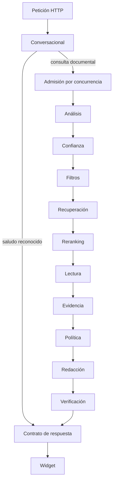

# Mapa del motor y propuesta de v2

Este mapa conserva el diseño de v1 y la propuesta inicial de v2. Desde el
2026-10-12, v2 es el motor predeterminado; su contrato vigente está en
[fuentes ordenadas](fuentes-v2.md). V1 se selecciona explícitamente.

## 1. Propósito

Identificar qué ocurre entre la entrada de una pregunta y la respuesta visible,
y delimitar una variante experimental que permita comparar el motor actual
con un recorrido menos dependiente de heurísticas semánticas.

Restricciones: CPU, sin LLM generativo, sin calibración manual por proyecto,
respuestas basadas en contenido de los documentos y procedencia verificable.
Los modelos de embeddings, reranking y lectura extractiva siguen siendo candidatos.

## 2. Alcance

Este documento conserva el diseño y el mapa del checkout inspeccionado el
2026-10-11, incluidos cambios locales anteriores a este mapa. La implementación
experimental posterior se documenta en el [avance](../plan/motor-v2-avance.md).
El orden real lo establece el perfil efectivo, no la lista de clases del registro.
La referencia principal es `medium`; `light` omite reranker y lector.

La ingesta y la consulta se compararán como factores separados. Un cambio de
parser exige reindexar y versionar las referencias al texto extraído.

## 3. Entradas, salidas y recorrido actual

Entrada HTTP: pregunta y sesión. El servicio valida la petición y aplica sus
controles de acceso. `Motor.consultar()` recibe la pregunta y el identificador
de sesión; crea un contexto y ejecuta las etapas configuradas.

Varias etapas pueden terminar antes de alcanzar la verificación. La recuperación
también puede marcar que se omitan reranker y lector. La traza registra esas salidas.

| Etapa efectiva | Comportamiento actual | Propuesta para la primera variante v2 |
|---|---|---|
| `conversacional` | Patrones de idioma detectan saludos, despedidas y capacidades; devuelven una plantilla sin buscar. | Excluir del recorrido documental de comparación. Evaluar luego como función de interfaz independiente. |
| `analisis` | Detecta estilo coloquial; corrige erratas; resuelve memoria; añade sinónimos; clasifica intención por reglas; expande recursos léxicos y alias. Puede producir varias preguntas diferentes. | Conservar normalización y corrección como variantes auditables. Retirar estilo, intención, herencia implícita y expansión semántica del recorrido básico; medir expansiones por separado. |
| `confianza` | Hace una búsqueda densa adicional para obtener top1 y margen. Puede completar la intención por similitud con ejemplos y reglas de compatibilidad. | Conservar señales como diagnóstico de ranking cuando aporten información. Retirar clasificación de intención y su uso como requisito de respuesta. Evitar la búsqueda adicional si ya se dispone de esas señales. |
| `filtros` | Selecciona términos de foco por IDF y calcula vocabulario ausente. Excluye palabras de relación y términos genéricos mediante reglas. Si falta política configurada, termina la consulta. | Retirar foco/OOV del camino de decisión. Se pueden calcular fuera del recorrido básico para estudiar diferencias. |
| `recuperacion` | Búsqueda densa + BM25 con RRF; añade resultados por entidades de la premisa. Puede pedir aclaración por reglas o saltar modelos si no hay foco. | Conservar híbrida/RRF y límites de recursos. Retirar recuperación dirigida por premisa, aclaración por patrones y salida temprana por foco. |
| `reranking` | Cross-encoder sobre un subconjunto; conserva `rerank_k`. Los demás quedan como descartados, algunos recuperables por pistas posteriores. | Conservar reranker y desempates estables. Declarar cuántos resultados híbridos se puntúan realmente y medir el costo. |
| `lectura` | Elige pasajes y agrega candidatos por pistas. Selecciona ventanas por fusión de cross-encoder, embeddings y léxico; excluye algunas definiciones/títulos/unidades cortas. Lee esas ventanas, elige un tramo y lo amplía con reglas en seguimientos. | Conservar lector ONNX y ventanas por tokens con solape. Sustituir la selección semántica por unidades fuente con contexto; retirar pistas, exclusiones por intención y completado semántico del tramo. |
| `evidencia` | Usa la oración del lector o un selector alternativo de oraciones. Verifica texto/offsets. Calcula foco/cobertura y penalizaciones de forma, modificador y ordinal. | Conservar verificación literal. Sustituir selector y penalizaciones por selección de la unidad fuente que contiene el tramo o del bloque recuperado cuando el lector no extrae. |
| `politica` | Premisa, OOV, foco, coseno, reranker, QA y umbrales deciden respuesta, relacionado o abstención. Hay umbrales especiales por estilo coloquial. Puede buscar alternativas con otro conjunto de pesos. | Sustituir la cascada por un contrato que diferencie extracción y recuperación, con señales de modelo explícitas. Excluir alternativas heurísticas en la comparación inicial. No convertir un score en garantía de corrección. |
| `redaccion` | Plantillas y conectores; limita fragmentos por cantidad y score relativo. Puede mostrar la ventana previa del lector. | Conservar fuentes y texto literal. Comparar primero con presentación equivalente; posteriormente mostrar bloques de párrafo, lista y tabla y eliminar conectores que añaden relaciones no verificadas. |
| `verificacion` | Comprueba entidades de la respuesta contra fuentes; actualiza memoria y arma el resultado. | Conservar validación de contenido y procedencia. Desacoplar memoria. Reemplazar la dependencia de tipos de entidad por comprobaciones de los bloques fuente cuando el contrato lo permita. |

Después del motor, la API convierte el contrato interno a público y, si el
registro está activo, persiste pregunta, respuesta, diagnóstico y traza. El
widget presenta hoy los bloques como párrafos y las fuentes aparte. El cambio
de presentación requiere modificar tanto el contrato como ese consumidor.

## 4. Algoritmo propuesto

Recorrido documental básico:

`pregunta original → variantes ortográficas → híbrida/RRF → deduplicación → reranker → contexto fuente → lector → evidencia literal → salida`

La pregunta original se conserva para reranking y lectura. Las variantes
ortográficas se evalúan como entradas adicionales de recuperación, sin
reemplazar silenciosamente el significado de lo escrito. El presupuesto de
búsqueda de variantes debe quedar explícito para evitar una ventaja artificial.

Las unidades completas se mantienen para la respuesta, aunque el lector
señale solo una cifra. En tablas grandes se seleccionan grupos de filas con
sus encabezados; la representación para buscar puede enriquecerse con rutas,
pero el contenido citado sigue vinculado a la fuente.

La primera comparación sobre el índice existente usa los chunks disponibles.
Las relaciones tabla/fila/celda requieren la segunda fase de ingesta.

Desempates por identificador estable. La deduplicación conserva todas las
procedencias de textos iguales. MMR será un experimento adicional: no debe
descartar filas complementarias solo por parecerse.

## 5. Qué significa retirar reglas

Retirar del recorrido básico las reglas que asignan significado mediante
patrones de pregunta, palabras genéricas, pistas de respuesta, foco obligatorio,
penalizaciones de forma/modificador/ordinal y memoria que añade temas implícitos.
Se mantienen en v1 para comparar; no se borran globalmente del repositorio.

Conservar algoritmos generales y comprobaciones de integridad: tokenización,
BM25, RRF, distancias de edición, límites de recursos, offsets y procedencia.
También son deterministas. El objetivo es reducir decisiones semánticas
dependientes de ejemplos, no eliminar el determinismo del software.

El corrector actual sigue ideas de SymSpell; es una implementación propia,
no una dependencia de SymSpell. Los «bigramas» actuales son pares de raíces de
palabras de contenido vecinas por línea, almacenados como presencia, no como
frecuencias. Se utilizan para corregir erratas, no como un índice de búsqueda
de bigramas. Su activación incluye una autoprueba automática durante la ingesta.
Esa autoprueba no requiere etiquetas del cliente ni calibra la abstención.
Su eficacia y sus límites se medirán también en preguntas ajenas a sus ejemplos.

## 6. Invariantes

- Ningún modelo genera la respuesta ni relaciones documentales.
- Cada bloque mostrado conserva origen, versión y ubicación en la fuente.
- Un porcentaje literal no acredita por sí solo la relación pedida.
- La verificación de offsets acredita fidelidad, no pertinencia ni completitud.
- v1 y v2 mantienen memorias separadas; la comparación inicial es sin memoria.
- Cada corrida registra versión, modelos, índice, configuración y etapas omitidas.
- El corpus de prueba se trabaja en copias aisladas.

## 7. Parámetros y decisiones pendientes

Los límites de candidatos, tokens, solape y tamaño de salida siguen siendo
necesarios. Se declaran por presupuesto de CPU, no por tema documental.
El perfil `medium` inspeccionado recupera 20 candidatos, puntúa como máximo 5
con reranker y conserva 4. La lectura semántica selecciona hasta 3 ventanas;
el camino alternativo parte de 2 candidatos y puede añadir otro por pista.
Los ajustes del proyecto pueden cambiar esos valores.

La condición inicial para observar una extracción puede usar la preferencia
del lector por tramo frente a «sin respuesta», sin el veto de foco/OOV. Esto
no es un umbral validado de corrección semántica. Cuando solo hay recuperación,
la salida debe decirlo; devolver el primer resultado como «respuesta correcta»
sesgaría la comparación. El contrato v2 y su correspondencia con los estados
HTTP actuales están implementados mediante el contrato común; su promoción
permanece pendiente.

«Sin calibración manual por proyecto» admite estadísticas automáticas del
corpus y parámetros generales del motor. No implica precisión garantizada en
cualquier documento ni que puedan desaparecer todos los límites o decisiones.

## 8. Complejidad y recursos

Reutilizar modelos ONNX y controles de admisión. Medir carga en frío aparte de
consultas con modelos calientes; latencia p50/p95, memoria y número de ventanas
leídas. Leer chunks completos puede aumentar considerablemente el costo frente
a tres oraciones. La ampliación de contexto necesita un presupuesto medido.

El parseo se paga al cargar/indexar. Evaluar parsers por fidelidad estructural,
tiempo y memoria en CPU. Docling es un candidato de adaptación; su configuración
debe excluir pipelines generativos. No se adopta ninguna dependencia en este mapa.

## 9. Fallos y fallback

Sin candidatos o sin evidencia válida: salida sin evidencia disponible. Con
candidatos y sin tramo QA: resultados recuperados con contexto, sin afirmar
que respondan. Con tramo QA: conservar tramo y unidad fuente; evaluar errores
de relación, entidad y completitud además de la literalidad.

Un parser que perdió columnas o encabezados puede entregar texto literal pero
mal relacionado. La preparación debe mostrar avisos y una vista previa; no
reconstruir automáticamente relaciones inciertas como si fueran hechos.

## 10. Seguridad y privacidad

Mantener controles HTTP, concurrencia, validaciones de archivos y aislamiento
de sesiones. Las trazas conservan el mecanismo opt-in existente. No activar
registro ni enviar documentos a servicios externos como efecto de este diseño.

## 11. Comparación y verificación

| Corrida | Consulta | Ingesta | Pregunta que resuelve |
|---|---|---|---|
| A | v1 | Actual | Referencia del comportamiento existente |
| B | v2 | Actual | Efecto de cambiar el recorrido de consulta |
| C | v1 | Estructurada nueva | Efecto de la ingesta sobre el motor existente, si los contratos son compatibles |
| D | v2 | Estructurada nueva | Resultado combinado |

Primero A/B con mismos modelos e índice y presupuestos documentados. Comparar
preguntas independientes antes de evaluar seguimientos. Añadir ortografía,
expansiones, memoria y MMR de una en una, en experimentos separados. Medir
calidad de la salida completa y costo, no solo el span de QA o el estado `ok`.

Casos prioritarios del corpus real: ponderaciones completas de P1, distinción
P1/P2, fecha con antecedente, costo ausente, preguntas ambiguas y cambios de
relación entre turnos. Usar también otros documentos y temas para evitar
optimizar exclusivamente el reglamento.

Medir por separado: evidencia correcta presente tras recuperación, reranking y
selección de contexto; exactitud/completitud de la respuesta; respuestas
incorrectas; abstenciones con evidencia disponible; calidad de presentación.
Para estudiar repetición, modificar únicamente la duplicación en copias del
corpus y comparar los mismos casos, preservando las relaciones originales.

## 12. Limitaciones

Retirar vetos puede recuperar respuestas y aumentar falsos positivos. Un
reranker mide pertinencia; un lector extractivo puede elegir una cifra de
otra relación. Las tablas y listas necesitan contexto aunque el lector no
extraiga sus múltiples elementos. La CPU disponible limita cuántas ventanas
podemos procesar. Las primeras comparaciones reales están en el
[avance](../plan/motor-v2-avance.md); no acreditan una mejora general de v2.

## 13. Referencias al código inspeccionado

- [Perfil medium](../../ipsis/recursos/perfiles/medium.yaml): orden y presupuestos.
- [Construcción](../../ipsis/aplicacion/consulta.py): componentes, modelos y perfil efectivo.
- [Orquestador](../../ipsis/consulta/motor.py): admisión, saltos y salidas tempranas.
- [Adaptadores](../../ipsis/aplicacion/registro_base.py): clasificador, extractor y verificador literal.
- [Análisis](../../ipsis/consulta/etapas/analisis.py), [ortografía](../../ipsis/lenguaje/ortografia.py) y [seguimiento](../../ipsis/consulta/seguimiento.py).
- [Confianza y recuperación](../../ipsis/consulta/etapas/recuperacion.py), [filtros](../../ipsis/consulta/etapas/filtros.py) y [reranking](../../ipsis/consulta/etapas/reranking.py).
- [Selección y evidencia](../../ipsis/consulta/etapas/seleccion.py), [lectura](../../ipsis/consulta/etapas/lectura.py) y [lector ONNX](../../ipsis/modelos/lector.py).
- [Política](../../ipsis/consulta/etapas/politica.py), [redacción](../../ipsis/consulta/etapas/redaccion.py) y [verificación](../../ipsis/consulta/etapas/verificacion.py).
- [API](../../ipsis/servicio/api.py), [widget](../../ipsis/servicio/estaticos/widget.js) y [traza](../../ipsis/nucleo/traza.py).
- [Parser](../../ipsis/ingesta/parsear.py), [chunking](../../ipsis/ingesta/chunking.py) e [ingesta](../../ipsis/ingesta/ingesta.py).

## 14. Estado

Implementación experimental. El mapa histórico de v1 sigue describiendo sus
capas. El motor v2, la preparación DOCX y el comparador offline están
implementados; las primeras corridas A/B/C/D incluyen regresiones de relación.
La [preparación estructural](preparacion-estructural.md) detalla el recorrido
efectivo, sus versiones y soporte. Los criterios
de aceptación de respuestas están pendientes de validación; no se declara
una garantía de precisión ni una calibración universal.

El [plan de implementación y reemplazo](../plan/motor-v2.md) define entregas,
criterios de promoción y retiro del motor anterior.
