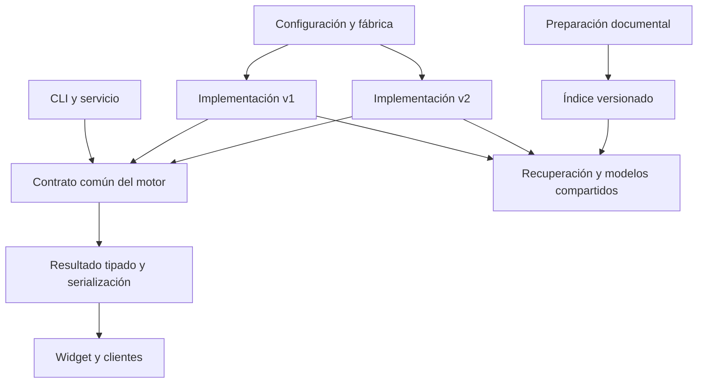

# Plan de motor v2 y reemplazo de v1

Estado: v2 predeterminado por decisión del usuario desde el 2026-10-12.
La evaluación general y el retiro de v1 siguen pendientes. Esta transición
no certifica todos los criterios de calidad de F6; v1 queda como opción explícita.
La primera entrega y sus límites se describen en el [avance](motor-v2-avance.md).

El [mapa de capas](../methodology/motor-v2.md) describe el comportamiento
inspeccionado. Este plan define cómo construir, comparar y, si corresponde,
reemplazar el motor. El plan V4 existente conserva su historial; este trabajo
no modifica sus resultados ni sus umbrales de producción.

## Objetivo y restricciones

Construir un asistente documental extractivo que funcione en CPU, sin LLM
generativo y sin calibración manual por proyecto. Conservar búsqueda híbrida,
reranking, lector, corrección ortográfica y procedencia. Retirar del recorrido
básico las heurísticas semánticas dependientes de patrones, pistas y foco.

El reemplazo se decide con evidencia de calidad y recursos. Pasar pruebas
técnicas no demuestra calidad de respuesta. Mejorar estados o scores sin
mejorar el contenido mostrado tampoco cuenta como una mejora.

## Arquitectura que permite el reemplazo

Una frontera común para servicio y CLI, con capacidades de consulta, carga de
modelos, cierre y diagnóstico. La construcción selecciona la implementación.
Los consumidores no preguntan qué versión está ejecutándose.

Decisiones de diseño:

- Selector explícito de pipeline en `config/engine.yaml`, separado de los
  perfiles de recursos `light`/`medium`: `pipeline: v1|v2`.
  Implementado con validación estricta y migración a configuración 6.
- Configuración sin selector usa v2, incluso en archivos antiguos. Una selección
  explícita `pipeline: v1` conserva v1; `pipeline: v2` activa el enrutador.
- El selector se resuelve en una única fábrica. Evitar `if v2` en cada etapa.
- Implementación experimental en un paquete aislado, por ejemplo
  `ipsis/consulta/v2/`; algoritmos reutilizados detrás de contratos neutrales.
- v2 no importa etapas, reglas de intención, seguimiento ni cascada de v1.
  El corrector actual depende de utilidades de `consultas.py`; esas utilidades
  se extraen primero sin trasladar la interpretación semántica a v2.
- Reutilizar ONNX, Qdrant, admisión y trazabilidad. No duplicar servicio,
  control de acceso, modelos ni registro.
- Resultado tipado compartido; un adaptador mantiene el contrato existente.
  Hoy parte del contrato HTTP vive en el diagnóstico del motor: retirarlo
  gradualmente de esa función para que v2 no dependa del serializador de v1.
- Pipeline, versión de configuración, versión documental, versión del índice
  y versión de API son dimensiones distintas, registradas explícitamente.

## F0. Congelar la referencia y las condiciones de comparación

- [x] Registrar código y cambios locales que constituyen la referencia real.
  No hacer stash, descartar ni incorporar cambios previos del usuario.
- [ ] Guardar snapshots de configuración, revisiones de modelos, corpus e índice.
- [x] Reproducir las preguntas del reglamento en copia aislada. Separar sesiones
  independientes de la conversación original y sus cambios de relación.
- [x] Identificar las pruebas existentes de arquitectura, contratos, configuración,
  consulta, servicio, widget y evaluación que afectan a las próximas fases.
- [ ] Medir CPU, hilos ONNX, memoria y latencia de referencia, en frío y caliente.

Aceptación: corrida reproducible de v1 con respuestas completas y trazas. Sus
fallos quedan documentados; no se modifica la referencia para ocultarlos.

## F1. Crear la frontera de motor y la selección de implementación

- [x] Definir un contrato común a partir de las capacidades que hoy consume
  `ipsis/aplicacion/consulta.py` y el servicio. Adaptar v1 sin cambiar sus decisiones.
- [x] Añadir selector de pipeline y opciones propias de v2, con esquema estricto.
  La configuración inválida o una versión futura fallan al arrancar.
- [x] Construir cada implementación en la fábrica y exponer versión efectiva
  en diagnóstico, snapshots y readiness.
- [x] Separar capacidades del contrato de dependencias particulares de v1:
  v2 no debe requerir clasificador de intención o cascada para ser «listo».
- [x] Definir resultado común con evidencias, tramo extraído, bloques, señales
  identificadas por método y motivo de selección. No mezclar logit, coseno y
  score RRF bajo una probabilidad común.
- [x] Mantener un adaptador al contrato público actual y documentar cualquier
  limitación. El contrato de bloques estructurados se añade en F5.
- [x] Añadir pruebas de construcción, migración idempotente, intercambio y ciclo
  de vida. Reutilizar contratos actuales donde realmente sean compatibles.

Aceptación: v1 produce el mismo contenido y decisiones; se puede seleccionar
una implementación experimental sin cambios en los consumidores. Los campos
de diagnóstico que identifican pipeline pueden diferir.

## F2. Implementar el recorrido mínimo v2 sobre el índice actual

- [x] Preparación: conservar pregunta original, normalización y variantes
  ortográficas acotadas con correcciones trazables. No clasificar intención,
  estilo coloquial ni heredar tema automáticamente.
- [x] Corrección: reutilizar borrados simétricos y pares de contexto actuales;
  aislarlos de las reglas de comprensión. No añadir una librería nueva por
  llamarla SymSpell. Conservar nombres, siglas y cifras sin corrección especulativa.
- [x] Recuperación: embeddings + BM25 y RRF. Documentar consulta usada por cada
  rama y presupuesto total. Sin foco obligatorio, aclaración por patrones,
  recuperación por premisa ni salto semántico de modelos.
- [x] Deduplicación exacta conservando todas las procedencias. MMR queda como
  variante posterior, no como condición para construir el primer motor.
- [x] Reranking: reutilizar cross-encoder y publicar cantidad realmente puntuada.
- [ ] Contexto: leer los chunks fuente disponibles con ventanas por tokens y
  solape. No seleccionar tres oraciones mediante pistas ni excluir definiciones
  o filas por intención. Medir el aumento de ventanas y su costo.
- [x] Lector: reutilizar ONNX y sus offsets. Diferenciar tramo señalado de la
  unidad fuente mostrada; una cifra no reemplaza el bloque que explica su relación.
- [x] Decisión mínima: distinguir «extracción», «resultados recuperados» y «sin
  evidencia disponible». No adoptar foco/OOV, umbrales coloquiales, penalizaciones
  de modificadores/ordinales ni búsqueda heurística de alternativas.
- [x] La preferencia del lector por tramo frente a «sin respuesta» sirve como
  destacado opcional con referencias, sin elegir el pasaje ni certificar una
  respuesta. Los pasajes se publican como resultados de búsqueda (`related`).
- [x] Validar offsets, texto y procedencia. Mantener presentación comparable a v1
  en esta fase, con plantillas neutrales y sin relaciones añadidas por conectores.
- [ ] Registrar entrada/salida y razones de exclusión por etapa, incluidas ventanas
  del lector. Mantener registro opt-in y memorias separadas.

Aceptación: v2 completa consultas sin importar heurísticas semánticas de v1;
cada hecho mostrado tiene respaldo literal. El lector permanece disponible,
pero su fallo no se oculta cambiando una recuperación en respuesta confirmada.
Primer informe A/B sobre el mismo índice, sin promesa de superioridad.

## F3. Construir el comparador de respuestas y auditar casos reales

- [x] Implementar una ejecución offline pareada, sin duplicar consultas de
  usuarios en producción. Leer trazas existentes solo cuando estén disponibles;
  capturar nuevas con el mecanismo opt-in.
- [x] Compartir archivos originales, modelos y condiciones de CPU. Registrar
  diferencias de presupuesto; no dar a v2 más candidatos sin reportarlo.
- [ ] Separar familias de documentos completas entre desarrollo y evaluación
  reservada. Congelar criterios antes de abrir el conjunto reservado.
- [ ] Priorizar casos reales revisados por una persona; los bancos existentes
  complementan con regresión y negativos. No usar un LLM como juez obligatorio.
- [ ] Evaluar contenido mostrado: relación pedida, sujeto correcto, valores,
  unidades, completitud, contexto y citas. Una tabla que contiene 20/40/40 en
  una cita oculta no cuenta si la respuesta visible omite la ponderación pedida.
- [ ] Separar respuesta afirmada incorrecta de resultado recuperado irrelevante.
  Cambiar la etiqueta a «relacionado» no permite eludir la medición de utilidad.
- [ ] Comparar por etapa dónde desaparece la evidencia y por salida qué casos
  gana, pierde o no resuelve cada motor. Contar ambiguos y conflictos aparte.
- [ ] Medir repetición en copias del corpus y ortografía/pares de contexto
  con variantes activas e inactivas. No mezclar cambios de modelos o parser.
- [x] Exportar reporte revisable con pregunta, respuestas, evidencias, decisiones,
  trazas, versiones, fallos y recursos. Los textos privados quedan fuera del repo.

Aceptación: una comparación distingue mejoras reales, falsos positivos y cambios
de presentación. Incluye limitaciones de la muestra y resultados por estructura,
idioma/perfil soportado y familia documental; no solo un promedio global.

## F4. Preparación documental estructurada, separada del motor

- [x] Definir un esquema versionado para documento, secciones, párrafos, listas,
  tablas/celdas, orden de lectura, padres/hijos y referencias de origen.
- [x] Separar contenido fuente de representación contextual para búsqueda.
  Los encabezados repetidos en el índice no se confunden con texto literal.
- [x] Empezar por DOCX del corpus real: conservar títulos, celdas vacías,
  combinaciones y relación tabla/filas, con pruebas de fidelidad estructural.
- [ ] Comparar ampliación del parser propio y adaptación de Docling. Selección
  por fidelidad y costo en CPU; excluir pipelines generativos y medir dependencias.
- [x] Añadir almacenamiento de unidades completas y relaciones. Reutilizar los
  campos padre/vecinos existentes donde sirvan; no duplicar modelos de datos.
- [ ] Recuperar por hijos y ampliar al padre relevante, con presupuesto. Tablas
  grandes se dividen por grupos de filas y conservan encabezados/procedencia.
  Implementada ampliación literal y agrupación por filas; falta incorporar al
  lector los encabezados externos de grupos posteriores como varios rangos.
- [ ] Definir referencias capaces de representar celdas y varios rangos. Las
  tablas renderizadas no se fuerzan a ser un único `EvidenceSpan` contiguo.
  Hay referencias por celda y rangos de contexto separados en la preparación.
  Su integración con lectura y bloques de salida permanece pendiente en F5.
- [x] Versionar parser, preparación, texto para búsqueda y configuración de
  fragmentación en el manifiesto. La huella debe reflejar cambios estructurales
  incluso si el texto literal no cambió.
- [x] Construir un índice nuevo en ubicación/colección distinta. Validarlo antes
  de activarlo; la indexación actual puede recrear una colección y no debe
  aplicarse sobre la referencia activa durante el experimento.
- [x] Exponer vista previa y avisos sobre extracción incompleta. Declarar soporte
  por formato, estructura y operación, evitando afirmar soporte universal.
- [x] Repetir matriz: A=v1/actual; B=v2/actual; C=v1/nueva si los contratos
  permiten una adaptación equivalente; D=v2/nueva. Si C no es viable, declararlo.
  Ejecutada sobre las cuatro preguntas reales; C usa los hijos compatibles con
  el contrato legacy, sin ampliación al padre. Resultados y límites en el avance.

Aceptación: título, tabla y filas P1/P2 conservan sus relaciones; ninguna cita
apunta a offsets de otra versión de extracción. El índice previo sigue disponible.
Las siguientes extensiones se priorizan tras esta fase; XLSX/CSV y fórmulas
no se declaran soportados antes de implementar y validar sus capacidades.

## F5. Presentación e integración completas

- [ ] Ampliar bloques de respuesta para párrafos, listas, tablas y destacados,
  con referencias fuente por bloque/celda cuando corresponda.
- [ ] Adaptar API y widget conjuntamente. Mantener texto plano equivalente para
  CLI y clientes existentes. Si un cambio no puede ser compatible, versionarlo.
- [ ] Mostrar primero contenido útil y fuentes consultables. Los resultados
  recuperados se distinguen de una extracción; eliminar «confianza alta» asignada
  únicamente por tener lector.
- [ ] Evaluar ortografía, alias y sinónimos como variantes independientes. Solo
  conservar lo que mejore el conjunto reservado sin reglas por documento.
- [ ] Evaluar conversación en una fase propia: pruebas de referencia explícita,
  seguimiento y cambio de relación. No copiar la memoria semántica de v1 como
  requisito del nuevo núcleo; mantener reinicio, vencimiento y aislamiento.
- [ ] Acreditar el comportamiento conversacional e idiomas/perfiles que sigan
  anunciados. Para `light`, definir explícitamente salida de recuperación sin
  lector. Documentar cualquier cambio de capacidad en vez de ocultar pérdidas.

Aceptación: el caso de ponderaciones se ve como información completa y legible;
tramo y contexto están vinculados a sus fuentes. Clientes anteriores reciben una
salida comprensible. La experiencia que se pretende reemplazar se ha evaluado
completa, incluyendo consultas independientes y conversaciones.

## F6. Puerta de decisión: conservar experimental o promover

Los siguientes criterios son objetivos propuestos de promoción. Se fijan antes
de la evaluación final; no se relajan después para declarar ganador al motor.

- [ ] Mejora neta de respuestas útiles y completas en la muestra real reservada
  y en familias documentales nuevas; ganados/perdidos visibles y revisados.
- [ ] Ningún nuevo fallo crítico de sujeto, versión, cifras o relación en los
  casos de control, y ninguna regresión confirmada de respuestas afirmadas
  incorrectas en la muestra pareada. Reportar tasas e incertidumbre; esto no
  certifica riesgo cero fuera de la muestra.
- [ ] Regresiones por idioma, estructura, perfil y conversación explicadas y
  resueltas antes de retirar soporte anunciado. Un promedio mejor no las oculta.
- [ ] Citas y procedencia válidas en todos los casos; ningún resultado privado
  enviado a servicios de generación o evaluación externos.
- [ ] Presupuestos de p95 y memoria fijados en F0 para la CPU objetivo. Usar como
  referencia la política de recursos del evaluador existente: p95 no supera el
  mayor entre presupuesto del perfil y línea base +25 % en igual hardware.
  Fijar también un límite absoluto de memoria con la medición de F0.
- [ ] Suite técnica correspondiente en verde, regresión general ejecutada con
  modelos y comparación sobre documentos reales archivada.
- [ ] Instalación, arranque offline con caché disponible, migración, reindexación,
  API, widget y rollback probados en una copia de proyecto existente.

Aceptación prevista: informe de promoción con decisión explícita y evidencia.
Los criterios pendientes siguen abiertos. El usuario decidió activar v2 por
defecto durante la transición del 2026-10-12 sin retirar v1.

## F7. Promoción y reemplazo limpio

- [x] Preparar la transición: v2 es opción por defecto para proyectos
  nuevos; los existentes siguen su selección/migración declarada. Documentar
  cambios de salida, capacidades y opciones obsoletas.
- [ ] Ofrecer una migración idempotente que compruebe compatibilidad, conserve
  configuración anterior y construya/valide el nuevo índice antes de activarlo.
  Conmutar una referencia pequeña al conjunto motor/índice/configuración.
- [ ] Probar rollback al conjunto anterior. Un cambio de versión del paquete
  solo no recupera un índice incompatible; conservar ambos conjuntos durante
  la transición y mantener referencias de logs a la versión correspondiente.
- [ ] Mantener un ciclo de publicación de transición con retorno a v1 disponible.
  Auditar consultas reales disponibles con registro autorizado. Un fallo crítico
  bloquea el retiro y activa el procedimiento de retorno.
- [ ] Una vez aceptado el reemplazo, hacer v2 el único recorrido normal y retirar
  selector, paquete v1, cascada, reglas y opciones exclusivamente antiguas.
- [ ] Actualizar ADR de comprensión/cascada/memoria, guías EN/ES, configuración,
  diagramas, CLI, administración y ejemplos para reflejar el motor definitivo.
- [ ] Mantener lectores/migradores de configuración histórica en la frontera,
  separados del núcleo. Opciones antiguas incompatibles producen una indicación
  accionable; no se ignoran ni reactivan reglas retiradas silenciosamente.
- [ ] Trasladar pruebas útiles a los contratos nuevos y retirar las que solo
  reproducen heurísticas eliminadas. Conservar reportes de v1 como historia,
  no como una dependencia del runtime.
- [ ] Eliminar código experimental de comparación del camino de producción.
  El comparador offline puede mantenerse como herramienta de evaluación.
- [ ] Verificar imports, opciones, dependencias, documentación y distribución
  del paquete para comprobar que queda una arquitectura coherente.

Aceptación: un único núcleo documental, configuración migrable, presentación
coherente y procedimiento de recuperación documentado. La coexistencia v1/v2
tiene un final definido; no queda una colección permanente de interruptores.
El rollback previo al retiro está probado. Después del retiro requiere restaurar
el paquete y conjunto histórico documentados, no seleccionar v1 en el nuevo núcleo.

## Orden de entrega y seguimiento

| Entrega | Fases | Resultado revisable |
|---|---|---|
| E1 | F0–F1 | Referencia reproducible y frontera intercambiable |
| E2 | F2–F3 | Motor v2 mínimo y primer A/B sobre índice actual |
| E3 | F4 | Preparación estructurada y comparación independiente de ingesta |
| E4 | F5–F6 | Experiencia completa e informe de promoción |
| E5 | F7 | Transición reversible y retiro de v1 si fue aprobado por evidencia |

Cada fase deja sus cambios, validación y reporte juntos. Los pasos marcados
están implementados; los restantes siguen pendientes. La preparación DOCX y
su índice separado están implementados de forma experimental; F4 conserva
pendiente de comparación con Docling. La lectura por campos con mapas de
varios rangos y los presupuestos propios de v2 están implementados; los
bloques tabulares del widget y la evaluación reservada siguen pendientes. V2
es el motor predeterminado; v1 permanece disponible por selección explícita.
Los commits y el push siguen las instrucciones explícitas de la sesión.

## Puntos de integración existentes

- [Mapa de capas](../methodology/motor-v2.md) y [metodología](../methodology/README.md).
- [Fábrica](../../ipsis/aplicacion/consulta.py), [registro](../../ipsis/aplicacion/registro_base.py), [motor](../../ipsis/consulta/motor.py).
- [Contratos](../../ipsis/nucleo/contratos.py), [esquemas](../../ipsis/nucleo/esquemas.py), [configuración](../../ipsis/configuracion/esquemas.py).
- [Manifiesto](../../ipsis/indice/manifiesto.py), [ingesta](../../ipsis/ingesta/ingesta.py), [traza](../../ipsis/nucleo/traza.py).
- [Regresión general](../../herramientas/evaluacion/README.md), [arquitectura](../../tests/test_arquitectura.py), [contratos del núcleo](../../tests/nucleo/test_contratos.py).
- [ADR de configuración](../decisions/0002-registry-and-versioned-configuration.md) y [respuestas no generativas](../decisions/0001-non-generative-answers.md).
