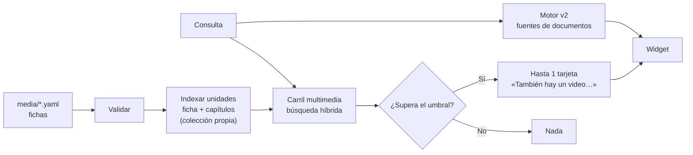

# Plan multimedia: fichas de audio y video en un carril aparte

Abierto el 2026-10-16. Tareas para ejecutar una por sesión:
[multimedia-tareas.md](multimedia-tareas.md). Estado:
[multimedia-avance.md](multimedia-avance.md).

## Qué se quiere

Guardar audios y videos **con su metadata escrita por una persona** (título,
descripción, palabras clave, capítulos) y que ipsis **enrute** a ellos cuando
una pregunta corresponde. No se transcribe ni se analiza el contenido del
archivo: se busca sobre la ficha.

Decisión del usuario (2026-10-16): **carril aparte**. Las fichas no compiten
en el ranking de documentos; se muestran en un bloque propio («También hay un
video sobre esto») cuando superan un umbral medido.

## Por qué un carril aparte

Las fichas son textos cortos y los pasajes son largos. Sus puntajes no son
comparables: mezclados, un video podría desplazar a la fuente correcta o no
aparecer nunca. Con un carril separado:

- el ranking de documentos no cambia (mismas fuentes, mismo orden);
- el umbral del carril se mide aparte, con un objetivo claro: **no mostrar
  videos que no corresponden**;
- el carril se puede apagar sin tocar nada más.

## Cómo encaja con «sin LLM»

Todo lo que se muestra de una ficha es texto que escribió una persona y se
publica literal, con su procedencia (la ficha y su versión). La tarjeta dice
que el enrutado se basa en la descripción del video, no en su contenido. No
hay descripciones generadas por modelos de visión ni transcripciones
automáticas ([ADR 0001](../decisions/0001-non-generative-answers.md)).

## Ficha (propuesta)

Un archivo YAML por ficha en la carpeta nueva `media/` del proyecto (separada
de `documents/`, que `ipsis sync` recorre solo en su primer nivel):

```yaml
# media/induccion-matricula.yaml   (id = nombre del archivo)
title: Inducción a la plataforma de matrícula
kind: video                      # video | audio
url: https://www.youtube.com/watch?v=XXXXXXXX
# file: files/induccion-matricula.mp4   (alternativa a url: archivo en media/files/)
description: >
  Cómo ingresar, inscribir asignaturas y revisar el horario.
keywords: [matrícula, inscripción, toma de ramos]
language: es
version: "2026-03"
duration: "00:14:32"             # opcional
active: true                     # opcional; false la retira sin borrarla
chapters:                        # opcional: enruta al minuto exacto
  - at: "00:01:10"
    title: Ingresar con la clave única
  - at: "00:06:45"
    title: Inscribir asignaturas
    description: Elegir secciones y confirmar la inscripción.
```

`transcript` queda reservado para un plan futuro: hoy la validación lo
rechaza con un mensaje claro, para que nadie crea que se usa.

## Flujo



## Fases

| Fase | Contenido | Cambia la conducta por defecto |
|---|---|---|
| M0 | Esquema de la ficha, validación y banco de evaluación | No |
| M1 | Indexar fichas en una colección propia (`ipsis index` / `ipsis sync`) | No (solo si existe `media/`) |
| M2 | Búsqueda del carril, umbral medido y contrato interno | No (apagado) |
| M3 | API pública y tarjeta del widget | No (apagado) |
| M4 | Servir archivos locales y subir fichas desde el panel | No |
| M5 | Activación, ADR y documentación | Sí, ⚠ con aprobación |

## Límites

- El enrutado es tan bueno como la ficha. Una descripción pobre no se
  encuentra; la guía debe decir cómo escribirlas.
- Enlaces externos (YouTube, Vimeo, SharePoint): ipsis no verifica que el
  enlace siga vivo ni su contenido.
- Archivos locales: ocupan disco del servidor y se sirven por HTTP con
  peticiones por rango; hay que medir el tamaño máximo razonable.
- Un capítulo solo se puede enlazar en un minuto exacto con archivos locales
  o con proveedores cuyo parámetro de tiempo se conoce (YouTube, Vimeo); en
  los demás casos se abre el enlace y se muestra el minuto como texto.
